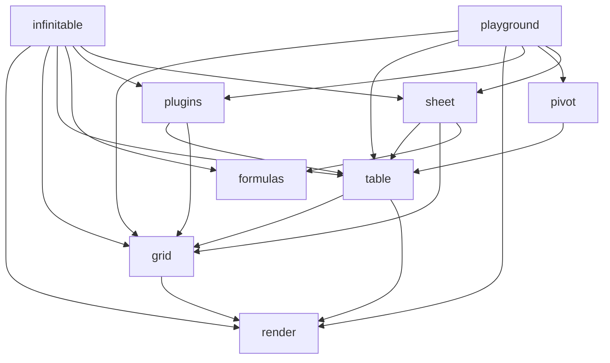

# 代码地图

只做定位：找模块、找路径、找依赖方向。行为口径与实现细节看代码、测试与 `docs/`，不写进本文件。

## 树

```text
infinitable/
├── packages/            # monorepo 主体
│   ├── render/          # 通用 canvas 渲染工具包（场景树/分层 canvas/失效登记/事件/池化/路径原语与内建图元）
│   ├── grid/            # 共享网格内核（自 core 拆出：ScrollManager/虚拟窗口/二分命中/共享边/选区状态/主题投影）
│   ├── table/           # ListTable 引擎（自 core 拆出：装配/溢出/填充柄/表头/取值/编辑；实现引擎装配协议）
│   ├── formulas/        # 公式引擎（tokenizer/Pratt parser/求值/49 内置函数/依赖图）
│   ├── plugins/         # 官方插件（TablePlugin 契约 + chart/print/watermark 插件）
│   ├── pivot/           # 透视表引擎（PivotGrid：多列树形行维度（同组跨行合并）× 多级列维度表头 × 度量交叉聚合，展开/折叠与维度/度量动态勾选，经装配协议消费 table 引擎）
│   ├── sheet/           # 电子表格核心（sheet 模型/命令/IO/SheetGrid 适配，自 plugins sheet 插件族迁入）
│   └── infinitable/     # 统一发布包（npm 单包 infinitable，主入口 re-export 五层，`./sheet` 子路径）
├── playground/          # 唯一应用：示例总览 + 架构与 API 边界 + 量化基准 + 冒烟自检
└── website/             # VitePress 开发者文档站：指南 + API 参考 + 可交互示例（mermaid 图）
```

## 模块

| 模块 | 路径 | 职责 | 主要入口 |
| --- | --- | --- | --- |
| render | `packages/render` | 通用 canvas 渲染工具包：场景树、分层 canvas、多 region 失效（档名去表格语义、各层消费策略建层参数化）、federated 事件、canvas 池化、路径原语与内建图元节点（矩形/文本/路径/图片）、paintTree/hitTest/region 工具导出 | `src/index.ts` |
| grid | `packages/grid` | 共享网格内核（自 core 拆出的通用网格机器纯搬运）：ScrollManager（唯一滚动源）、行列前缀和/虚拟窗口/二分命中、滚动条几何、触控惯性、共享边、cell-range、选区状态、float-object-layer、主题投影；仅依赖 render | `src/index.ts` |
| table | `packages/table` | ListTable 引擎（core 领域代码原样搬运）：ListTable 主体与装配、溢出走廊、填充柄、表头装配、取值三形态、编辑链路、交互、图片/图表媒体、插件注册路径；依赖 grid 与 render，实现引擎装配协议（数据面 + 渲染宿主 + 主题 + 生命周期 + 插件槽位） | `src/index.ts` |
| formulas | `packages/formulas` | 公式引擎：地址与错误码、tokenizer、Pratt parser、evaluate、49 内置函数注册表、依赖图与容错引用扫描 | `src/index.ts` |
| plugins | `packages/plugins` | 官方插件承载：TablePlugin 契约具名转出 + chart/print/watermark 插件（print/watermark 面向引擎装配协议槽位挂载，不再以 ListTable 具体类型为挂载参数） | `src/index.ts` |
| pivot | `packages/pivot` | 透视表引擎：PivotGrid（平级领域引擎经装配协议接入的参考实现——内部 new ListTable 后以 TableEngine 持有，对外转发实现 EngineAssembly，协议插件跨引擎挂载生效；行方向多列树形布局：每行维度一列，同组跨行合并经 setMergeCells 落地，点击组格左缘展开图标折叠（collapsible 配置可禁用折叠始终平铺），选区不复用 sheet 交互面（引擎 interactiveSelection 关闭：无拖选/表头拖选/键盘移动/填充柄），选区是纯填充无边框领域高亮（主题 selectionBorderWidth 压 0）：组格高亮从命中维度列起的整行带、列维度表头高亮列组 × 全部数据行、数据格高亮自身（均经 applyExternalSelection 回写），图标折叠/展开后按新结构重放高亮（折叠组收敛为自带聚合的单行载体），列方向多级表头以引擎冻结行 + 横向合并落地（引擎自带列头关闭，表头区行维度列按维度分列标题竖条），列结构 setColCount/setFrozenColCount/setFrozenRowCount/setMergeCells 原地落地）+ PivotModel 聚合模型（leaf/折叠载体/grand 行 × 列维度树路径 × 度量聚合 → TableModel 数据面，引擎坐标含表头行偏移；行/列维度与度量动态勾选排序、聚合方式切换、折叠态管理、组可见行块 groupRange 与合并区计算）；依赖 table | `src/index.ts` |
| sheet | `packages/sheet` | 电子表格核心：sheet 模型、命令、IO（xlsx 导出）、SheetGrid 适配——自 plugins 的 sheet 插件族整体迁入（`createSheetPlugin` 已删），依赖 table、grid 与 formulas（SheetGrid 经引擎装配协议消费 table 引擎） | `src/index.ts` |
| infinitable | `packages/infinitable` | 唯一 npm 发布包：主入口显式转售各层公共 API + `./sheet` 子路径，vp build 整体打成自包含 dist（chart 保持动态分包、@cat-kit/core 外部化），`scripts/build-types.mjs` 装配类型树并改写跨包说明符；发版统一走发版技能 `.agents/skills/release`（changesets + CI） | `src/index.ts` |
| playground | `playground` | 唯一应用（React + shadcn/ui + Tailwind CSS，vite MPA：index 示例 + bench.html 基准）：示例总览、架构与 API 边界页、量化基准、冒烟自检 | `src/main.tsx`、`bench.html`、`src/app/views/ArchitecturePage.tsx`、`src/bench/headless.test.ts` |
| website | `website` | 开发者文档站（VitePress + mermaid）：指南、架构、API 参考、可交互示例（Vue 组件挂载真实 `ListTable`） | `.vitepress/config.mts`、`index.md` |

## 模块内检索

定位到目录级。模块内部加删文件不算地图变更，文件清单以盘上为准。

### grid — `packages/grid/src`

- 自 core 纯搬运的通用网格机器：滚动 `scroll-manager.ts`（唯一滚动源）、`touch-scroll.ts`、画布内建滚动条 `scrollbar.ts`；几何 `grid-layout.ts`（前缀和/虚拟窗口/二分命中）、`shared-edges.ts`、cell-range；选区状态 `selection.ts`；浮动 `float/float-object-layer.ts`；主题投影 `theme.ts`

### table — `packages/table/src`

- ListTable 领域代码原样搬运：主体与装配 `list-table*.ts`；溢出 `cell-node.ts`、`cell-renderer.ts`（设计依据 `docs/overflow-rendering-research.md`）；交互 `list-table-interaction.ts`、`keyboard-navigation.ts`、`resize.ts`、填充柄 `fill-handle.ts`、sky 浮层 `interaction-overlay.ts`；编辑 `editing/`、`editor-registry.ts`、`sheet-model.ts`、`model-binding.ts`；图片/图表 `list-table-media.ts`、`media/`；引擎装配协议 `engine.ts`（中立本体 EngineAssembly：数据面/渲染宿主/主题/painter 槽位/插件槽位/生命周期 + 可选导出读取面；表格引擎协议面 TableEngine）与插件注册路径 `plugin.ts`（插件可写引擎预留位 chartMediaResolver、underlay/overlay painter 在 `list-table.ts`）；文件清单以盘上为准

### render — `packages/render/src`

`scene/` 场景树、`layers/` 分层 canvas、`invalidation/` 失效登记、`events/` federated 事件、`pool/` canvas 池、`frame-scheduler.ts` 帧调度、`render-host.ts` RenderHost 窄接口

### formulas — `packages/formulas/src`

`address.ts`、`errors.ts`、`tokenizer.ts`、`parser.ts`、`evaluator.ts`；内置函数注册表 `functions/`；依赖图 `dependency-graph.ts`；静态引用 `ast-refs.ts`；编辑中容错扫描 `scan-refs.ts`。边界：无数组公式，循环检测由宿主护栏

### plugins — `packages/plugins/src`

- chart 插件 `chart/`：声明解析、Chart.js 按需加载、插件工厂、离屏出图；`scripts/assert-chart-chunk.mjs` 构建断言守 chart.js 不进主产物
- print 插件 `print/`：headless 分页引擎（fitpage/fixrows 双模式）+ 页面 HTML 构建（页眉页脚占位符）+ iframe 打印输出与 DOM 预览薄壳；数据经 PrintSource 抽象供数
- watermark 插件 `watermark/`：文字平铺水印，经引擎装配协议 overlay 绘制槽位挂载（锚定视口）
- 接口面红线：`docs/plugin-interface-map.md`

### pivot — `packages/pivot/src`

- 透视表领域引擎：`pivot-grid.ts`（PivotGrid：领域 API setRowDimensions/setColumnDimensions/setMeasures/updateMeasure + toggleNode/expandAll/collapseAll + getCellRecords/onCellDrill 明细下钻 + EngineAssembly 转发面 + resolveCellRenderer 树格自绘（合并组格展开钮）与点击命中）、`pivot-model.ts`（leaf/折叠载体/grand 行 × 列维度树路径 × 度量聚合矩阵与合并区计算，实现 TableModel，引擎坐标含表头行偏移）、`types.ts`（PivotDimension/PivotMeasure 五类聚合器/PivotRecord/装配选项）；文件清单以盘上为准

### sheet — `packages/sheet/src`

- 电子表格核心：sheet 模型、命令、IO（xlsx 导出）、SheetGrid 适配——自 plugins 的 sheet 插件族整体迁入（`createSheetPlugin` 已删）；内部文件清单以盘上为准

### playground — `playground`

- 壳与路由：`src/app/**`（React 应用壳 + hash 路由 + 16 页面；`?smoke=1` 全量挂载在 `src/app/SmokeMode.tsx`）
- 示例：`src/sections/**` 十三演示区（display/native-scroll/data-forms/interaction/hyperlink-image/media/chart/watermark/print/editing/pivot/report/infinite-sheet；native-scroll 为 ListTable + SheetGrid 双实例浏览器原生滚动条模式，pivot 为透视表引擎演示区（多列树形行头跨行合并 + 图标折叠/组格整行高亮 + collapsible 平铺开关 + 行/列维度与度量动态勾选排序 + 初始两级列维度表头（年份/月份日期层级示例）+ 聚合切换 + 双击明细下钻 + 水印插件跨引擎挂载），末者为不指定行列数的 WPS 式无限表格；hyperlink-image 为单元格超链接 + 格内嵌入图 + 浮动图右键三合一演示区）；`?smoke=1` 页内自检写 `window.__SMOKE__`。sheet 电子表格示例已移除（下游 ultra-ui 自实现 sheet 包；`@infinitable/sheet` 包与 playground 依赖保留——report 区与 bench S5 场景仍在用）
- 架构页：`src/app/views/ArchitecturePage.tsx` + `src/app/architecture-data.ts`（子包分层/职责/公共 API 边界单一事实源；值导出名册由 `architecture-data.test.ts` 对照各包模块守卫）
- 基准：`src/bench/headless.test.ts` 并入 `vp test run`（headless 回归，无独立命令）+ `bench.html` 浏览器入口，10 场景 JSON 落档 `results/`
- 脚本（npm script 收敛，按需直跑）：`scripts/smoke.mjs`（构建 + preview + 冒烟断言）

## 依赖



- render 与 grid/table 只经 RenderHost 窄接口耦合；formulas 与 grid/table 互不依赖，求值接线在宿主侧（packages/sheet 的 FormulaEngine 适配层）
- infinitable 为发布层：devDependencies 挂内部包（workspace:*，仅构建期），产物自包含不再依赖 @infinitable/*；playground 仍直接吃各内部包源码
- 不入图的外部依赖：@cat-kit/core（formulas $n）、hucre（sheet xlsx 导出）、chart.js（plugins 动态分包）、react 技术栈（react/react-dom、shadcn/ui、tailwind css；仅 playground，不进任何 packages）
- 包 exports 三条件 types/dev/import → dist；仓内 playground 走 dev 条件直接吃源码；包间消费统一走公共入口（grid 无 `./src/*` 深路径导出）

## 关键路径

跨模块链路一链一行；模块内部主流程看代码入口。

- render 主循环：三档失效（region / band / full；各层失效消费策略建层参数化）→ FrameScheduler 单帧收敛 → 各层按策略消费脏区 → 合成上屏；grid 的滚动与 table 的交互/图片/批量更新都汇入这条失效语言
- grid 滚动窗口：ScrollManager 唯一滚动源 → table 的 ListTable 增量维护可视窗口场景 → band 失效进 render 主循环
- chart 出图：plugins 离屏出图 → 注入 table `chartMediaResolver` → cell 级 MediaCache blit 上屏，与格内图片同一管线
- 水印上屏：plugins 平铺 painter → 经引擎装配协议 overlay 槽位注入（table 实现，ground 层 underlay 槽位同构）→ 对应层整层失效，锚定视口不随滚动平移
- formulas 求值：宿主经 FormulaResolver 驱动求值（packages/sheet 的 FormulaEngine 适配层）；依赖图标脏由宿主消费
- sheet 公式重算：模型命令 → FormulaEngine（sheet 包内图簿联动/改名别名/易失编排）→ formulas 依赖图标脏 + evaluate 逐格求值；#CYCLE! 由适配层递归护栏产出，第二套图/求值不存在
- sheet 装配：playground 示例已移除（下游 ultra-ui 接手）；`@infinitable/sheet`（电子表格核心：模型/命令/IO/SheetGrid 适配）+ table + formulas 的装配能力保留在包内（SheetGrid 经引擎装配协议消费 table 引擎），playground 消费面为 report 区与 bench S5 的只读渲染 + hyperlink-image 区的可写模型 API 演示（setCellImage/insertRows 等）
