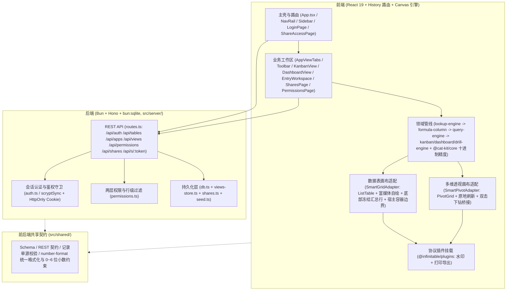

# 多维数据台（DataDesk / `apps/smart-table`）架构与表结构设计文档

> 物理目录 `apps/smart-table`、npm 包名 `@infinitable/smart-table`、SQLite 文件名 `smart-table.sqlite` 与库表名及内部核心 TS 符号（`SmartTableMeta` / `SmartApp` / `WorkspaceView` 等）保持稳定不变；产品展示名称与文档统一为 **「多维数据台（DataDesk）」**。

---

## 1. 定位与总体架构

### 1.1 与 `print-form-designer` 的核心差异

| 维度             | 打印单设计器 (`apps/print-form-designer`)            | 多维数据台 DataDesk (`apps/smart-table`)                                                                                |
| ---------------- | ---------------------------------------------------- | ----------------------------------------------------------------------------------------------------------------------- |
| **底层网格引擎** | `@infinitable/sheet`（`SheetGrid` 自由二维电子表格） | `@infinitable/table`（`ListTable`）+ `@infinitable/pivot`（`PivotGrid`）                                                |
| **数据形态**     | 单元格 `(row, col)` 自由绑定 / 浮动数据块            | **数据源表原始结构（`SmartTableMeta` + `SmartRecord[]`）与多维数据台应用派生层（`SmartApp`）分离**                      |
| **跨表关联**     | 手写公式或单格取数                                   | **向导式傻瓜 VLOOKUP**（多条件联合匹配、重名冲突消歧义、一对多汇总）+ **整列公式列**                                    |
| **视图与分析**   | 固定区域聚合行                                       | **四类视图（表格 / 看板 / 多维透视 / 仪表盘）+ 十进制精确聚合 + 双击下钻（明细穿透 & 逐层按维度下钻）+ 独立数据录入端** |
| **权限与分享**   | 单机工作台                                           | **SQLite 用户与会话认证 + 应用/视图可见范围与表内行级两层权限隔离 + 免登录对外分享 `/s/:token` 与生命周期管理**         |

### 1.2 应用内分层（`apps/smart-table/src/`）

采用轻量全栈分层（React 19 + Tailwind CSS v4 + lucide-react + Hono + `bun:sqlite`），严格遵守 `server` 不 import `canvas` / `components`：



```text
apps/smart-table/
├── package.json
├── index.html                        # <title>多维数据台 - DataDesk</title>
├── vite.config.ts
├── scripts/
│   └── dev.ts                        # 前后端并行启动脚本
└── src/
    ├── main.tsx
    ├── app.css
    ├── api.ts                        # REST API 客户端（含 401 会话失效统一拦截）
    ├── App.tsx                       # 主壳：History 路由、会话门禁、统一侧栏 NavRail（内嵌 Sidebar 子目录）、工作台编排
    ├── shared/
    │   ├── schema.ts                 # 表、列、SmartApp、WorkspaceView、用户/会话/权限/分享核心类型单源
    │   ├── api-types.ts              # 前后端 REST 请求/响应契约
    │   ├── number-format.ts          # 统一数值格式化（Grid/Pivot/汇总/看板/图表/下钻共用）与小数位映射
    │   ├── record-validation.ts      # 前后端单源单元格类型校验与强类型转换
    │   └── import-parse.ts           # CSV / XLSX 导入解析与列推断
    ├── domain/
    │   ├── router.ts                 # History API 路由单源（含 ?entry= 兼容跳转与 redirect 清洗）
    │   ├── permissions.ts            # 两层权限模型与访客边界纯函数判定
    │   ├── workspace-helpers.ts      # 导航可见性、资源能力快照解析、默认视图构建与 CSV/XLSX 导出
    │   ├── lookup-engine.ts          # 向导式 VLOOKUP 引擎（联合匹配、重名冲突检测、消歧锁定、一对多汇总）
    │   ├── lookup-manage.ts          # 派生列管理与孤立消歧记录清理
    │   ├── formula-column.ts         # 整列公式求值（映射 [字段名] 到 @infinitable/formulas 求值）
    │   ├── query-engine.ts           # 数据计算管线（VLOOKUP → 公式列 → 过滤 → 多级排序 → 底部精确汇总）
    │   ├── style-engine.ts           # 多层次列/单元格/条件格式样式解析
    │   ├── kanban-engine.ts          # 看板泳道分组与卡片投影
    │   ├── dashboard-engine.ts       # 仪表盘 KPI 与图表聚合（@cat-kit/core 十进制精确计算）
    │   ├── drill-engine.ts           # 透视表下钻（明细行反查 + 下一维度精确分组拆解）
    │   └── utils.ts                  # 十进制安全算术、空值与文本转换工具
    ├── canvas/
    │   ├── host-container.ts         # 宿主容器定位与 ResizeObserver 尺寸同步守卫
    │   ├── smart-grid.ts             # ListTable 封装：富媒体渲染器、原生底部冻结汇总行、热区与右键菜单、水印/打印
    │   └── smart-pivot.ts            # PivotGrid 封装：维度/度量映射、原地刷新、小数位格式化、水印、下钻桥接
    ├── components/
    │   ├── NavRail.tsx               # 统一侧栏（品牌位 + 按角色能力过滤的一级导航 + 当前板块子目录插槽 + 账号切换/登出）
    │   ├── Sidebar.tsx               # 侧栏子目录（多维数据台 / 数据录入表 / 数据源中心，嵌在激活的一级导航下方）
    │   ├── LoginPage.tsx             # 独立无侧栏登录页（/login，含内置演示账号快捷填入与一键登录）
    │   ├── AppViewTabs.tsx           # 多维数据台页头（应用标题 + 视图页签：四类视图切换/新建/调序 + 应用与视图共用的分享入口）
    │   ├── PageHeading.tsx             # 各页头共用的标题簇（图标徽标 + 标题 + 说明文字）
    │   ├── Toolbar.tsx               # 权限裁剪的静音工具栏（筛选/快捷筛选/派生列/VLOOKUP/水印/导出/视图配置；数据源模式下附带表名页头与建台/分享入口）
    │   ├── EntryWorkspace.tsx        # 独立数据录入端（/entries/:tableId：行内编辑/表单抽屉/批量追加导入）
    │   ├── EntryRecordDrawer.tsx     # 录入端单行新建/编辑表单抽屉
    │   ├── AppendImportModal.tsx     # 录入端批量追加导入弹窗
    │   ├── PermissionsPage.tsx       # 权限管理页（/permissions：两层权限配置矩阵）
    │   ├── SharesPage.tsx            # 分享管理页（/shares：分享链接状态筛选/复制/失效）
    │   ├── ShareModal.tsx            # 一键分享弹窗（应用 / 单视图 / 录入表分享生成）
    │   ├── ShareAccessPage.tsx       # 独立无侧栏访客分享页（/s/:token：密码门禁 / 只读交互 / 匿名填报）
    │   ├── KanbanView.tsx / KanbanCardDetailDrawer.tsx
    │   ├── DashboardView.tsx / DashboardCharts.tsx
    │   ├── ViewConfigDrawer.tsx / DrawerStylePanel.tsx / DrawerKanbanPanel.tsx / DrawerPivotPanel.tsx / DrawerDashboardPanel.tsx
    │   ├── DrillDownDrawer.tsx       # 透视下钻抽屉（明细 ListTable 反查 & 逐层按下一维度拆解）
    │   ├── LookupWizardModal.tsx / LookupFieldPanel.tsx / DisambiguatePopover.tsx
    │   ├── AddColumnModal.tsx / ColumnManagerModal.tsx / ImportExcelModal.tsx
    │   └── CellEditorPopover.tsx / GridPopupMenu.tsx / SummaryMenuPopover.tsx / CustomSelect.tsx / ConfirmModal.tsx / Toast.tsx
    └── server/
        ├── index.ts                  # Hono 服务入口与 Bun.serve 监听（默认 8788）
        ├── auth.ts                   # scryptSync + timingSafeEqual 密码校验、HttpOnly 会话与演示账号
        ├── permissions.ts            # 权限总览与配置持久化、行级权限校验
        ├── shares.ts                 # 分享链接生命周期管理与 /api/s/:token 访客数据边界控制
        ├── db.ts                     # SQLite 建表、旧库平滑迁移、双模式数据源表 CRUD
        ├── views-store.ts            # SmartApp 派生列/消歧锁定与 WorkspaceView 持久化及校验
        ├── import.ts                 # 导入建表事务提交
        ├── routes.ts                 # 全接口鉴权守卫与 REST API 路由挂载
        └── seed.ts                   # 六表联动（121 行）+ 七应用 + 演示账号 + 真实小数样本种子
```

---

## 2. 导航架构、路由与账号权限体系

### 2.1 统一侧栏与独立路由（`src/domain/router.ts`）

- **布局形态**：统一侧栏（`NavRail`：品牌位 + 按角色能力过滤的一级导航「工作台 / 数据录入 / 数据源 / 分享管理 / 权限管理」+ 当前板块子目录 `Sidebar`（嵌在激活的一级导航下方）+ 底部账户菜单与登出）+ 主工作区；主工作区为两段式页头（标题 / 视图页签 / 分享，下接一条除「新增行」外全部无边框无底色的静音工具栏）；`/login` 与 `/s/:token` 为独立无侧栏全屏路由。
- **支持路由**：
  - `/`、`/apps/:appId`、`/apps/:appId/views/:viewId`：多维数据台应用与四类视图工作台（表格 / 看板 / 透视 / 仪表盘）。
  - `/entries`、`/entries/:tableId`：普通数据表独立数据录入端（支持旧 `/?entry=<tableId>` 自动 `replaceState` 规范化跳转）。
  - `/datasources`、`/datasources/:tableId`：数据源中心（仅管理员与负责人可访问，维护底层原始字段与主数据）。
  - `/shares`：分享链接生命周期管理页（管理员看全空间，负责人看本人创建，普通成员不可访问）。
  - `/permissions`：两层权限管理矩阵页（管理员看全空间，负责人看本人创建或负责资源，普通成员不可访问）。
  - `/login`：独立登录页（支持 `?redirect=` 站内回跳校验）。
  - `/s/:token`：免登录对外分享访问页（支持应用只读、单视图只读、录入表匿名填报）。

### 2.2 账号认证与两层权限模型

- **内置演示账号（`src/server/auth.ts`）**：系统管理员 `admin`（`admin123`）、华北负责人 `manager`（李四 / `manager123`）、华南负责人 `wangwu`（王五 / `manager123`）、普通成员 `member`（钱七 / `member123`）。
- **认证与全局守卫**：`sessions` 表持久化 SHA-256 哈希 Token，浏览器通过 HttpOnly `st_session` Cookie 鉴权；除 `/api/auth/*` 与 `/api/s/*` 外，所有业务接口未登录一律返回 `401`。
- **第一层（应用与视图级）**：`visibilityScope`（`self` / `managers` / `all`）+ `managerUserIds` + `memberAccess`（`readonly` / `editable`，视图支持继承或覆盖所属应用）。
- **第二层（数据源表行级）**：`rowScope`（`self` / `manager` / `all`）+ 可选绑定 `person` 类型列 `ownerColumnKey` + 新建/导入记录自动写入 `record_ownership.created_by`，普通成员与负责人按归属过滤并拦截越权读写（HTTP `403`）。

### 2.3 一键分享与访客安全边界（`src/server/shares.ts`）

- 管理员与资源创建者/负责人可对 **多维数据台应用（`app`）**、**单视图（`view`）** 或 **普通数据录入表（`entry`）** 生成 `/s/:token` 链接，支持有效期（1 天 / 7 天 / 30 天 / 永久）、可选访问密码（服务端 Cookie/Header 解锁令牌）与随时手动失效（已失效/过期返回 HTTP `410`）。
- **访客数据边界**：`app` / `view` 分享下访客仅可只读交互（支持本地临时筛选、排序与下钻浏览，不写库且不暴露数据源），可见数据行受 **分享创建者** 的权限边界裁剪；`entry` 分享仅允许提交新记录，历史内部数据对匿名访客严格不可见。

---

## 3. 数据分层、十进制精度与核心特性

### 3.1 数据源表层 vs 多维数据台应用层（`src/shared/schema.ts`）

- **数据源表层（`SmartTableMeta`）**：区分 `normal`（普通自建表，JSON 行存储，支持自由增删列与数据录入）与 `advanced`（进阶 SQL 物理表，带业务主键与唯一索引），仅保存原始字段（`text` / `number` / `select` / `date` / `checkbox` / `person` / `progress` / `image` / `link`）。
- **多维数据台应用层（`SmartApp`）**：基于指定数据源表创建，同一数据源可衍生多张独立业务应用；承载 `derivedColumns`（`lookup` / `formula` 派生列）与 `lookupOverrides`（VLOOKUP 重名消歧锁定），并下挂多张 `WorkspaceView`（`table` / `kanban` / `pivot` / `dashboard`）。

### 3.2 傻瓜式 VLOOKUP 与双模式下钻

- **向导式 VLOOKUP（`src/domain/lookup-engine.ts`）**：支持 1~N 条件联合匹配、一对一批量带出与一对多汇总（`sum` / `count` / `avg` / `min` / `max` / `join`）；一对一命中多条同名记录时默认取首条并绘制重名提示角标，点击可在 `DisambiguatePopover` 锁定唯一 `_id` 或追加联合匹配条件。
- **透视与双模式下钻（`src/domain/drill-engine.ts`、`src/components/DrillDownDrawer.tsx`）**：消费 `@infinitable/pivot`（`PivotGrid`）支持多级行/列维度与度量聚合及原地刷新；双击汇总格打开抽屉，支持 **明细反查/直接编辑（嵌入式 `ListTable`，宿主容器严格对齐边界）** 与 **按下一维度逐层拆解（带面包屑导航）**。

### 3.3 全链路十进制精确计算与统一数值格式化

- **精度治理**：`packages/pivot`（`PivotModel`）及 `apps/smart-table` 内所有底部汇总、VLOOKUP Rollup、看板聚合、仪表盘 KPI/图表统计、透视下钻均通过 `@cat-kit/core`（`$n` / `n`）执行十进制精确计算，避免 `0.1 + 0.2` 等 IEEE-754 浮点误差。
- **统一格式化与小数位配置（`src/shared/number-format.ts`）**：Grid 单元格、Pivot 指标、底部汇总、看板卡片、仪表盘 KPI/图表与下钻抽屉 6 处共用同一套格式口径；列字段、透视度量与仪表盘 KPI 均支持配置 `decimalPlaces`（`0~6` 位整数或默认自动），经前后端校验后持久化。

---

## 4. SQLite 持久化与演示种子（`src/server/`）

### 4.1 SQLite 核心物理表（`src/server/db.ts`）

- 账号与会话：`users`、`sessions`
- 权限与分享：`shares`、`record_ownership`
- 应用与视图：`smart_tables`、`smart_apps`、`workspace_views`、`smart_table_records`
- 进阶 SQL 业务物理表：`biz_employees`（主索引 `emp_id`、姓名索引 `idx_emp_name`）、`biz_payments`（主键 `pay_id`、项目索引 `idx_pay_project`）
- 迁移与设置：`server_settings`、`PRAGMA user_version`（当前 `SEED_VERSION = 9`）

### 4.2 六表联动演示种子（`src/server/seed.ts`）

启动空库自动初始化 **6 张互关联表、121 条记录**（含真实小数业务样本与精度边界）、**7 张示范多维数据台应用** 与 **4 个角色演示账号**：

1. `tbl_projects`《项目跟进与业绩总表》（`normal`，16 行，含重名「张三」与小数金额/比例）
2. `tbl_employees`《企业员工花名册》（`advanced -> biz_employees`，`system`，15 行，含同名「张三」）
3. `tbl_payments`《客户回款流水表》（`advanced -> biz_payments`，`system`，48 行）
4. `tbl_inventory`《产品库存与采购台账》（`normal`，16 行）
5. `tbl_suppliers`《供应商名录》（`normal`，8 行）
6. `tbl_tickets`《客户工单与 SLA 追踪》（`normal`，18 行）

---

## 5. 底层引擎包联动与构建契约

- `@infinitable/table`：支撑 `ListTable` 富媒体单元格自绘、图片/超链接媒体层、原生底部冻结汇总行、表头热区隔离、列宽写回与协议水印/打印插件。
- `@infinitable/pivot`：支撑 `PivotGrid` 多列树形行维度、多级列维度、动态度量与维度切换、`setRecords` 原地刷新、`onCellDrill` 下钻及 `PivotModel` 十进制精确聚合；共享 `engine` 构建 chunk 保持不引入 `@cat-kit/core`，由 `scripts/check-package-exports.mjs` 守卫。
