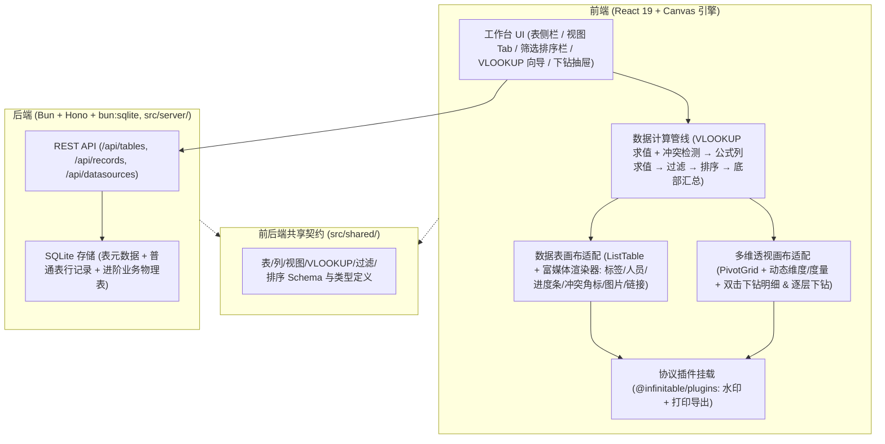
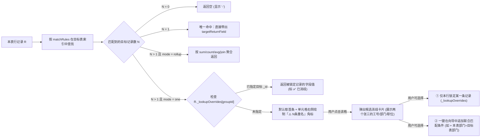

# `apps/smart-table`（类企业微信智能表格）架构与表结构设计文档

---

## 1. 定位与总体架构

### 1.1 与 `print-form-designer` 的核心差异

| 维度             | 打印单设计器 (`apps/print-form-designer`)            | 智能表格 (`apps/smart-table`)                                                                         |
| ---------------- | ---------------------------------------------------- | ----------------------------------------------------------------------------------------------------- |
| **底层网格引擎** | `@infinitable/sheet`（`SheetGrid` 自由二维电子表格） | `@infinitable/table`（`ListTable`）+ `@infinitable/pivot`（`PivotGrid`）                              |
| **数据形态**     | 单元格 `(row, col)` 自由绑定 / 浮动数据块            | **统一为结构化数组 `Record[]` + 强类型列定义 `SmartColumn[]`**                                        |
| **跨表关联**     | 手写公式或单格取数                                   | **向导式傻瓜 VLOOKUP**（多条件联合匹配、重名冲突消歧义、一对多聚合）                                  |
| **分析能力**     | 固定区域聚合行                                       | **多视图体系（表格视图 + 多维透视视图）+ 筛选/排序/快捷胶囊 + 双击下钻（明细穿透 & 逐层按维度下钻）** |

### 1.2 应用内分层（`apps/smart-table/src/`）

保持与 `apps/print-form-designer` 同构的轻量全栈分层（React 19 + Hono + `bun:sqlite`）：



```text
apps/smart-table/
├── package.json
├── index.html
├── vite.config.ts
├── scripts/
│   └── dev.ts                  # 前后端并行启动脚本
└── src/
    ├── shared/
    │   ├── schema.ts           # 表、列、视图、VLOOKUP、筛选、排序的核心类型单源
    │   └── api-types.ts        # 前后端 REST 接口请求/响应契约
    ├── domain/
    │   ├── lookup-engine.ts    # 傻瓜式 VLOOKUP 引擎（单/多条件索引匹配、重名冲突检测、消歧义锁定、一对多聚合）
    │   ├── formula-column.ts   # 整列公式求值（把 [字段名] 编译/映射到行记录求值）
    │   ├── query-engine.ts     # 数组过滤（AND/OR + 类型自适应操作符）、多级排序、底部统计汇总计算
    │   └── drill-engine.ts     # 透视表下钻（明细行反查 + 按下一维度二次分组聚合）
    ├── canvas/
    │   ├── smart-grid.ts       # ListTable 封装：富媒体 CellRenderer（标签/进度条/人员头像/VLOOKUP 冲突角标）、图片/链接/勾选框绑定、列头排序指示
    │   └── smart-pivot.ts      # PivotGrid 封装：动态维度/度量同步、水印/打印挂载、双击下钻桥接
    ├── components/
    │   ├── Sidebar.tsx         # 左侧表目录（区分「普通自建表」与「进阶数据源表」）+ 新建/导入表
    │   ├── ViewTabs.tsx        # 顶部视图 Tab（数据表视图 / 多维透视视图 / 新增视图）
    │   ├── Toolbar.tsx         # 工具栏：筛选构建器弹窗、多级排序弹窗、快捷筛选胶囊、添加列、水印/打印
    │   ├── LookupWizardModal.tsx # 傻瓜式 VLOOKUP 向导弹窗（选表 → 1~N 匹配条件 → 勾选多字段带出 → 冲突/汇总策略）
    │   ├── DisambiguatePopover.tsx # 重名冲突消歧义卡片（展示同名候选记录完整信息，点选锁定唯一 _id）
    │   ├── PivotConfigBar.tsx  # 透视视图配置栏（行维度、列维度、度量指标与聚合方式切换、展开/折叠）
    │   ├── DrillDownDrawer.tsx # 下钻抽屉/弹窗（Tab 1：底层明细 ListTable 支持直接反查编辑；Tab 2：选下一维度继续拆解）
    │   └── SummaryFooter.tsx   # 表格底部统计汇总栏（每列可切换：求和/平均/最大/最小/计数/已填占比）
    └── server/
        ├── index.ts            # Hono 服务入口
        ├── db.ts               # SQLite 建表与连接管理
        ├── seed.ts             # 「项目与销售协同」三表联动种子数据
        └── routes.ts           # 表定义、行数据增删改、进阶 SQL 数据源同步接口
```

---

## 2. 核心数据模型与 Schema 设计（`src/shared/schema.ts`）

### 2.1 双模式数据表定义（普通自建表 + 进阶数据源表）

每张表的数据在前端统一体现为 `SmartRecord[]` 数组，每条记录必带内部唯一行标识 `_id: string`，进阶表额外声明业务主键列（如 `emp_id`）与索引列：

```ts
export type TableKind =
  | 'normal' // 普通自建表（类 Excel，用户自由增删改行列）
  | 'advanced' // 进阶数据源表（对接 SQL 物理表/主数据，带业务主键与唯一索引）

export interface SmartTableMeta {
  id: string
  name: string
  kind: TableKind
  description?: string
  /** 进阶表的业务主键字段 key（如 'emp_id'），用于索引加速与重名消歧展示 */
  primaryKeyField?: string
  /** 进阶表绑定的后端 SQL 查询或物理表名 */
  sourceSqlTable?: string
  columns: SmartColumn[]
  views: SmartView[]
  /** 底部汇总栏配置：columnKey -> SummaryType */
  summaries: Record<string, SummaryType>
}

export interface SmartRecord {
  /** 系统内部唯一行 ID（UUID 或主键映射），重名消歧义时靠它锁定目标行 */
  _id: string
  /** 各列的原始值或消歧义锁定映射 */
  [fieldKey: string]: unknown
  /**
   * 傻瓜式 VLOOKUP 手动消歧义锁定表：
   * Record<lookupGroupKey, targetRecordId>
   * 例如存在两个“张三”时，用户在单元格点选了「研发部-张三(EMP001)」，记录在此
   */
  _lookupOverrides?: Record<string, string>
}
```

### 2.2 列类型体系（含富媒体列、傻瓜式 VLOOKUP 列、整列公式列）

全面复用 `@infinitable/table`（`packages/table/src/types.ts`）的 `resolveCellRenderer`、`resolveCellImage`、`resolveCellLink`、`cellType: 'checkbox'`：

```ts
export type SmartColumnType =
  | 'text' // 文本
  | 'number' // 数值 / 金额（支持千分位、货币符号、小数位配置）
  | 'select' // 彩色单选标签（Canvas 圆角胶囊自绘）
  | 'date' // 日期（YYYY-MM-DD）
  | 'checkbox' // 勾选框（复用 ListTable 内置 checkbox）
  | 'person' // 人员列（Canvas 绘彩色圆形头像缩写 + 姓名 + 可选工号副标）
  | 'progress' // 进度条列（0~100%，Canvas 绘轨道 + 进度色条 + 百分比文字）
  | 'image' // 图片列（复用 ListTable resolveCellImage L2 media 层无闪渲染）
  | 'link' // 超链接列（复用 ListTable resolveCellLink 蓝字下划线 + 点击打开）
  | 'lookup' // 傻瓜式 VLOOKUP 跨表查找引用列
  | 'formula' // 整列计算公式列（如 [累计回款] / [合同金额]）

export interface SelectOption {
  label: string
  color: string // 胶囊背景色
  textColor: string // 胶囊文字色
}

export interface SmartColumn {
  key: string
  title: string
  type: SmartColumnType
  width: number
  /** 是否为唯一键/索引列（进阶表会在列头展示 🔑 标识） */
  isUniqueKey?: boolean
  /** select 类型的枚举项 */
  options?: SelectOption[]
  /** number 类型的格式：'integer' | 'decimal' | 'currency' | 'percent' */
  numberFormat?: 'integer' | 'decimal' | 'currency' | 'percent'
  /** lookup 类型的向导配置 */
  lookupConfig?: LookupConfig
  /** formula 类型的列级公式表达式，如 "[paid_amount] / [contract_amount]" */
  formulaExpr?: string
}
```

---

## 3. 核心特性详细设计

### 3.1 傻瓜式 VLOOKUP 引擎（`src/domain/lookup-engine.ts`）

#### （1）配置结构（向导式、零公式门槛）

```ts
export interface LookupMatchRule {
  sourceField: string // 本表匹配列（如 'owner_name' 负责人姓名）
  targetField: string // 目标表匹配列（如 'name' 员工姓名）
}

export type LookupMode =
  | 'one' // 一对一查找带出字段（如：根据姓名查工号/部门/职级）
  | 'rollup' // 一对多汇总（如：根据客户名去回款流水表汇总累计回款）

export type LookupRollupAgg = 'sum' | 'count' | 'avg' | 'min' | 'max' | 'join'

export interface LookupConfig {
  /** 同一次向导批量生成的列共享同一个 groupId，消歧义一次即可联动同组所有带出列 */
  groupId: string
  targetTableId: string
  /** 支持 1~N 个匹配条件（AND 关系，例如：姓名=姓名 且 部门=部门） */
  matchRules: LookupMatchRule[]
  /** 要从目标表带出的字段 key */
  targetReturnField: string
  mode: LookupMode
  /** mode === 'rollup' 时的聚合方式 */
  rollupAgg?: LookupRollupAgg
}
```

#### （2）解决「同名同姓 / 重复键」的完整机制



- **批量带出**：在 VLOOKUP 向导第 3 步，用户可以同时勾选目标表的多个字段（如勾选「工号」「所属部门」「职级」），点击确定后自动生成 3 列且共享同一个 `groupId`——当某行“张三”消歧义选定 `EMP001` 后，这 3 列同步更新为 `EMP001` 对应的工号、部门和职级。

---

### 3.2 排序、过滤与快捷筛选胶囊（`src/domain/query-engine.ts`）

```ts
export type FilterOperator =
  | 'eq'
  | 'neq'
  | 'contains'
  | 'not_contains'
  | 'gt'
  | 'gte'
  | 'lt'
  | 'lte'
  | 'in'
  | 'is_empty'
  | 'is_not_empty'

export interface FilterCondition {
  id: string
  field: string
  operator: FilterOperator
  value: unknown
}

export interface FilterGroup {
  conjunction: 'and' | 'or'
  conditions: FilterCondition[]
}

export interface SortRule {
  field: string
  direction: 'asc' | 'desc'
}
```

- **视图级互通**：每个视图（`SmartView`）持有自己的 `filterGroup`、`quickFilters`（快捷胶囊筛选，如顶部一键切「部门」「状态」）和 `sortRules`。在「数据表视图」配好的筛选条件，切换到「多维透视视图」或直接新建透视视图时，基于过滤后的 `SmartRecord[]`（含 VLOOKUP 与公式计算结果）做实时交叉聚合。

---

### 3.3 多维透视视图与双模式「下钻」（`src/domain/drill-engine.ts`）

直接消费 `@infinitable/pivot` 的 `PivotGrid`：

1. **全字段可做维度/指标**：本表原生列、**VLOOKUP 跨表带出列**（例如从员工表带过来的「职级」「所属大区」）、**整列公式列**均可自由勾选为行维度、列维度或度量指标（`sum` / `count` / `avg` / `min` / `max`）。
2. **双击汇总格下钻（`PivotGrid.onCellDrill`）**：
   双击透视表任意聚合单元格 `(col, row)` 时，打开 **下钻分析抽屉 (`DrillDownDrawer`)**，提供两种下钻方式：
   - **方式 A：穿透查看/编辑底层明细（Detail Records）**
     内部挂载一个 `ListTable` 实例，展示构成该聚合数字的 N 条原始记录；支持在明细表里直接双击修改源数据，修改后主表与透视表实时重算。
   - **方式 B：按下一维度继续下钻（Next-Dimension Breakdown）**
     自动列出当前尚未放入行/列维度的其余字段（例如当前是「状态 × 年份」，可选「按负责人继续下钻」「按客户行业继续下钻」「按月份继续下钻」），点击即可在当前单元格过滤子集上立即生成下一层聚合拆解表与占比条！

---

## 4. 数据库存储与内置三表种子场景（`src/server/`）

### 4.1 SQLite 物理表结构（`src/server/db.ts`）

```sql
-- 1. 智能表元数据表（存列定义、视图配置、VLOOKUP 配置、汇总配置）
CREATE TABLE IF NOT EXISTS smart_tables (
  id TEXT PRIMARY KEY,
  name TEXT NOT NULL,
  kind TEXT NOT NULL,            -- 'normal' | 'advanced'
  primary_key_field TEXT,
  source_sql_table TEXT,
  schema_json TEXT NOT NULL,     -- SmartColumn[] + summaries
  views_json TEXT NOT NULL,      -- SmartView[]
  updated_at TEXT NOT NULL
);

-- 2. 普通表记录存储（行级 JSON，支持灵活增删列与 _lookupOverrides）
CREATE TABLE IF NOT EXISTS smart_table_records (
  id TEXT PRIMARY KEY,
  table_id TEXT NOT NULL,
  row_order INTEGER NOT NULL,
  data_json TEXT NOT NULL        -- SmartRecord JSON
);
CREATE INDEX IF NOT EXISTS idx_records_table ON smart_table_records(table_id, row_order);

-- 3. 进阶数据源物理表 1：企业员工花名册（带主键与索引）
CREATE TABLE IF NOT EXISTS biz_employees (
  emp_id TEXT PRIMARY KEY,       -- 唯一工号（主键索引）
  name TEXT NOT NULL,            -- 姓名（含同名同姓“张三”）
  dept TEXT NOT NULL,            -- 所属部门
  level TEXT NOT NULL,           -- 职级（P6/P7/P8）
  region TEXT NOT NULL,          -- 负责大区
  email TEXT NOT NULL
);
CREATE INDEX IF NOT EXISTS idx_emp_name ON biz_employees(name);

-- 4. 进阶数据源物理表 2：客户回款流水表（一对多业务流水）
CREATE TABLE IF NOT EXISTS biz_payments (
  pay_id TEXT PRIMARY KEY,       -- 流水号
  project_code TEXT NOT NULL,    -- 关联项目编号
  customer_name TEXT NOT NULL,   -- 客户名称
  pay_date TEXT NOT NULL,        -- 回款日期
  year TEXT NOT NULL,            -- 年份（2024年/2025年）
  month TEXT NOT NULL,           -- 月份
  amount REAL NOT NULL,          -- 回款金额
  pay_method TEXT NOT NULL       -- 结算方式
);
CREATE INDEX IF NOT EXISTS idx_pay_project ON biz_payments(project_code);
```

### 4.2 开箱即用的「项目与销售协同」三表联动种子（`src/server/seed.ts`）

1. **表 1：《项目跟进与业绩总表》（`normal` 普通自建表，主工作表）**
   - **原生富媒体列**：
     - `project_code`（文本，项目编号）
     - `project_name`（文本，项目名称）
     - `owner_name`（**人员列**，负责人姓名——其中故意包含两条由 **「张三」** 负责的项目）
     - `status`（**彩色单选标签列**：进行中 / 已交付 / 风险预警 / 待启动）
     - `progress`（**进度条列**：0%~100% 可视化条形）
     - `contract_amount`（**数值金额列**：合同总额）
     - `verified`（**勾选框列**：财务已核验）
     - `blueprint_img`（**图片列**：架构缩略图，走 L2 media 层）
     - `doc_url`（**超链接列**：项目立项书链接）
   - **傻瓜式 VLOOKUP 列（跨表 1 → 表 2《企业员工花名册》）**：
     - 匹配条件：`本表[负责人(owner_name)] = 员工表[姓名(name)]`（一对一模式）
     - 批量带出 3 列：`负责人所属部门`、`负责人职级`、`唯一工号`
     - **亮点演示**：因为员工表里有两个「张三」（`EMP-001 研发部 P7` 与 `EMP-009 华东销售部 P6`），“张三”所在行自动显示 **`⚠️ 2条重名`** 角标，点击即可弹出消歧卡片一键指定，或在向导中追加 `部门` 条件消歧！
   - **傻瓜式 VLOOKUP 汇总列（跨表 1 → 表 3《客户回款流水表》）**：
     - 匹配条件：`本表[项目编号(project_code)] = 回款流水表[关联项目编号(project_code)]`（一对多 Rollup 模式）
     - 带出 2 列：`累计回款金额（Sum 求和）`、`回款笔数（Count 计数）`
   - **整列公式列**：
     - `回款达成率` = `[累计回款金额] / [合同总额]`（自动按百分比渲染）
   - **预置视图**：
     - 视图 1：`全部项目明细`（数据表视图 + 快捷胶囊筛选 + 底部汇总行）
     - 视图 2：`部门 × 状态业绩多维分析`（透视表视图，把 VLOOKUP 带出的「负责人所属部门」作为行维度、「状态」作为列维度、汇总合同金额与累计回款，支持双击任意格下钻明细或按「职级」继续下钻）
2. **表 2：《企业员工花名册》（`advanced` 进阶数据源表，主键 `emp_id`）**
   - 预置 12 名员工（含两条同名「张三」分属不同部门与工号），支持直接查看、新增员工或修改属性，修改后立即驱动表 1 的 VLOOKUP 列刷新。
3. **表 3：《客户回款流水表》（`advanced` 进阶数据源表，主键 `pay_id`）**
   - 预置 36 条跨 2024/2025 年各月的回款记录，自带「回款流水表视图」与「年度×月度×大区多维透视视图」。

---

## 5. 底层引擎包联动检查

- `@infinitable/table`：已完备支持 `records` / `columns`、`resolveCellRenderer`、`resolveCellImage`、`resolveCellLink`、`resolveCellStyle`、编辑回写与协议插件。
- `@infinitable/pivot`：已完备支持多列树形行维度、多级列维度表头、动态维度/度量勾选、展开/折叠、`onCellDrill` 明细下钻与协议插件挂载；后续需在 `PivotGrid` / `PivotModel` 上补一个轻量的 `setRecords(records)`（及维度/度量池动态追加方法），使智能表格在过滤条件变化或新增 VLOOKUP 列时，透视表也能**原地刷新而不必销毁重建画布**。
