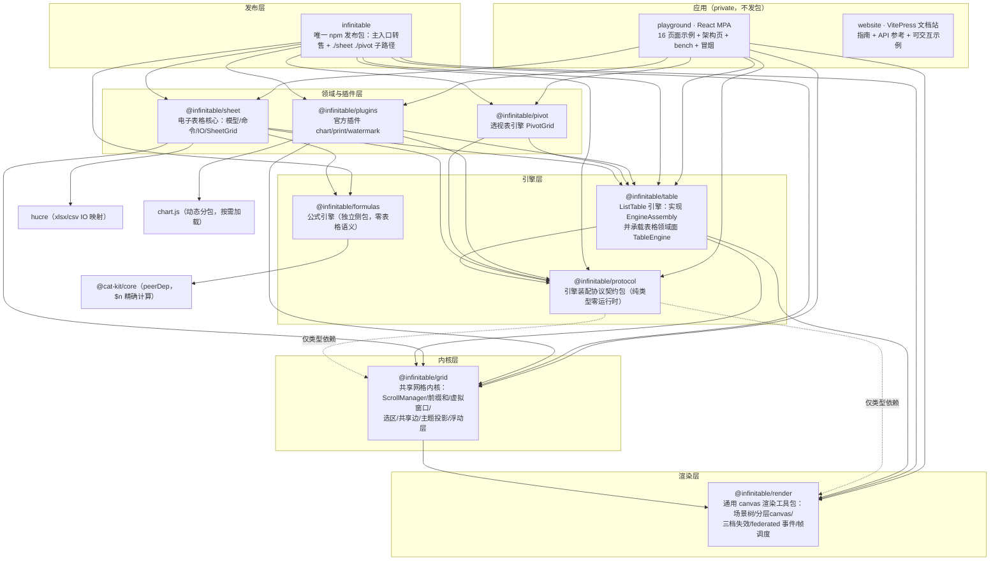
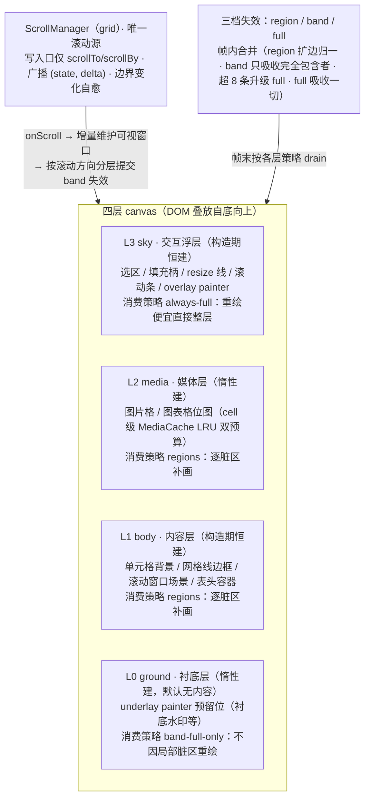
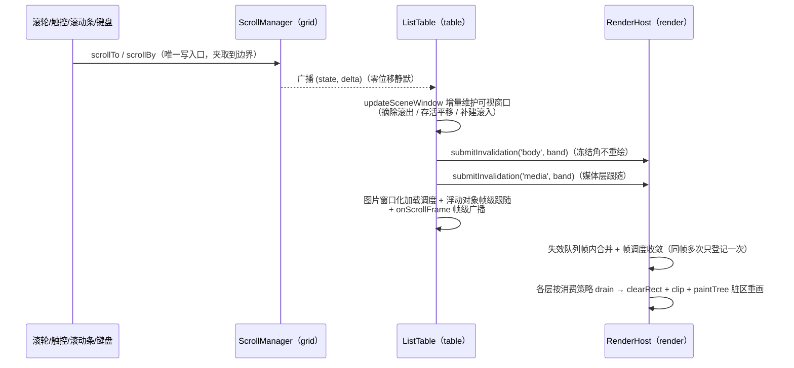

# infinitable 架构总览与 docs/ 阅读地图

高性能 canvas 表格引擎 monorepo 的**全局架构总览**：一篇看懂仓库定位、九包分层、四层画布与失效模型、引擎装配协议、关键链路，并充当 `docs/` 全部深度文档的**入口与索引**。所有机制细节都指向对应深度文档，本篇只负责「地图与口径」。

## 这是什么仓库

**infinitable** 是为替代 [VisActor VTable](https://github.com/VisActor/VTable) 而生的**框架无关无头（headless-friendly）内核库**：多层 canvas 失效驱动渲染 + 全量虚拟滚动，10 万～100 万行数据下首次渲染、滚动与写入性能不随数据量劣化（100 万行 TTFF 16.7ms），最小构建 gzip 仅 **61.4KB**。自研渲染零 vrender 系列依赖；面向 React/Vue/SSR/测试/bun 任意宿主装配；下游为 ultra-ui 等自用产品。

multi-engine 架构是核心叙事：**table（ListTable）/ pivot（PivotGrid）/ sheet（SheetGrid）三类平级领域引擎**经同一引擎装配协议接入，甘特图引擎为后续同构规划。官方特性与用户扩展走同一插件路径（协议插件 / 领域面插件 / 注册表插件三分类）。

仓库形态：bun workspaces 多包 monorepo（`packages/*` 九包 + `playground` 示例应用 + `apps/print-form-designer` 打印表单设计器全栈应用（前端设计器 + Bun/bun:sqlite/Hono 后端）+ `website` VitePress 文档站），发布收敛为**唯一公开 npm 包 `infinitable`**（changesets + CI 发布）。

## docs/ 阅读地图（本篇即索引）

`docs/` 共 14 篇：1 篇总览（本篇）+ 9 篇按域深入 + 1 篇验收红线 + 3 篇历史与调研。完整分组索引见 [docs/ 全目录索引](#docs-全目录索引)。

| 读者 | 建议路径 |
| --- | --- |
| 新人第一周 | 本篇 → [render-engine.md](./render-engine.md) → [grid-kernel.md](./grid-kernel.md) → [list-table-engine.md](./list-table-engine.md) → [engine-assembly-protocol.md](./engine-assembly-protocol.md) |
| 做功能开发 | 按域直达：数据/编辑/交互看 [list-table-engine.md](./list-table-engine.md)；公式看 [formulas.md](./formulas.md) + [sheet.md](./sheet.md)；透视表看 [pivot-engine.md](./pivot-engine.md)；打印看 [print.md](./print.md) |
| 写插件 / 改公共面 | [engine-assembly-protocol.md](./engine-assembly-protocol.md) → [plugin-interface-map.md](./plugin-interface-map.md)（红线）→ [infinitable-package.md](./infinitable-package.md)（公开面冻结） |
| 理解设计来由 | [overflow-rendering-research.md](./overflow-rendering-research.md)（溢出语义）→ [univer-research.md](./univer-research.md)（打印/水印/插件调研）→ [replace-vtable-roadmap.md](./replace-vtable-roadmap.md)（替换史） |

## 业务与技术架构鸟瞰

**定位**：承载平级引擎（表格 / sheet / 透视表 / 规划中甘特图）的高性能 canvas 内核库。渲染全自研（`@infinitable/render` 场景树 + 分层 canvas + 三档失效，替代 @visactor/vrender 全家），工具库用 `@cat-kit/core`（替代 @visactor/vutils）。

核心域能力一张表（细节均落在对应深度文档）：

| 能力域 | 内容 | 深入 |
| --- | --- | --- |
| 表格渲染 | 四层 canvas（ground/body/media/sky）、虚拟滚动窗口、行带增量失效、Excel 式文本溢出走廊 | [render-engine.md](./render-engine.md) · [grid-kernel.md](./grid-kernel.md) · [list-table-engine.md](./list-table-engine.md) |
| 交互 | 选区（多段/shift 扩展/外部回写防回环）、列宽行高拖拽、冻结、合并、键盘导航、填充柄（几何与事件在内核、生成在宿主）、编辑链路（编辑器注册表 + DOM 浮层）、触控惯性、canvas/原生双档滚动条 | [grid-kernel.md](./grid-kernel.md) · [list-table-engine.md](./list-table-engine.md) |
| 排序/筛选 | 不内置——数据供给在宿主，重排 records 后批量刷新（内核只保证便宜） | [list-table-engine.md](./list-table-engine.md) |
| 公式引擎 | 解析（Pratt）/ 求值（宿主注入 resolver）/ 49 内置函数 / 依赖图增量失效（affectedBy 传递闭包 + 易失函数）/ 引用平移；自定义函数走实例函数集（多工作簿隔离），全局注册为兜底；#CYCLE! 由宿主护栏产出 | [formulas.md](./formulas.md) |
| 电子表格 | sheet 模型 + 命令系统（一切写操作可 undo/redo）+ 图簿级公式编排（FormulaEngine）+ xlsx/csv IO（经 hucre）+ SheetGrid 适配 | [sheet.md](./sheet.md) |
| 透视表 | 行维度树 × 列维度树 × 度量交叉聚合（PivotModel 状态机）；树形行头跨行合并 + 图标折叠 + 维度/度量动态勾选 + 双击下钻 | [pivot-engine.md](./pivot-engine.md) |
| 引擎装配协议 | EngineAssembly 中立本体、EngineReadView 导出读取面、EnginePlugin 插件契约与三分类；协议插件跨引擎挂载 | [engine-assembly-protocol.md](./engine-assembly-protocol.md) |
| 插件 | chart（Chart.js 按需动态分包 + 离屏出图）、print（headless 分页 + iframe 打印）、watermark（overlay 槽位平铺水印） | [print.md](./print.md) · [engine-assembly-protocol.md](./engine-assembly-protocol.md) |

技术栈：TypeScript 7（tsgo）/ ESM only / 浏览器 + bun；bun workspaces + vite-plus（vp CLI：rolldown-vite / oxlint / oxfmt / vitest）；测试 vitest（浏览器行为用浏览器模式冒烟）；应用 UI（playground）React + shadcn/ui + Tailwind；应用后端（apps/print-form-designer）Bun + bun:sqlite + Hono；部署公开 npm 包 `infinitable`，其余子包与应用（playground、print-form-designer）及 website 私有不发。发版走 `.agents/skills/release` 技能（changesets + CI，禁止本地 publish）。

### 场景走读（心智模型）

五个高频场景的层间协作一句话版（交互版见 playground 架构页，数据源 `playground/src/app/architecture-data.ts`）：

| 场景 | 数据流 | 心智锚点 |
| --- | --- | --- |
| 首屏：10 万行为什么秒开 | 装配（数据面 + 主题 + 渲染宿主，一次）→ 前缀和定位可视窗口 → 只为窗口内格子建场景节点 → 分层一次合成 | 全链路无 DOM 无组件树：数据 → 可视窗口 → 场景节点 → 像素，成本只和「看得见多少」有关 |
| 滚动：滚一屏和滚一万行一样便宜 | 六路输入收口唯一滚动状态机 → 窗口平移（只算新滑入行列）→ 变化以失效登记表达（局部/行带/整层按粒度选档）→ 帧调度收敛一帧一绘 | 滚动成本与数据总量无关；表达变化用「失效」而不是「重建」 |
| 编辑带公式的格子：一次修改的传播链 | 编辑提交 → 模型回写发变更 → 依赖图标脏全部引用者（易失全图标脏）→ 纯计算引擎逐格重算回写 → 只有值真变的格子向渲染层报失效 | 公式引擎是不知道界面的计算器；「谁依赖谁」的图、求值、界面刷新是三件事，由接线层串起来 |
| 挂水印：一份代码处处生效 | 插件挂载只拿中立装配面 → 往「内容之上」整层绘制槽位注册 painter（锚定视口不随滚动平移）→ 销毁逆序卸载 | 跨引擎生效不是巧合，是契约中立性的直接结果 |
| 打印导出：表格不在屏幕上也能拿到内容 | 经契约的导出读取面读「引擎眼里的有效数据」（取值管线 + 样式投影后的值/几何/合并区）→ 无头分页 → HTML → iframe 打印 | 引擎对外两套面貌：数据语义（read 面）与像素语义（场景树离屏重放），都不需要真的显示在页面上 |

## 九包分层全景



### 分层带（自上而下 = 依赖方向自上向下）

| 层带 | 含义 |
| --- | --- |
| 发布层 | 用户只装一个包：统一出口、自包含产物，内部多包结构对外不可见 |
| 领域与插件层 | 平级领域引擎与官方插件：经装配协议复用引擎层，插件只认契约不认引擎 |
| 引擎层 | 契约与首个实现：protocol 定契约（纯类型），table 落地第一个引擎；formulas 为独立侧包 |
| 内核层 | 跨引擎共享的网格机器：滚动 / 虚拟窗口 / 几何 / 选区 / 主题 |
| 渲染层 | 通用 canvas 绘制：场景树 / 分层画布 / 脏区重绘，不含任何表格语义 |

### 依赖方向铁律

| # | 铁律 | 说明 |
| --- | --- | --- |
| 1 | **render 是最底层、零第三方依赖、零表格语义** | 上游只有各包对它的依赖；对上只暴露 RenderHost **窄接口**（`createLayer / submitInvalidation / requestFrame / measure / resize / destroy` 六方法），场景内容读写一律经 `LayerHandle.root` 场景树 API |
| 2 | **grid 只依赖 render 的窄接口** | 不依赖任何 vrender 系列包；消费面收敛为类型 + `SceneNode` 子类（float-object-layer 自绘） |
| 3 | **protocol 纯类型零运行时** | 只依赖 grid 与 render 的**类型**（依赖边是类型依赖）；协议类型只有一个家——table/infinitable 公共入口只具名转出，禁止重复定义 |
| 4 | **formulas 与 grid/table/render 互不依赖** | 渲染链与公式链正交；求值接线在宿主侧（`packages/sheet` 的 FormulaEngine 适配层是仓内唯一宿主）；唯一外部依赖 @cat-kit/core（peerDep） |
| 5 | **sheet/pivot 经 TableEngine 协议面消费 table** | 不 import ListTable 具体类型、不走深路径、不触碰引擎内部状态；pivot 包依赖仅 `table + protocol` 两个 |
| 6 | **包间消费统一走公共入口** | 各包 `package.json` exports 仅有 `.`（无 `./src/*` 深路径）；公共 API 显式导出、禁止 `export *` |
| 7 | **infinitable 是发布层漏斗** | devDependencies 挂内部包（workspace:*，仅构建期），产物自包含不再依赖 @infinitable/*；playground 直接吃各子包源码（dev 条件）不经发布包 |

包 exports 口径（易混点）：**8 个内部包 `@infinitable/*` 是三条件**（`types` / `dev`→`./src/index.ts` / `import`→dist，仓内 playground 走 dev 条件吃源码）；**发布包 `infinitable` 本体只有 `types` / `import` 两条件**（无 dev 条件，发布包不被仓内消费）。

## 四层 canvas 与失效模型鸟瞰

一句话：**所有像素从 render 出去，所有变化用「失效声明」表达**——内容方写场景树、变更处提交三档失效（region 局部脏区 / band 视口行带 / full 整层），失效队列帧内合并、FrameScheduler 收敛为一帧一次 flush，各层按建层时参数化的消费策略 drain 出重绘计划，逐脏区 `clearRect + clip + paintTree` 重画后浏览器合成上屏。下游从不直接触发绘制。

table 在其上叠四层 canvas（自底向上 L0→L3），全部由 grid 的**唯一 ScrollManager 状态机**驱动（六路滚动输入——滚轮/触控/内建滚动条/原生容器/惯性/scrollToCell——收口到同一夹取/广播/失效链路）：



要点速记：滚动产出 **band**、交互/图片加载产出 **region**、无可信 bounds 必须提交 **full**（禁止猜小块）；同一份失效提交给不同消费策略的层，重绘结果不同；失效档名与层名均为通用 canvas 词汇，不含表格语义。机制细节见 [render-engine.md](./render-engine.md)（失效队列/帧调度/场景树/DPR）与 [grid-kernel.md](./grid-kernel.md)（ScrollManager/前缀和/虚拟窗口/二分命中）。

## 引擎装配协议鸟瞰

**EngineAssembly**（`@infinitable/protocol`，纯类型零运行时）是四类平级引擎与插件体系的公共装配契约——一个引擎 = 渲染宿主（render 的 RenderHost）+ 数据面（TableModel 形态：rowCount/getCellValue/updateCell/onCellChange）+ 主题（getTheme/updateTheme）+ painter 槽位（setUnderlayPainter/setOverlayPainter）+ 插件槽位（use）+ 生命周期（destroy）+ 可选导出读取面（`read?: EngineReadView`，供 print 等导出类插件读有效数据/样式/几何/合并区）。本体不烧进行号列、表头、合并等表格领域概念（中立性红线）。

| 接入方 | 姿势 |
| --- | --- |
| table（实现） | `ListTable implements TableEngine`（`TableEngine extends EngineAssembly`，叠加表格领域公共操作签名集合）；`get read()` 恒提供 |
| pivot（转发） | `PivotGrid implements EngineAssembly`：内部 `new ListTable`（引擎唯一构造点）以 `TableEngine` 持有当渲染底盘，对外逐成员转发（rowCount/getCellValue 转发领域聚合模型，其余转发 table）——协议插件经 `pivot.use()` 挂载即落到内部引擎 |
| sheet（消费） | `SheetGrid` 构造 ListTable 后以 `TableEngine` 协议面持有并传给全部协作模块；模型直挂 + pull 式取值 + 运行时同步 |
| 甘特（规划） | 同构接入：内部消费 table 引擎 + 对外实现 EngineAssembly（PivotGrid 即参考实现） |

**插件三分类**（判据：挂载点，出处 `packages/protocol/src/plugin.ts` 头注）：

| 分类 | 判据 | 官方件 | 换引擎 |
| --- | --- | --- | --- |
| 协议插件 | mount 只收 `EngineAssembly`，任意引擎可挂（跨引擎生效即判据） | watermark（overlay 槽位）、print（经 `engine.read` 供数） | 生效 |
| 领域面插件 | 消费特定引擎领域 API，换引擎即失效 | chart（mount 写 table 的 `chartMediaResolver` 预留位） | 失效 |
| 注册表插件 | 注册即插拔，机制不换只换实现，不走 `use()` | 编辑器（EditorRegistry）、公式函数（registerFormulaFunction / 实例函数集）、媒体解析器 | 与引擎无关 |

`EnginePlugin` 契约本身极简（`{ name, mount(engine), unmount?(engine) }`）——对比 univer 的 DI/生命周期/依赖拓扑体系，infinitable 刻意极简：插件靠 mount 时写引擎公开/预留面（chartMediaResolver、painter 槽位同一先例），官方特性与用户扩展走同一路径、插件没有特权。painter 槽位为单写方（多种顶层内容须合并进一个 painter）；`engine.read` 是可选能力，消费方须探测降级。

细节与源码级链路走读（水印上屏、print 取数、chart 构造缝注入、pivot 转发面）见 [engine-assembly-protocol.md](./engine-assembly-protocol.md)；接口面验收红线见 [plugin-interface-map.md](./plugin-interface-map.md)。

## 关键链路速查表

一链一行，细节指向对应深度文档。最高频的滚动主循环配时序图：



| 链路 | 一句话走向 | 深入 |
| --- | --- | --- |
| 滚动主循环 | 六路输入 → ScrollManager 唯一滚动源（夹取/静默/缩容自愈）→ table `onScroll` 增量维护可视窗口（只补建滚入行列、摘除滚出）→ 按方向分层提交 band 失效（冻结角不重绘）→ render 单帧收敛重绘 → 图片窗口化加载调度 + 浮动对象帧级跟随 + `onScrollFrame` 帧级广播 | [grid-kernel.md](./grid-kernel.md) · [list-table-engine.md](./list-table-engine.md) |
| 失效主循环 | 变更处提交三档失效 → InvalidationQueue 帧内合并（region 双包围盒 union + 扩边 10px；band 只吸收完全包含者、超 8 条升级 full；full 吸收一切）→ FrameScheduler 同帧多次提交只登记一次 → 各层按消费策略 drain → `clearRect + clip + paintTree` 脏区重画 → 合成上屏 | [render-engine.md](./render-engine.md) |
| chart 出图 | `createChartPlugin({ resolveCellChart })` 声明通道 → mount 写引擎 `chartMediaResolver` 预留位 → 场景装配调 resolver 解析声明（WeakMap 双重校验 memo）→ `CellChartMedia.produce(size)` 离屏出图（Chart.js 按需动态加载、不进主产物）→ 位图落 cell 级 MediaCache，滚动滚回直贴无闪（与格内图片同一管线、同格互斥图片优先） | [engine-assembly-protocol.md](./engine-assembly-protocol.md) · [list-table-engine.md](./list-table-engine.md) |
| 水印上屏 | `createWatermarkPlugin` → `engine.use()` / 构造 plugins → mount 经 `setOverlayPainter` 写 sky 层最顶（ground 层 underlay 槽位同构）→ 对应层整层失效一帧生效，锚定视口不随滚动平移；pivot 上挂经转发面落到内部 ListTable，插件零改动 | [engine-assembly-protocol.md](./engine-assembly-protocol.md) |
| 公式求值 | 宿主经 FormulaResolver 注入读格驱动 `evaluate`（纯函数无状态）；依赖图 `DependencyGraph` 是静态引用反向索引：value 变更经 `affectedBy` 传递闭包标脏，易失函数（RAND/NOW 等）随任意变更重算，循环由宿主护栏报 `#CYCLE!`（本包只保留错误码枚举） | [formulas.md](./formulas.md) |
| sheet 命令 → 重算 | 一切写操作收敛 `executeCommand`（产出 Mutation 差量补丁，undo/redo 双向回放）→ `recalcAfterCommand` 提取变更格 → FormulaEngine.recalc 标脏（闭包 + 易失集）→ `evaluateDirty` 拓扑递归求值（memo 每格一次）→ 派生补丁经 applyPatch 应用并并入同一 undo 单元 → cell-change → 引擎局部刷新 | [sheet.md](./sheet.md) · [formulas.md](./formulas.md) |
| pivot 装配与折叠 | 维度/度量勾选或折叠 → PivotModel rebuild（行序列 + 列序列 + 聚合矩阵 + 合并区四族）→ 一次 `batchUpdate` 原地落地引擎几何（setRowCount/setColCount/setFrozenColCount/setFrozenRowCount/setColWidth/setMergeCells）→ 清空选区；图标折叠后按新结构重放组高亮 | [pivot-engine.md](./pivot-engine.md) |
| 打印取数 | print 插件 mount 记录挂载引擎 → `buildDocumentHtml` 时 `engine.read`（EngineReadView）经 `createEnginePrintSource` 映射供数（无 read 则抛错由消费方降级）→ headless 分页（fitpage/fixrows 双模式）→ 页面 HTML（`@page` + 占位符）→ 隐藏 iframe 打印 / DOM 预览 | [print.md](./print.md) · [engine-assembly-protocol.md](./engine-assembly-protocol.md) |
| 发布打包 | `bun run build`（tsc -b + 各包 vp build）→ infinitable 三 entry 整体打进自包含 dist（render/grid/table/formulas 钉进单一共享 engine chunk 保跨入口 `instanceof`；chart.js 动态分包；@cat-kit/core 外部化 peerDep）→ `build-types.mjs` 装配类型树并改写跨包说明符 → `check:exports` 8 条守卫 → changesets + CI 发版（OIDC trusted publishing） | [infinitable-package.md](./infinitable-package.md) |

## 各包速查表

九包一览（作用与典型场景据 `playground/src/app/architecture-data.ts` 单一事实源扩写；主入口均为包内 `src/index.ts`）：

| 包 | 一句话职责 | 典型场景 | 主入口 | 深度文档 |
| --- | --- | --- | --- | --- |
| `@infinitable/render` | 通用 canvas 渲染工具包：场景树 + 分层 canvas + 三档失效 + federated 事件 + 帧调度，零表格语义零第三方依赖 | 滚动时只有新行带重绘；选区拖动只有 sky 层在动；导出复用同一棵场景树离屏重放 | `src/index.ts` | [render-engine.md](./render-engine.md) |
| `@infinitable/grid` | 共享网格内核：ScrollManager 唯一滚动源、行列前缀和/虚拟窗口/二分命中、滚动条几何（canvas/原生双档）、触控惯性、共享边、cell-range、选区状态、浮动对象层、主题投影 | 任意引擎里 Home 跳首、触控甩动惯性、拖格子扩选——行为一致因为滚的是同一台机器；纯函数可脱离引擎搭自研网格 | `src/index.ts` | [grid-kernel.md](./grid-kernel.md) |
| `@infinitable/protocol` | 引擎装配协议契约包（纯类型零运行时）：EngineAssembly / EngineReadView / EnginePlugin / painter 槽位词汇 | 水印同时挂表格与透视表零改动；写新引擎实现契约即得全部协议插件 | `src/index.ts` | [engine-assembly-protocol.md](./engine-assembly-protocol.md) |
| `@infinitable/table` | ListTable 表格引擎：装配协议首个实现 + 表格领域面 TableEngine；四层画布场景、溢出走廊、取值三形态、编辑链路、填充柄、表头装配、媒体管线 | 10 万行首屏秒开（虚拟窗口 + 拉取取值）；点格编辑回写模型联动公式 | `src/index.ts` | [list-table-engine.md](./list-table-engine.md) |
| `@infinitable/formulas` | 纯函数式公式计算内核：A1 地址 + Pratt 解析 + 求值 + 49 内置函数 + 双路径注册 + 依赖图 + 容错扫描 + 引用平移 | 单测直接断言公式文本；sheet 里输入公式依赖图标脏驱动增量重算；独立复用到报表公式字段 | `src/index.ts` | [formulas.md](./formulas.md) |
| `@infinitable/plugins` | 官方插件 chart/print/watermark——三类扩展方式的活样板（协议/领域面/注册表） | 水印跨引擎；打印无头取数；图表格滚动滚回直贴、chart.js 不进主产物 | `src/index.ts` | [engine-assembly-protocol.md](./engine-assembly-protocol.md) · [print.md](./print.md) |
| `@infinitable/pivot` | 透视表领域引擎 PivotGrid：行维度树 × 列维度树 × 度量交叉聚合（PivotModel 状态机），渲染/滚动/选区全部经 TableEngine 复用 table，对外转发 EngineAssembly | 区域→城市行树 × 年→月列树 × 求和交叉展示；折叠只看汇总；双击格下钻明细 | `src/index.ts` | [pivot-engine.md](./pivot-engine.md) |
| `@infinitable/sheet` | 电子表格核心：sheet 模型/命令（可 undo）/IO（xlsx·csv 经 hucre）/SheetGrid 适配；FormulaEngine 组合 formulas 做图簿联动重算编排 | 改 A1 引用格一帧联动；插列公式引用自动平移；两工作簿同名自定义函数互不串扰 | `src/index.ts` | [sheet.md](./sheet.md) |
| `infinitable` | 统一 npm 发布包（唯一公开物）：主入口显式转售六层公共 API（README 对外叙事按五层口径：装配协议纯类型归入 table）+ `./sheet`、`./pivot` 子路径白名单转售；vp build 自包含打包 | 下游一行依赖装齐全栈能力，按需 tree-shaking；仓内 playground 不消费它 | `src/index.ts`（+ `src/sheet.ts` / `src/pivot.ts`） | [infinitable-package.md](./infinitable-package.md) |

## docs/ 全目录索引

14 篇按「新人入门路径 / 按域深入 / 红线与验收 / 历史与调研」分组：

### 新人入门路径（建议按序）

| 文档 | 一句话说明 | 建议读者 |
| --- | --- | --- |
| [architecture.md](./architecture.md)（本篇） | 全局鸟瞰与 docs/ 阅读地图：九包分层、四层画布与失效、装配协议、关键链路、全索引 | 所有人，第一站 |

### 按域深入（每域一篇，口径与代码逐标识符核对）

| 文档 | 一句话说明 | 建议读者 |
| --- | --- | --- |
| [render-engine.md](./render-engine.md) | 渲染工具包：三档失效与合并语义、各层消费策略、帧调度、场景树/命中、federated 事件、DPR 跟随、RenderHost 窄接口 | 所有想理解「像素从哪来」的人 |
| [grid-kernel.md](./grid-kernel.md) | 共享网格内核：ScrollManager 唯一滚动源、前缀和/虚拟窗口/二分命中、滚动条几何与原生档、触控惯性、共享边、cell-range/选区、浮动层、主题投影 | 引擎层开发、自研网格宿主 |
| [engine-assembly-protocol.md](./engine-assembly-protocol.md) | 装配协议：EngineAssembly 逐成员解剖、EngineReadView、插件三分类判据、水印/print/chart/pivot 四条源码级链路走读 | 写插件者、接入新引擎者 |
| [list-table-engine.md](./list-table-engine.md) | ListTable 引擎：装配生命周期、取值三形态、溢出走廊、填充柄、表头装配、编辑链路、交互、媒体管线、TableEngine 领域面 | 表格功能开发主力文档 |
| [formulas.md](./formulas.md) | 公式引擎：管线（文本→token→AST→值）、错误码体系、依赖图标脏闭包、49 内置函数、自定义函数双路径、宿主接线 | 公式/sheet 开发 |
| [sheet.md](./sheet.md) | 电子表格核心：命令驱动模型与重算、FormulaEngine 图簿联动、SheetGrid 协议面适配、xlsx IO 与 hucre 红线 | sheet/下游 ultra-ui 开发 |
| [pivot-engine.md](./pivot-engine.md) | 透视表引擎：PivotModel rebuild 管线与合并区四族、PivotGrid 装配/树格自绘/点击路由/EngineAssembly 转发面、折叠与下钻交互 | 透视表开发、甘特引擎预备 |
| [print.md](./print.md) | 打印插件：headless 分层、fitpage/fixrows 分页语义、PDF 导出契约（puppeteer recipe）、静默打印扩展点 | 打印/导出场景消费者 |
| [infinitable-package.md](./infinitable-package.md) | 发布包：入口与子路径解剖、共享 engine chunk 打包策略、类型树装配、check:exports 8 条守卫、发版流程 | 发版维护者、公共面把关者 |

### 红线与验收

| 文档 | 一句话说明 | 建议读者 |
| --- | --- | --- |
| [plugin-interface-map.md](./plugin-interface-map.md) | 插件化接口面验收红线：插件包零引擎内部 API，构造/实例方法/事件/主题/编辑器五分区映射表 | 写插件、扩公共面、做 review 的人——改导出面前必读 |

### 历史与调研（设计依据与来龙去脉）

| 文档 | 一句话说明 | 建议读者 |
| --- | --- | --- |
| [overflow-rendering-research.md](./overflow-rendering-research.md) | Luckysheet/Univer/x-spreadsheet 溢出实现调研 + Excel/WPS 桌面口径终判——现溢出走廊的设计依据 | 改溢出/文本渲染行为前 |
| [replace-vtable-roadmap.md](./replace-vtable-roadmap.md) | ultra-ui 替换 VTable 操作手册（S1–S7 已全部完成，留作历史记录） | 理解仓库来路与下游形态 |
| [univer-research.md](./univer-research.md) | univer/ureport2 调研：插件机制、打印骨架、浮动图变换——print/watermark/浮动层取舍依据 | 改插件体系/打印链路前 |

### 深度文档导读（八篇各一段）

- **[render-engine.md](./render-engine.md)**：全仓唯一「画画」的包。读完能回答：三档失效怎么合并、为什么同帧多次提交只重绘一次、四层消费策略差异（同笔 region 提给 sky 整层重绘、提给 ground 直接忽略）、RenderHost 六方法窄接口如何支撑 SSR/测试注入。示例 9 个全部取自测试与下游真实用法。
- **[grid-kernel.md](./grid-kernel.md)**：渲染层之上的第一个「网格语义」层，但**不知道「表格」**。ScrollManager 的夹取/静默/缩容自愈广播契约、前缀和 + 二分命中（10 万行深处 O(log n)）、共享边 bottom-right 所有权、选区外部回写保锚点防回环——引擎行为一致性的根都在这。
- **[engine-assembly-protocol.md](./engine-assembly-protocol.md)**：multi-engine 的「宪法」。为什么契约要独立成包（否则 pivot 实现协议得依赖 table、watermark 拖着引擎包）、EngineAssembly 逐成员语义、三类插件判据（挂载点即分类，不另建并行插件系统）、`pivot.use(watermark)` 跨引擎挂载的机制证明。
- **[list-table-engine.md](./list-table-engine.md)**：业务主力文档。构造五步装配、滚动主循环与窗口增量维护、取值三形态（records / model 直挂 / 纯 hook）叠加规则、Excel 式溢出走廊全语义、编辑三级判定与提交链路、图片/图表同一媒体管线、以及能力边界（多级表头/排序/填充生成不内置）。
- **[formulas.md](./formulas.md)**：一台不知道 canvas 的纯计算器。四段纯函数管线、7 种错误码（#CYCLE! 本包不产出）、依赖图两段式标脏闭包、49 内置函数（lazy kind / 易失 / $n 精确计算）、自定义函数双路径（实例函数集先于全局命中、多工作簿隔离）。
- **[pivot-engine.md](./pivot-engine.md)**：多引擎架构的「证明题」。PivotModel rebuild 五步管线、合并区四族、PivotGrid 以 TableEngine 持内部引擎 + 对外转发 EngineAssembly 的同构姿势、点击路由四类落点、折叠后按新结构重放高亮——后续甘特引擎照此样板写。
- **[sheet.md](./sheet.md)**：table + formulas + hucre 的宿主装配层。一切写操作命令化（applyPatch 唯一变更通道、undo/redo 纯补丁回放不重算）、FormulaEngine 组合而不重建（图簿联动/改名别名/删表 #REF!/#CYCLE! 递归护栏）、SheetGrid 经协议面消费引擎、hucre 只限 IO 映射。
- **[infinitable-package.md](./infinitable-package.md)**：发布层漏斗。为什么单包发布、共享 engine chunk 钉死单副本保跨入口 `instanceof`（否则 sheet 里的 ListTable 与主入口的是两个类）、chart.js 动态分包断言、类型树三步装配、8 条消费守卫、changesets + CI 发版全流程与红线（禁止本地 publish）。

## 周边文档导览

| 位置 | 是什么 | 何时用 |
| --- | --- | --- |
| `../agent-docs/` | AI 消费的 API 文档面：`index.md` 总览（安装 + 全部公共导出 → 文档路径速查表）、`apis/` 14 篇（list-table / engine-protocol / theme-style / interaction-selection / editing / cell-rendering / media-float / render-engine / formula-engine / sheet / pivot / chart-watermark-plugin / print-plugin / exports）、`guide/` 3 篇（quick-start / plugin-integration / performance-virtual-scroll） | 查具体导出符号的用法与判据（`apis/exports.md` 是导出面全量清单） |
| `../website/` | VitePress 开发者文档站：guide（入门/架构/渲染管线/数据模型/交互编辑/主题/性能/插件开发/公式/sheet/pivot/贡献）+ api 参考 + examples 可交互示例（Vue 组件挂载真实 ListTable）+ changelog | 面向用户的成体系教程；命令（仓库根）：`bun run docs:dev`（热更新）/ `bun run docs:build` / `bun run docs:preview` |
| `../playground/` | 应用（React + shadcn/ui + Tailwind，vite MPA）：16 页面（Display/DataForms/Interaction/Editing/Media/Chart/Watermark/Print/Pivot/Report/HyperlinkImage/NativeScroll/InfiniteSheet/Architecture/Smoke/Home）、13 演示区（`src/sections/**`）、架构页（`ArchitecturePage.tsx` + `architecture-data.ts` 单一事实源，叙事完整性有测试守卫）、量化基准、冒烟自检 | 跑起来看全部能力；架构页是本篇的交互版 |

playground 怎么跑（命令以 package.json / README 实文为准）：

```bash
# 本地开发（示例总览 + 架构页 + 各演示区）
cd playground && bun run dev

# 量化基准：headless 回归并入根命令（无独立命令，10 场景 JSON 落档 playground/results/）
bun run test                     # 仓库根：vp test run（含 playground/src/bench/headless.test.ts）
# bench.html：playground dev 起后浏览器访问（10 场景交互入口）

# 浏览器冒烟自检（playground 下：构建 + preview + 页内断言；依赖全局 playwright-cli）
node scripts/smoke.mjs           # 或任意页面加 ?smoke=1，页内自检写 window.__SMOKE__
```

仓库级命令（根 `package.json`）：`bun run build`（tsc -b + 各包 vp build）、`bun run test`、`bun run check`（vp check：oxfmt + oxlint + 类型检查）、`bun run lint`（vp lint + core 依赖检查）、`bun run check:exports`（发布包消费冒烟 8 条守卫）。

## 如何贡献文档

**新增包级深度文档时**：

1. 命名与位置：`docs/<域名>.md`（kebab-case），与既有九篇同构。
2. 首行定位段：一句话说清「这是什么、代码入口在哪」，并附 `返回 [architecture.md](./architecture.md)` 链接（九篇既有格式）。
3. **挂进本篇索引**：在「按域深入」分组加一行，并在「深度文档导读」补一段摘要；相关包文档互链同步更新。
4. 结构样板：定位段 → 在整体架构中的位置（含 mermaid）→ 核心概念速查表 → 模块分层表 → 关键机制走读 → 示例集 → 测试与验证入口 → 边界与红线。风格样板取 [print.md](./print.md)（短文档：分层表 + 语义速查 + 契约）与其余八篇（长文档全结构）。

**红线**：

- **示例必须核对公开导出面**：每个标识符逐一对照对应包 `src/index.ts` 显式导出（发布包对照 `packages/infinitable/src/*.ts` 与 `agent-docs/apis/exports.md`），**禁止发明 API**、禁止把 `@internal` 成员与未导出符号写进示例。
- **命令必须与实文核对**：引用 `package.json` scripts、README、CI 实文（如 `cd playground && bun run dev`、根 `bun run docs:dev`），不凭记忆写命令。
- **事实口径以代码为准**：包依赖、导出面、行为语义与 package.json / 源码漂移时，先核对再落笔；agent 索引文档（`.agents/docs/`）与 playground 架构页是辅助事实源，冲突以代码实文为准。
- 相对链接一律 `./xxx.md`（跨目录用 `../`）；口径变更（改名、迁包、能力边界变化）时同步更新本篇与相关深度文档，不留说谎链接。
