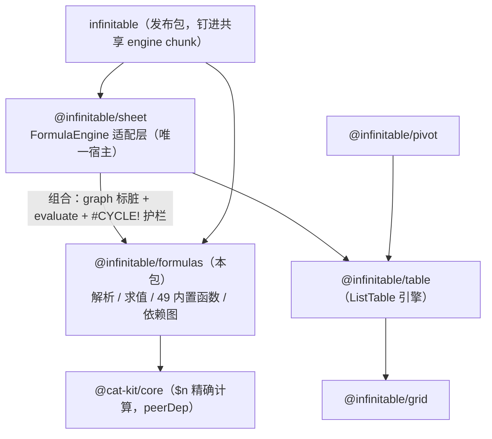

# 公式引擎（@infinitable/formulas）

纯函数式公式计算内核：A1 地址系统 + Pratt 解析 + 求值 + 49 个内置函数 + 函数注册表（全局 + 实例函数集双路径）+ 依赖图（`DependencyGraph`，增量失效的中枢）+ 编辑中容错引用扫描 + 引用平移。零表格语义、零 DOM：求值经 `FormulaResolver` 由宿主驱动，标脏经 `affectedBy` 传递闭包由图驱动——「解析/求值 + 依赖图」是它的全部职责。代码入口 `packages/formulas/src/index.ts`。

返回 [architecture.md](./architecture.md)

## 在整体架构中的位置

formulas 与 `@infinitable/grid` / `@infinitable/table` **互不依赖**（渲染链与公式链正交）：grid/table 不知道公式存在，formulas 也不知道 canvas 存在。求值接线全部在宿主侧——仓库内唯一宿主是 `@infinitable/sheet` 的 `FormulaEngine` 适配层（`packages/sheet/src/core/formula-engine.ts`），它组合本包的 `DependencyGraph`（标脏闭包）与 `evaluate`（逐格求值），自己只做图簿联动编排与 `#CYCLE!` 递归护栏，见 [sheet.md](./sheet.md)。唯一外部依赖是 `@cat-kit/core`（peerDependency，`$n` 精确计算）。



- grid / table / render 与 formulas 之间**没有任何依赖边**——ListTable（见 [list-table-engine.md](./list-table-engine.md)）与 pivot（见 [pivot-engine.md](./pivot-engine.md)）不带公式能力，公式是 sheet 领域层的增益。
- 下游把「公式函数」注册视为注册表插件挂载形态（插件挂载点分类见 [plugin-interface-map.md](./plugin-interface-map.md)）。
- 包消费统一走公共入口 `@infinitable/formulas`（package.json `exports` 仅有 `.`）；`sideEffects` 只声明 `./src/functions/**`——入口 `import './functions'` 副作用即完成 49 个内置函数注册。

## 核心概念

| 概念 | 类型或类名 | 代码位置 |
| --- | --- | --- |
| A1 地址（0 基坐标 + `$` 绝对标记 + 跨表名） | `CellRef` / `RangeRef` | `address.ts` |
| 地址换算与格式化 | `colLetters` / `parseCellRef` / `formatCellRef` / `createRangeRef` / `formatRangeRef` | `address.ts` |
| 公式错误值（7 种错误码 + 标记对象） | `FormulaError` / `formulaError` / `isFormulaError` / `isFormulaErrorCode` | `errors.ts` |
| 分词器（token 序列；token → 文本） | `FormulaParseError` / `tokenText`（`tokenizeFormula` 为包内深路径） | `tokenizer.ts` |
| 词法原语（引用/数字形态、ident 字符集、错误字面量匹配；tokenizer/parser/scan-refs 单一消歧口径） | `CELL_REF_RE` / `NUMBER_RE` / `isIdentStart` / `isIdentPart` / `matchErrorLiteral`（均为深路径） | `lexicon.ts` |
| Pratt 解析（文本 → AST） | `parseFormula` / `AstNode` | `parser.ts` / `ast.ts` |
| AST 求值（纯函数，resolver 注入） | `evaluate` / `FormulaResolver` / `FormulaEvalContext` / `EvalValue` / `ScalarValue` | `evaluator.ts` |
| 静态引用扫描（含 lazy 未求值分支）+ 易失探针 | `collectAstReferences` / `astHasVolatileCall` | `ast-refs.ts` |
| 依赖图（公式格 → 引用的反向索引，增量失效中枢） | `DependencyGraph` / `FormulaRefCoord` / `SheetCellCoord` | `dependency-graph.ts` |
| 编辑中容错引用扫描（染色框用，永不抛错） | `scanFormulaReferences` / `ScannedReference` | `scan-refs.ts` |
| 引用平移（行列插删改写公式文本；填充柄增量平移同源） | `shiftFormulaText` / `shiftFormulaRefs` / `FormulaShiftResult` | `shift.ts` |
| 函数注册表（全局，大小写不敏感，同名覆盖） | `registerFormulaFunction` / `getFormulaFunction` / `getFormulaFunctionInfo` / `listFormulaFunctions` / `FORMULA_FUNCTION_CATEGORIES` | `functions/registry.ts` |
| 函数定义（normal/lazy 双 kind + volatile + 元数据） | `FormulaFunction` / `FormulaFunctionInfo` / `FormulaFunctionCategory` / `FormulaFunctionOverrides` | `functions/registry.ts` |
| 内置函数集装配（副作用导入注册 49 个） | `functions/index.ts` → `math` / `statistics` / `logic` / `text` / `lookup` / `financial` / `datetime` | `functions/` |

## 公开面

`packages/formulas/src/index.ts` 显式导出（禁止 `export *`），分词 / 强制转换原语 / 签名格式化等是包内深路径能力，不占公共面：

| 模块 | 公开导出 |
| --- | --- |
| address | `colLetters` `createRangeRef` `formatCellRef` `formatRangeRef` `parseCellRef`；类型 `CellRef` `RangeRef` |
| errors | `formulaError` `isFormulaError` `isFormulaErrorCode`；类型 `FormulaError` |
| tokenizer | `FormulaParseError` `tokenText` |
| ast | 类型 `AstNode` |
| parser | `parseFormula` |
| ast-refs | `astHasVolatileCall` `collectAstReferences` |
| dependency-graph | `DependencyGraph`；类型 `FormulaRefCoord` `SheetCellCoord` |
| scan-refs | `scanFormulaReferences`；类型 `ScannedReference` |
| shift | `shiftFormulaText` `shiftFormulaRefs`；类型 `FormulaShiftResult` |
| evaluator | `evaluate`；类型 `EvalValue` `FormulaEvalContext` `FormulaResolver` `ScalarValue` |
| registry | `FORMULA_FUNCTION_CATEGORIES` `getFormulaFunction` `getFormulaFunctionInfo` `listFormulaFunctions` `registerFormulaFunction`；类型 `FormulaFunction` `FormulaFunctionCategory` `FormulaFunctionInfo` `FormulaFunctionOverrides` |

深路径（包内/测试消费，不入公共面）：`tokenizeFormula`、`parseColLetters`、`formatSheetName`、`FORMULA_ERROR_CODES`、`coerceToNumber/coerceToText/coerceToBoolean`、`isVolatileFormulaFunction`、`invokeFormulaFunction`、`formatFunctionSignature`、`shiftRange` 等。发布包把它整体钉进 `infinitable` 的共享 engine chunk（跨入口 `instanceof` 语义，见 [infinitable-package.md](./infinitable-package.md)）。

## 管线走读：文本 → token → AST → 值

四段纯函数管线，每段可独立消费：

```
公式文本（不含 '='）
  → tokenizeFormula          数字/字符串/ident/引号表名/错误字面量/运算符，不做语义消歧
  → Parser（Pratt）           ident 消歧：后随 ( → 函数调用；后随 ! → 表名前缀；
                              匹配单元格形态 → 引用；TRUE/FALSE → 布尔；其余 → name 节点
  → AstNode（10 种节点）      number/string/boolean/error/name/cell/range/unary/percent/binary/call
  → evaluateAst + ctx        字面量直出；cell/range 经 resolver 读宿主；call 经注册表分发
  → 标量 或 FormulaError
```

### 优先级与结合性（同 Excel）

| 优先级（低 → 高） | 运算符 | 说明 |
| --- | --- | --- |
| 1 | `= <> < <= > >=` | 比较；混合类型 数字 < 文本 < 布尔，文本比较大小写不敏感，空格归一为对方类型零值 |
| 2 | `&` | 文本连接（操作数强转文本） |
| 3 | `+ -` | 加减（`$n` 精确计算） |
| 4 | `* /` | 乘除（`$n`；除零 → `#DIV/0!`） |
| 5 | 一元 `+ -` | 操作数绑定力 6，**紧于幂次**：`-2^2 = (-2)^2 = 4` |
| 6 | `^` | 右结合（绑定力 `[6, 5]`）：`2^3^2 = 512` |
| 7 | `%` | 百分号后缀（除以 100），最高 |

### 地址编码

- 坐标统一 **0 基**：`{ col: 0, row: 0 }` 即 A1；`$` 绝对标记在解析时保留（供平移/填充改写，v1 求值不消费）。
- 跨表引用经可选 sheet 名表达：`Sheet2!A1`（裸表名）/ `'Sheet 2'!A1`（引号表名，`''` 转义字面单引号）；区域为闭区间，乱序角点经 `createRangeRef` 归一（start ≤ end，sheet 取起点引用）。
- 「列限 1–3 字母」是 parser / scan-refs 层的**引用形态判定**（`lexicon.ts` 的 `CELL_REF_RE`，防 `ABCD1`、`LOG10(` 误判）；`address.ts` 的 `parseCellRef` 是纯解析原语，本身不限列长。

### 错误码体系（7 种）

| 错误码 | 产出位置 |
| --- | --- |
| `#DIV/0!` | 除零 / `0^-1` 幂；AVERAGE 空集 |
| `#VALUE!` | 强转失败（如 `"abc"+1`）；参数个数越界（minArgs/maxArgs）；区域作终值（无数组公式）；查找函数参数形态非法 |
| `#NAME?` | 未知名称（非引用形态 ident）；未注册函数 |
| `#REF!` | resolver 抛错（未知表等）；查找列/行序号越界；平移中引用被删除区间覆盖（`#REF!` 占位） |
| `#N/A` | 查找未命中；RANK 目标不在数据集 |
| `#ERROR!` | 解析失败（`FormulaParseError` 被 `evaluate` 捕获）；宿主求值期异常兜底 |
| `#CYCLE!` | **本包不产出**——枚举保留，由宿主递归护栏产出（见下文） |

错误以 `FormulaError` 标记对象在求值器内传递，遇运算即传播（左操作数优先）；错误字面量（如 `#N/A`）可直接写在公式里，求值为对应错误值。

### 强转规则（Excel 语义）

| 目标 | 规则 |
| --- | --- |
| 数字 | 空格→0；TRUE/FALSE→1/0；数字文本（含科学计数）→数字；其余文本→`#VALUE!`；数组→`#VALUE!` |
| 文本 | 空格→`''`；数字→String；布尔→`TRUE`/`FALSE` |
| 布尔 | 空格→FALSE；数字≠0；`TRUE`/`FALSE` 文本；其余→`#VALUE!` |
| 聚合参数 | 区域展开（`fromRange`）内文本/布尔被忽略、只取同类型格；直接参数强转（非法→传播）——SUM/COUNT 等据此区分 Excel 语义 |

四则与 SUM/AVERAGE/ROUND/ABS 走 `@cat-kit/core` 的 `$n` 精确计算（`0.1+0.2 = 0.3`，结果仍 JS number）；空单元格作终值按 Excel 观感显示为 0（空字符串字面量参与算术仍是 `#VALUE!`）。

## 依赖图机制（增量失效的中枢）

`DependencyGraph` 是「公式格 → 静态引用」的**反向索引**，不存值、不求值——宿主登记边、宿主消费闭包。

| 结构 | 形态 | 查询成本 |
| --- | --- | --- |
| `formulas` | 公式格 key → 坐标（`size`/`has`/易失快照回查源） | O(1) |
| `deps` | 公式格 key → 依赖条目（remove 时按此清反向索引） | O(1) |
| `cellIndex` | sheet → `'col,row'` → 依赖该格的公式格 key 集（两级 Map） | 点查 O(1) |
| `rangeIndex` | sheet → 区域条目集（`{ range, owner }`） | 点查线性扫该表区域条目（区域条目数 ≈ 含区域引用的公式数，千级公式下开销可忽略；刻意不上区间树） |
| `volatileKeys` | 易失公式格 key 集 | `volatileCells()` 快照 |

公式格 key 用「长度前缀 + sheet」编码（`${sheet.length}#${sheet}|${col},${row}`）：sheet 名可含任意字符（含 `|`、`,` 本身），长度前缀保证无歧义。

**生命周期**：`setFormula(cell, refs, { volatile })` 全量替换该格旧边（先 `remove` 再建边，refs 按完全相同去重、cell 与 range 重叠不合并）；`remove(cell)` 清边（非公式格空操作）；`removeSheet(sheet)` 清该表全部公式格 + 其它表指向该表的边（表没了依赖无意义，引用方由宿主整表处理缓存）。

**标脏闭包 `affectedBy(changed)`**：直接或间接依赖 changed 中任一格的公式格（去重）。两段式：

1. 初始变更坐标按表分组批量点查——单格依赖逐点 O(1)；区域依赖把同表坐标合并为按行列区间（`mergeIntoRowSpans`，相邻列合并），每条目一次相交判定（`spansOverlap`）。连续矩形批量写（粘贴/填充/初始化）的区间数 ≪ 格数；随机分散时退化到 ≈ 逐格同阶，不更差。
2. 只有命中的公式格进 BFS 队列沿闭包继续扩散；原始变更坐标不进队列——百万级批量写只付一次批处理成本。空图（无公式格）直接返回空，跳过逐格遍历。

**易失函数（volatile）语义**：`RAND` / `RANDBETWEEN` / `TODAY` / `NOW` 在注册表带 `volatile: true` 标记。宿主在公式注册时经 `astHasVolatileCall`（静态探针，lazy 函数未求值分支内的易失调用也算）把公式格记入图内易失集；**任意**单元格变更触发的重算，宿主都把 `volatileCells()` 及其 `affectedBy` 闭包并入脏集——易失公式格无论是否依赖变更格都重算，且重算沿图向上传播给下游公式。

**循环检测为什么留给宿主护栏**：图只是静态引用反向索引，环上格在 `affectedBy` 闭包里照常出现（含自依赖），但「环」只有在**求值过程**中才可判定（依赖值传递路径）。递归求值护栏（在途栈 + memo）是宿主 `FormulaEngine` 的职责——回边出现时栈中自回边点起全部标 `#CYCLE!`，环外格只传播错误不入环。`evaluate` 本身无状态、无环概念，重复调用同一公式不会死循环（resolver 决定是否递归）。

## 内置函数注册表（49 个）

`functions/index.ts` 副作用导入装配 7 个实现文件，共 49 个内置函数（`listFormulaFunctions()` 枚举，registry.test.ts 以 `toHaveLength(49)` 守护），每个都带分类/描述/参数表元数据——公式栏补全、参数提示、函数面板的单一数据源。分类是展示口径（`meta.category`），与实现文件是两套维度：

| 分类（面板分组顺序） | 函数 | 数量 | 实现文件 |
| --- | --- | --- | --- |
| 常用 | SUM、ROUND、ABS、AVERAGE、MAX、MIN、COUNT、IF、AND、OR | 10 | `math.ts` / `statistics.ts` / `logic.ts` |
| 财务 | PMT、FV、PV、IPMT、PPMT | 5 | `financial.ts` |
| 日期与时间 | TODAY、NOW | 2 | `datetime.ts` |
| 数学 | RAND、RANDBETWEEN | 2 | `math.ts` |
| 统计 | COUNTA、COUNTIF、COUNTBLANK、MEDIAN、LARGE、SMALL、RANK | 7 | `statistics.ts` |
| 查找与引用 | VLOOKUP、HLOOKUP、MATCH、INDEX、CHOOSE、ROW、COLUMN | 7 | `lookup.ts` |
| 文本 | CONCATENATE、LEN、LEFT、RIGHT、MID、UPPER、LOWER、TRIM、EXACT、SUBSTITUTE、REPLACE | 11 | `text.ts` |
| 逻辑 | NOT、XOR、IFERROR、TRUE、FALSE | 5 | `logic.ts` |

横切语义：

- **易失**：RAND / RANDBETWEEN / TODAY / NOW（4 个，`volatile: true` 元数据，宿主缓存策略据此查询）。
- **lazy kind**（自行求值参数，共 9 个）：IF（短路分支）、COUNTBLANK（按引用节点几何推算空白数）、VLOOKUP / HLOOKUP / MATCH / INDEX（稀疏数组丢失位置信息，按 AST 引用节点取区域几何经 `ctx.readCell` 逐格回读）、CHOOSE（只求值被选参数）、ROW / COLUMN（省参时取 `ctx.currentCell`）。其余为 normal kind（参数先求值后传入 `impl(args, ctx)`）。
- **参数校验**：`invokeFormulaFunction` 统一执行——名称未知 → `#NAME?`；`minArgs`/`maxArgs` 越界 → `#VALUE!`；再按 kind 分发。
- **大小写不敏感**：注册与查询 key 均为大写形态（`sum(1,2)` 与 `SUM(1,2)` 等价）。
- **精确计算**：SUM/AVERAGE（`plusAll`/`$n.div`）、ROUND（`n().fixed` 半进位）、ABS、MEDIAN 偶数个均值、财务函数全程 `$n`。
- TODAY/NOW 返回 1900 系统序列数（本地时间，含 Lotus 伪闰日修正）；财务函数为等额年金族（Excel 符号约定：收入 pv 为正、付出 pmt 为负）。

## 自定义函数双路径（重点）

自定义函数有两条注册路径，覆盖关系与判据如下（实例函数集机制由 commit `b85a874` 落地）：

| 维度 | 全局注册表 | 实例函数集（overrides） |
| --- | --- | --- |
| API | `registerFormulaFunction(name, def)` | 宿主构造注入（`FormulaEngineOptions.functions`）/ 运行时 `FormulaEngine.registerFunction(name, def)`；求值侧经 `evaluate(formula, resolver, { functions })` |
| 作用域 | 模块级单例，全进程共享 | 每实例一份（`FormulaFunctionOverrides` = `ReadonlyMap`），与全局隔离、不改写全局 |
| 同名覆盖 | 覆盖全局（含内置函数），影响所有消费方 | 只覆盖本实例；**查询先于全局命中**，未命中回落全局（可覆盖内置，如实例集盖 SUM 只影响本簿） |
| 易失探针 | `astHasVolatileCall(ast)` 走全局 | `astHasVolatileCall(ast, overrides)` / 求值传 overrides 时先查实例集 |
| 元数据查询 | `getFormulaFunctionInfo` / `listFormulaFunctions` 可见 | **不可见**（元数据查询只枚举全局注册表；实例函数仅参与求值与易失判定） |
| 多工作簿 | 互相串扰，无法按簿覆盖 | 天然隔离：多工作簿各持各的函数集 |
| 适用场景 | 全局兜底便捷路径：应用级通用函数、无多实例隔离诉求 | 默认推荐：sheet 宿主（`Workbook({ functions })`）、测试隔离、按簿差异化内置行为 |

命中顺序（`getFormulaFunction(name, overrides)` 的实现即判据）：

```
overrides.get(name.toUpperCase())  ??  registry.get(name.toUpperCase())
└─ 实例函数集先命中（求值 invokeFormulaFunction 与易失探针同此顺序）   └─ 回落全局注册表（内置 49 个在此）
```

运行时注册注意（`FormulaEngine.registerFunction` 口径）：此后**新求值**立即生效；已写入的公式格（含此前的 `#NAME?` 格）不自动重算——经 `FormulaEngine.recalcAll()` / `Workbook.recalcAllFormulas()` 全量追溯。易失标记是公式注册时的快照，运行时增补 volatile 函数不追溯已注册公式节点（新写入公式全链路生效）。

## 宿主接线：FormulaEngine（@infinitable/sheet）

`FormulaEngine` 是 sheet 模型对本包的唯一消费层，**组合而非重建**——依赖索引用 `DependencyGraph`，求值用 `evaluate`，本层只做编排：

| 编排职责 | 实现 | 本包对应能力 |
| --- | --- | --- |
| 图状态同步 | `syncCell`（经 `Sheet.applyPatch` 唯一变更通道，命令/undo/redo/rollback 全覆盖）f 增删改 → `registerFormula` / `graph.remove`；`rebuildSheet` 整表重建 | `parseFormula` + `collectAstReferences`（裸引用归一到公式所在表）+ `astHasVolatileCall`（易失标记）+ `graph.setFormula` |
| 增量重算 | `recalc(changed)`：变更格 ∩ 公式格 + `affectedBy(coords)` + `volatileCells()` + `affectedBy(volatile)` 并成脏集 | `graph.affectedBy` / `graph.volatileCells` |
| 求值驱动 | `evaluateDirty`：递归向下（依赖先于使用）、memo 每格最多算一次、值收敛不产冗余补丁；派生补丁只写 v/t 保留样式 | `evaluate(formula, resolver, { sheet, cell, functions })`；resolver 读 store 稀疏格 |
| `#CYCLE!` 护栏 | `evaluateCoord` 在途栈遇回边 → 栈中自回边点起全部入环标 `#CYCLE!`，环外格只传播错误 | 本包仅保留错误码枚举 |
| 表生命周期 | `unregisterSheet`（先 `affectedBySheet` 收集引用方 → `removeSheet` → 引用方重算 `#REF!`）；`renameSheet`（别名链拍平，AST 旧名引用经别名解析，公式文本不重写） | `graph.affectedBySheet` / `graph.removeSheet` / `graph.formulasOf` |
| 实例函数集 | 构造 `options.functions` → 内部 Map（key 大写）；`registerFunction` 运行时增补；`recalcAll` 全量追溯 | `evaluate` 的 `functions` 选项 + `astHasVolatileCall` 的 overrides |
| 求值期异常兜底 | 自定义函数抛错不击穿重算 → 记 `#ERROR!` | — |

细节：lazy 查找函数（VLOOKUP/MATCH 等）按 AST 取区域几何逐格回读时绕过求值器的缺省表填充（`ref.sheet` 为 undefined 到达 resolver）——引擎在递归求值时保存/恢复「当前表」路由裸引用；区域读取只迭代稀疏存在的格（空格不进数组，聚合语义由函数层决定）。完整模型/命令/undo 口径见 [sheet.md](./sheet.md)。

## 示例集

以下示例改编自测试（逐条标注取材来源），`bun test` / vitest 环境可直接运行；`@infinitable/formulas` 的公开 API 均可脱离表格实例消费。

### 1. 地址编码与解析

```ts
// 取材 packages/formulas/tests/address.test.ts
import { colLetters, parseCellRef, formatCellRef, createRangeRef, formatRangeRef } from '@infinitable/formulas'

colLetters(0)   // 'A'
colLetters(26)  // 'AA'
colLetters(701) // 'ZZ'
parseCellRef('$A$1')  // { col: 0, row: 0, colAbsolute: true, rowAbsolute: true } —— 0 基坐标
parseCellRef('c10')   // { col: 2, row: 9, colAbsolute: false, rowAbsolute: false }（大小写不敏感）
parseCellRef('A0')    // null（行号从 1 起）

// 区域构造：乱序角点归一（start ≤ end，sheet 取起点引用）
const range = createRangeRef(parseCellRef('D5')!, parseCellRef('B2')!)
range                    // { startCol: 1, startRow: 1, endCol: 3, endRow: 4 }
formatRangeRef(range)    // 'B2:D5'
formatCellRef({ ...parseCellRef('A1')!, sheet: 'Sheet 2' })  // "'Sheet 2'!A1"（不安全表名自动引号包裹）
```

### 2. 公式解析：文本 → AST

```ts
// 取材 packages/formulas/tests/parser.test.ts
import { parseFormula } from '@infinitable/formulas'

parseFormula('42')      // { kind: 'number', value: 42 }
parseFormula('TRUE')    // { kind: 'boolean', value: true }（parser 归约，非函数）
parseFormula('$A$1')    // { kind: 'cell', ref: { col: 0, row: 0, colAbsolute: true, rowAbsolute: true } }
parseFormula('B3:A1')   // { kind: 'range', ref: { startCol: 0, startRow: 0, endCol: 1, endRow: 2 } }
parseFormula('Sheet2!A1')  // { kind: 'cell', ref: { sheet: 'Sheet2', col: 0, row: 0, ... } }
parseFormula('ABCD1')   // { kind: 'name', name: 'ABCD1' }（列超 3 字母不作引用 → 求值 #NAME?）
parseFormula('SUM(A1, B1:B2)')  // { kind: 'call', name: 'SUM', args: [{ kind: 'cell' }, { kind: 'range' }] }
parseFormula('')        // 抛 FormulaParseError（evaluate 捕获后 → #ERROR!）
```

### 3. 求值器直用：算术 / 比较 / 文本拼接（无引用形态）

```ts
// 取材 packages/formulas/tests/evaluator.test.ts；EMPTY_RESOLVER 即 cell: () => null, range: () => []
import { evaluate, isFormulaError } from '@infinitable/formulas'

const empty = { cell: () => null, range: () => [] }
evaluate('0.1+0.2', empty)   // 0.3（$n 精确计算，非 0.30000000000000004）
evaluate('19.9*100', empty)  // 1990
evaluate('2^3^2', empty)     // 512（幂右结合）
evaluate('-2^2', empty)      // 4（一元紧于幂：(-2)^2）
evaluate('10%', empty)       // 0.1（百分号后缀）
evaluate('1/0', empty)       // FormulaError { code: '#DIV/0!' }
evaluate('"a"&1', empty)     // 'a1'（& 连接强转文本）
evaluate('"a"="A"', empty)   // true（文本比较大小写不敏感）
evaluate('1<"a"', empty)     // true（混合类型 数字 < 文本 < 布尔）
isFormulaError(evaluate('1 +', empty))  // true（解析失败 → #ERROR!）
```

### 4. 宿主 resolver 注入：跨格引用 / 区域 / 跨表

```ts
// 取材 packages/formulas/tests/evaluator.test.ts 与 tests/testing/fake-resolver.ts
import { colLetters, evaluate } from '@infinitable/formulas'

/** 内存多表假 resolver：'A1' 键值地图 + 空格不进数组（稀疏语义，镜像 SheetBook 宿主） */
function createBook(book: Record<string, Record<string, unknown>>, defaultSheet = Object.keys(book)[0]) {
  const sheets = new Map(
    Object.entries(book).map(([name, cells]) => [name, new Map(Object.entries(cells))]),
  )
  return {
    cell: (ref: { sheet?: string; col: number; row: number }) => {
      const sheet = sheets.get(ref.sheet ?? defaultSheet)
      return sheet?.get(`${colLetters(ref.col)}${ref.row + 1}`) ?? null
    },
    range: (ref: { sheet?: string; startCol: number; startRow: number; endCol: number; endRow: number }) => {
      const sheet = sheets.get(ref.sheet ?? defaultSheet)
      const values: unknown[] = []
      for (let row = ref.startRow; row <= ref.endRow; row++)
        for (let col = ref.startCol; col <= ref.endCol; col++) {
          const value = sheet?.get(`${colLetters(col)}${row + 1}`)
          if (value != null) values.push(value) // 先行后列展开；空格不进数组
        }
      return values
    },
  }
}

const resolver = createBook({ Sheet1: { A1: 7, A2: 5, B1: 1, B2: 2 } })
evaluate('A1+A2', resolver)        // 12
evaluate('SUM(A1:B2)', resolver)   // 15
evaluate('A1+1', resolver)         // 8（空格按 0：A3 未登记 → null → 0）

const cross = createBook({ Sheet1: {}, Sheet2: { A1: 41, A2: 1 } })
evaluate('Sheet2!A1+1', cross)             // 42
evaluate('SUM(Sheet2!A1:A2)', cross)       // 42
// options.sheet 填入裸引用缺省表名；options.cell 供 ROW()/COLUMN() 省参
evaluate('A1*2', cross, { sheet: 'Sheet2' })              // 82
evaluate('ROW()', cross, { cell: { col: 2, row: 4 } })    // 5（1 基行号）
evaluate('COLUMN()', cross, { cell: { col: 2, row: 4 } }) // 3
```

### 5. 依赖图：登记 → 变更 → 标脏闭包 → 增量重算完整链

```ts
// 取材 packages/formulas/tests/dependency-graph.test.ts
import { DependencyGraph } from '@infinitable/formulas'

const graph = new DependencyGraph()
const cell = (sheet: string, col: number, row: number) => ({ sheet, col, row })

// 登记：S1!B1 = S1!A1；S1!C1 = S1!B1；S2!A1 = S1!C1（宿主注册前已把裸引用归一到规范 sheet id）
graph.setFormula(cell('S1', 1, 0), [{ kind: 'cell', ref: cell('S1', 0, 0) }])
graph.setFormula(cell('S1', 2, 0), [{ kind: 'cell', ref: cell('S1', 1, 0) }])
graph.setFormula(cell('S2', 0, 0), [{ kind: 'cell', ref: cell('S1', 2, 0) }])

const sorted = (coords: ReturnType<DependencyGraph['affectedBy']>) =>
  coords.map((c) => `${c.sheet}!${c.col},${c.row}`).sort()

sorted(graph.affectedBy([cell('S1', 0, 0)]))  // ['S1!1,0', 'S1!2,0', 'S2!0,0'] —— 三级传递闭包
sorted(graph.affectedBy([cell('S1', 2, 0)]))  // ['S2!0,0'] —— 中游变更只波及下游

// 区域依赖（换新图，对齐测试的独立场景）：S1!A1 = SUM(S1!B2:D5)
const regionGraph = new DependencyGraph()
regionGraph.setFormula(cell('S1', 0, 0), [
  { kind: 'range', ref: { sheet: 'S1', startCol: 1, startRow: 1, endCol: 3, endRow: 4 } },
])
sorted(regionGraph.affectedBy([cell('S1', 2, 2)]))  // ['S1!0,0']（区域内）
regionGraph.affectedBy([cell('S1', 4, 2)])          // []（区域外，列越界）

// 重复 setFormula 全量替换旧边：旧依赖变更不再波及
graph.setFormula(cell('S1', 1, 0), [{ kind: 'cell', ref: cell('S1', 5, 5) }])
graph.affectedBy([cell('S1', 0, 0)])          // []（B1 已不依赖 A1）
// 宿主拿到闭包后自行逐格重算（evaluateDirty 编排在宿主，见 sheet.md）
```

### 6. 易失函数：静态探针 + 图内易失集

```ts
// 取材 packages/formulas/tests/ast-refs.test.ts 与 tests/dependency-graph.test.ts
import { DependencyGraph, astHasVolatileCall, getFormulaFunctionInfo, parseFormula } from '@infinitable/formulas'

astHasVolatileCall(parseFormula('TODAY()'))                 // true
astHasVolatileCall(parseFormula('IF(FALSE, NOW(), 1)'))     // true（未求值分支内的易失调用也算——纯静态扫描）
astHasVolatileCall(parseFormula('SUM(A1, RAND())'))         // true（嵌套命中）
astHasVolatileCall(parseFormula('NOSUCHFN(A1)'))            // false（未注册 = 非易失）
getFormulaFunctionInfo('RAND')?.volatile                    // true（元数据查询）
getFormulaFunctionInfo('TODAY')?.signature                  // 'TODAY()'

// 宿主在公式注册时把易失公式格记入图内易失集；任意变更后 volatileCells() 并入脏集
const graph = new DependencyGraph()
graph.setFormula({ sheet: 'S1', col: 0, row: 0 }, [], { volatile: true })
graph.volatileCells()  // [{ sheet: 'S1', col: 0, row: 0 }]
graph.setFormula({ sheet: 'S1', col: 0, row: 0 }, [])  // 重注册不带 volatile → 出易失集
graph.volatileCells()  // []
```

### 7. 全局自定义函数：registerFormulaFunction（兜底路径）

```ts
// 取材 packages/formulas/tests/functions/registry.test.ts
import { evaluate, getFormulaFunctionInfo, registerFormulaFunction } from '@infinitable/formulas'

registerFormulaFunction('DOUBLE', {
  minArgs: 1,
  maxArgs: 1,
  meta: { params: [{ name: 'value' }], description: '翻倍', category: '数学' },
  impl: (args) => (typeof args[0] === 'number' ? args[0] * 2 : 0),
})

const empty = { cell: () => null, range: () => [] }
evaluate('double(21)', empty)                    // 42（注册与查询大小写不敏感）
getFormulaFunctionInfo('DOUBLE')?.category       // '数学'（元数据进面板）
evaluate('DOUBLE()', empty)                      // FormulaError { code: '#VALUE!' }（minArgs 校验）
registerFormulaFunction('DOUBLE', { impl: () => 'covered' })  // 同名覆盖全局
evaluate('DOUBLE(21)', empty)                    // 'covered'
```

### 8. 实例函数集：evaluate 注入 + 覆盖内置（不写全局）

```ts
// 取材 packages/formulas/tests/functions/registry.test.ts「实例函数集（overrides）」
import { evaluate, getFormulaFunction } from '@infinitable/formulas'
import type { FormulaFunction, FormulaFunctionOverrides } from '@infinitable/formulas'

const overrides: FormulaFunctionOverrides = new Map<string, FormulaFunction>([
  ['ADDER', { minArgs: 2, maxArgs: 2, impl: (args) => Number(args[0]) + Number(args[1]) + 100 }],
  ['ABS', { impl: () => 'overridden' }],                     // 覆盖内置
  ['MYRAND', { volatile: true, impl: () => 1 }],             // 易失实例函数
])

const empty = { cell: () => null, range: () => [] }
getFormulaFunction('adder', overrides)?.minArgs   // 2（实例集先命中）
getFormulaFunction('sum', overrides)              // 内置 SUM（未命中回落全局）

evaluate('ADDER(1,2)', empty, { functions: overrides })  // 103
evaluate('ADDER(1,2)', empty)                            // #NAME?（不传实例集则不存在——不写全局）
evaluate('ABS(-1)', empty, { functions: overrides })     // 'overridden'（实例集盖内置）
evaluate('ABS(-1)', empty)                               // 1（全局侧不受影响）
evaluate('ADDER(1)', empty, { functions: overrides })    // #VALUE!（实例集同走 minArgs/maxArgs 校验）

// 易失探针感知实例集
import { astHasVolatileCall, parseFormula } from '@infinitable/formulas'
const ast = parseFormula('MYRAND()+SUM(1,2)')
astHasVolatileCall(ast, overrides)  // true
astHasVolatileCall(ast)             // false（全局未注册）
```

### 9. 多工作簿隔离：构造 functions（宿主形态）

```ts
// 取材 packages/sheet/tests/core/formula-engine.test.ts「实例函数集（自定义公式）」
import { Workbook } from '@infinitable/sheet'
import type { EvalValue } from '@infinitable/formulas'

const MYFUNC = {
  minArgs: 1,
  maxArgs: 1,
  impl: (args: EvalValue[]) => (typeof args[0] === 'number' ? args[0] * 10 : 0),
}

const a = new Workbook({ functions: { MYFUNC } })
const b = new Workbook()  // 未提供实例集
for (const wb of [a, b]) {
  wb.activeSheet.setCellValue({ row: 0, col: 0 }, 3)
  wb.activeSheet.setCellFormula({ row: 0, col: 1 }, '=MYFUNC(A1)')
}
a.activeSheet.getCellData({ row: 0, col: 1 })  // { v: 30, ... }
b.activeSheet.getCellData({ row: 0, col: 1 })  // { v: '#NAME?', t: 'e' } —— 实例集不写全局注册表

// 实例集盖内置 SUM 只影响本簿
const c = new Workbook({ functions: { SUM: { impl: () => -1 } } })
const d = new Workbook()
c.activeSheet.setCellFormula({ row: 0, col: 0 }, '=SUM(1,2)')
d.activeSheet.setCellFormula({ row: 0, col: 0 }, '=SUM(1,2)')
c.activeSheet.getCellData({ row: 0, col: 0 })  // { v: -1 }
d.activeSheet.getCellData({ row: 0, col: 0 })  // { v: 3 }（内置 SUM 不受影响）
```

### 10. 运行时 registerFunction + recalcAllFormulas 追溯

```ts
// 取材 packages/sheet/tests/core/formula-engine.test.ts
import { Workbook } from '@infinitable/sheet'

const wb = new Workbook()
const sheet = wb.activeSheet
sheet.setCellFormula({ row: 0, col: 1 }, '=MYFUNC(7)')
sheet.getCellData({ row: 0, col: 1 })  // { v: '#NAME?', t: 'e' }

wb.formulaGraph.registerFunction('MYFUNC', {
  minArgs: 1, maxArgs: 1,
  impl: (args) => (typeof args[0] === 'number' ? args[0] * 10 : 0),
})
// 此后新写入的公式立即求值成功
sheet.setCellFormula({ row: 0, col: 2 }, '=MYFUNC(2)')
sheet.getCellData({ row: 0, col: 2 })  // { v: 20 }
// 已写入的 #NAME? 格不随其它格变更自动重算（不依赖任何格）——全量重算追溯
wb.recalcAllFormulas()
sheet.getCellData({ row: 0, col: 1 })  // { v: 70 }
```

### 11. scanFormulaReferences：编辑中容错扫描（半成品公式）

```ts
// 取材 packages/formulas/tests/scan-refs.test.ts
import { scanFormulaReferences } from '@infinitable/formulas'

// 染色框：start/end 为原文本字符偏移（end 排他），span 含表名前缀；兼容前导 '='
scanFormulaReferences('=A1')[0]        // { ref: { col: 0, row: 0, ... }, isRange: false, start: 1, end: 3 }
scanFormulaReferences('SUM(A1, B2)')   // 两条：span [4,6) 与 [8,10)——函数名被跳过
scanFormulaReferences('Sheet2!A1')[0]  // span [0,9)：前缀计入染色范围
scanFormulaReferences('LOG10(100)')    // []（后随 '(' 的 ident 是函数名，不是引用）
scanFormulaReferences('"a""B2" & C3')  // 只报 C3——字符串字面量内不扫描
scanFormulaReferences('1E5')           // []（科学计数数字不产生 E5 假引用）

// 容错：编辑中的半截公式永不抛错，「扫到多少算多少」
scanFormulaReferences('SUM(A1,')       // 仍报 A1（缺右括号）
scanFormulaReferences('A1:')           // 尾巴非法退化只报 A1
scanFormulaReferences("'abc")          // []（未闭合引号表名）
scanFormulaReferences('"abc')          // []（未闭合字符串）
```

### 12. FormulaEngine 宿主接线全链：增量重算与 #CYCLE! 护栏

```ts
// 取材 packages/sheet/tests/core/formula-engine.test.ts
import { Sheet } from '@infinitable/sheet'

const sheet = new Sheet()
const A1 = { row: 0, col: 0 }, B1 = { row: 0, col: 1 }, C1 = { row: 0, col: 2 }

// 拓扑序重算：A1 → B1(=A1*2) → C1(=B1+1)，宿主驱动 evaluate、图驱动标脏
sheet.setCellValue(A1, 1)
sheet.setCellFormula(B1, '=A1*2')
sheet.setCellFormula(C1, '=B1+1')
sheet.getCellData(C1)  // { v: 3, ... }
sheet.setCellValue(A1, 5)
sheet.getCellData(B1)  // { v: 10 }（若顺序错误 C1 会拿到旧 B1）
sheet.getCellData(C1)  // { v: 11 }

// 循环：环上双格 #CYCLE!（宿主递归护栏产出）；打破循环自动恢复
sheet.setCellFormula(A1, '=B1+1')
sheet.setCellFormula(B1, '=A1+1')
sheet.getCellData(A1)  // { v: '#CYCLE!', t: 'e' }
sheet.getCellData(B1)  // { v: '#CYCLE!', t: 'e' }
sheet.setCellValue(B1, 5)
sheet.getCellData(A1)  // { v: 6, t: 'n' }
```

### 13. 引用平移：行列插删改写公式文本

```ts
// 取材 packages/formulas/tests/formula-shift.test.ts（sheet 模型插删行列时消费；填充柄增量平移同源）
import { shiftFormulaText, shiftFormulaRefs } from '@infinitable/formulas'

shiftFormulaText('A5+1', 'rows', 2, 3, 'insert').text          // 'A8+1'（插入点之后下移）
shiftFormulaText('SUM(A1:B3)', 'rows', 2, 2, 'insert').text    // 'SUM(A1:B5)'（插入点在区域内 → 扩展）
shiftFormulaText('Sheet2!A5*2+SUM(C1:C3)', 'rows', 2, 1, 'insert').text  // 'Sheet2!A6*2+SUM(C1:C4)'
shiftFormulaText('A$5+1', 'rows', 2, 3, 'insert').text         // 'A$5+1'（行绝对不随行平移）
const broken = shiftFormulaText('A3+1', 'rows', 2, 2, 'delete')  // 删除区间覆盖引用
broken  // { text: '#REF!+1', broken: true }（调用方决定落库策略）

shiftFormulaRefs('$A$1+A1', 1, 1)  // '$A$1+B2'（填充柄复制语义：绝对轴锁定，delta 平移）
```

## 测试与验证入口

测试位于 `packages/formulas/tests/`（vitest；根命令 `vp test run`），示例的取材来源即此：

| 测试文件 | 覆盖 |
| --- | --- |
| `address.test.ts` | 列字母换算 / A1 解析（$ 绝对）/ 区域规范化 / 跨表格式化 |
| `errors.test.ts` | 7 种错误码 / 标记构造与判定 |
| `tokenizer.test.ts` | 数字（科学计数）/ 字符串 / ident / 引号表名 / 错误字面量 / 运算符 |
| `parser.test.ts` | 优先级与结合性 / 引用消歧 / 跨表 / 函数调用 / 解析失败 |
| `evaluator.test.ts` | 四则精确计算 / 强转 / 比较 / 错误传播 / 引用与跨表 / 终值形态 |
| `ast-refs.test.ts` | 静态引用收集（含 lazy 分支）/ 易失调用检测 |
| `dependency-graph.test.ts` | 边注册/替换/移除/整表清理 / 传递闭包 / 循环 / 区域点查 / 易失集 / 15 万级批量输入 / 随机图差分等价（30 轮） |
| `scan-refs.test.ts` | 容错扫描 / 跨表前缀 / 跳过项 / 半截公式不抛错 |
| `formula-shift.test.ts` / `row-col-shift.test.ts` | 行列插删平移 / 填充柄增量平移 / 坐标层平移口径 |
| `functions/*.test.ts`（8 个） | 数学 / 统计 / 逻辑 / 文本 / 查找 / 财务 / 日期 / 注册表与实例函数集（`registry.test.ts` 含 49 函数计数守护） |
| `packages/sheet/tests/core/formula-engine.test.ts` | 宿主口径等价：依赖重算 / 循环 / 跨表 / 错误值 / undo 集成 / 实例函数集（多簿隔离、覆盖内置、运行时注册） |

## 边界与红线

- **无数组公式**：区域引用只作为函数参数形态出现（展开为数组）；区域作为最终结果求值为 `#VALUE!`（v1 明确不做，后续单独立项）。
- **循环检测不在本包**：`#CYCLE!` 枚举保留、由宿主递归护栏产出（sheet 适配层的在途栈 + memo）；`DependencyGraph` 是静态反向索引，环上格照常进标脏闭包。
- **不依赖 grid/table**：formulas 与渲染链正交，求值接线在宿主侧（packages/sheet 的 FormulaEngine 适配层）；grid/table 侧不带公式能力。
- **宿主驱动求值**：`evaluate` 纯函数、不持状态；单元格读取是求值的唯一外部依赖（`FormulaResolver`），空格/未知表的语义由宿主决定（约定：空格返回 null，未知表回落 `#REF!`）。
- **公共面克制**：分词 / AST 细节 / 强制转换原语为包内深路径能力，不占公共面；公共入口显式导出、禁止 `export *`。
- **全局注册表是模块级单例**：`registerFormulaFunction` 同名覆盖影响全进程；多工作簿 / 测试隔离场景一律走实例函数集。
