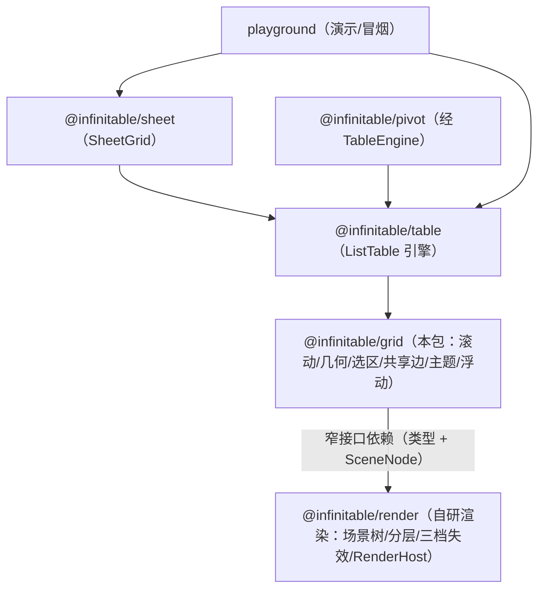

# 共享网格内核（@infinitable/grid）

自旧 core 拆出的通用网格机器：滚动状态机、行列几何与虚拟窗口、画布滚动条、触控惯性、共享边、合并区/选区状态、浮动对象层与主题投影——不含任何表格领域语义，供 table/sheet/pivot 与任意自研网格宿主复用。代码入口 `packages/grid/src/index.ts`。返回 [architecture.md](./architecture.md)。

## 在整体架构中的位置

grid 是渲染层之上的第一个「网格语义」层：只依赖 `@infinitable/render` 的窄接口（`Region` / `LayerHandle` / `SceneNode` / `RenderContext` / `SceneEvent` / `RenderImageSource` 类型 + `SceneNode` 类），不依赖任何 vrender 系列包；对下消费渲染原语，对上向 table（ListTable 引擎，见 [list-table-engine.md](./list-table-engine.md)）、sheet（见 [sheet.md](./sheet.md)）、pivot（经 table，见 [pivot-engine.md](./pivot-engine.md)）、playground 输出网格原语。protocol 契约包（见 [engine-assembly-protocol.md](./engine-assembly-protocol.md)）只依赖 grid 的类型。



消费关系三类：**引擎装配**（table 把 ScrollManager 广播接到场景窗口重建与 band 失效）、**纯函数直用**（playground/宿主直接用前缀和与窗口计算搭自研网格）、**协议词汇**（protocol 的格坐标/选区快照词汇来自 grid 类型）。包间消费统一走公共入口 `@infinitable/grid`（package.json `exports` 仅有 `.`，无 `./src/*` 深路径）。

## 核心概念

| 概念 | 类型或类名 | 代码位置 |
| --- | --- | --- |
| 唯一滚动状态源 | `ScrollManager` / `ScrollState` / `ScrollDelta` | `scroll-manager.ts` |
| 列宽/行高前缀和 | `computeColOffsets` / `computeRowOffsets` | `grid-layout.ts` |
| 虚拟滚动窗口 | `computeScrollableColWindow` / `computeScrollableRowWindowFromOffsets` / `expandWindowRange` / `WindowRange` | `grid-layout.ts` |
| 二分命中（坐标↔行列） | `findColAt` / `findRowAt` | `grid-layout.ts` |
| 冻结带几何（固定/平移换算） | `clampFrozenCount` / `resolveCellX` / `resolveCellYFromOffsets` | `grid-layout.ts` |
| 跨度与包围盒 | `spanWidth` / `spanHeight` / `unionRegions` | `grid-layout.ts` |
| 画布内建滚动条几何 | `planScrollbarThumb` / `hitScrollbar` / `mapScrollbarThumbDrag` / `mapScrollbarTrackPoint` / `MIN_SCROLLBAR_THUMB_PX` / `ScrollbarThumbGeometry` / `ScrollbarHit` | `scrollbar.ts` |
| 滚动条配置归一化 | `resolveScrollbarConfig` / `ScrollbarConfig` / `ScrollbarOptions` / `ScrollbarMode` | `scrollbar.ts` / `types.ts` |
| 原生滚动条装配 | `NativeScrollbarHost` | `native-scrollbar.ts` |
| 触控惯性 | `TouchScrollTracker` / `InertiaScroller` | `touch-scroll.ts` |
| 合并区（cell-range） | `CellRange` / `normalizeCellRange` / `sanitizeMerges` / `MergeCellMap` / `MergeOverlapError` / `cellKey` / `rangeCrossesBoundary` | `cell-range.ts` |
| 选区状态机 | `SelectionState` / `SelectionRange` / `SelectionSnapshot` / `normalizeRange` | `selection.ts` |
| 共享边裁决 | `resolveSharedEdges` / `strongerEdge` | `shared-edges.ts` |
| 逐格样式词汇 | `CellStyle` / `CellBorder` / `CellBorderEdge` 等 | `cell-style.ts` |
| 主题投影 | `defaultTheme` / `extendsTheme` / `themeCellBase` / `opaqueHeaderHighlight` / `TableTheme` / `ThemeOverride` | `theme.ts` |
| 格坐标引用 | `CellRef` | `types.ts` |
| 浮动对象层 | `FloatObjectLayer` / `FloatObject` | `float/float-object-layer.ts` |
| 图片资源服务 | `ImageService` | `media/image-service.ts` |
| 媒体绘制助手 | `drawFittedImage` / `fittedRect` / `paintImagePlaceholder` / `bodyViewportClip` / `MEDIA_CELL_BACKGROUND` / `ImageFit` | `media/draw-image.ts` |

## 模块分层

| 层 | 模块 | 触 render | 触 DOM | 说明 |
| --- | --- | --- | --- | --- |
| G1 纯函数几何 | `grid-layout` / `cell-range` / `shared-edges` / `cell-style` / `theme` / `scrollbar`（几何部分） | 否（`Region` 类型除外） | 否 | 纯函数/纯类型，可在任意宿主与测试环境直接消费 |
| G1 状态机 | `scroll-manager` / `selection` / `touch-scroll` | 否 | 否 | 只持状态与广播，帧调度可注入 |
| G2 渲染承载 | `float/float-object-layer` | 是（SceneNode/LayerHandle/失效） | 否 | 浮动对象独立对象树，挂宿主提供的层 root 最顶 |
| G2 媒体 | `media/image-service` / `media/draw-image` | 是（RenderContext/RenderImageSource） | 否（缺省加载器用 DOM `Image`，可注入） | 窗口化加载 + 位图 LRU + fit 绘制 |
| G3 DOM 装配 | `native-scrollbar` | 否 | 是 | 仅 `mode: 'native'` 时由 table 装配；文档源可注入（SSR/测试） |

关键分工：**grid 不知道「表格」**——没有列定义、数据供给、表头层级、编辑器等概念（这些在 table，见 [list-table-engine.md](./list-table-engine.md)）；它只提供「网格机器」：行列坐标系上的滚动、窗口、命中、选区、边框裁决与样式词汇。

## 关键机制走读

### ScrollManager：唯一滚动源

`scroll-manager.ts` 全部状态收敛为 `left/top` 两个数与 `contentWidth/contentHeight/viewportWidth/viewportHeight` 四个边界量：

- **写入口只有 `scrollTo` / `scrollBy`**（代码滚动、滚动条拖拽、触控惯性、原生容器同步、键盘导航最终都调这里）。目标值夹取到 `[0, maxLeft] × [0, maxTop]`（`max = max(0, content − viewport)`）；夹取后位移为零**不广播**——`scrollBy(0, 0)`、越界滚动、等值回写都静默。
- **广播契约 `(state, delta)`**：listener 同时拿到绝对位置与增量。增量是消费方分层失效的依据（见下）。
- **边界变化自愈**：`setContentSize` / `setViewportSize` 经 `clampIntoBounds` 重夹取——内容缩小（如删行）后超界位置自动修正并广播一次修正位移，消费方无需特判。
- table 的口径（`list-table.ts`）：`scroll.setViewportSize(viewportWidth − frozenColsWidth, viewportHeight − frozenRowsHeight)`、`setContentSize(contentWidth − frozenColsWidth, contentHeight − frozenRowsHeight)`——**滚动位置定义在「可滚动内容」（总内容扣除冻结区）上**，grid-layout 的窗口函数按同一口径换算。

**增量维护可视窗口与 band 失效如何进 render 主循环**（table 侧消费，`list-table.ts` 的 `onScroll` + `list-table-scene.ts`）：

1. `scroll.onScroll((_state, delta) => this.onScroll(delta))` 单点订阅；
2. `onScroll` 先跑 `updateSceneWindow`：用 `computeScrollableRowWindowFromOffsets` / `computeScrollableColWindow` 求新滚动带窗口，`expandWindowRange` 两端扩 overscan 做滚动缓冲，再由 table 侧 `clampWindowToScrollableBand` 回收冻结带边界——窗口只补建新滑入的行列节点、摘除滑出的，不整树重建；
3. 按 `delta` 方向分层提交 **band 失效**：`delta.dy !== 0` 时 `host.submitInvalidation('body', { type: 'band', region: 冻结行之下的横带 })`（`region.y = headerHeight + frozenRowsHeight`）；`delta.dx !== 0` 同理提交冻结列以右的纵带。media 层跟随提交。冻结角与对侧冻结区**不重绘**；
4. render 主循环（见 [render-engine.md](./render-engine.md)）把当帧多次 band/region/full 失效收敛为一帧重绘——这就是「三档失效」语言：滚动产出 band、交互产出 region、无可靠边界时 full。

「唯一滚动源」的价值：滚轮、触控板、内建滚动条拖拽/点按、原生滚动容器、惯性滚动、`scrollToCell` 六路输入共享同一条夹取/广播/失效链路，任何一处的滚动语义（边界、增量、静默）都天然一致，无双滚口径分歧。

### GridLayout：前缀和、虚拟窗口与二分命中

`grid-layout.ts` 是纯函数族，核心数据结构是**前缀和数组**：`computeColOffsets(colWidths)` 产出 `offsets[i] = 第 i 列左缘的内容坐标`，长度为列数 + 1，末项即内容总宽；`computeRowOffsets(rowCount, defaultRowHeight, rowHeights?)` 支持逐行高度覆盖（行 resize 产物，`Map<行号, 高度>`）。

- **虚拟窗口**：`computeScrollableColWindow(scrollLeft, viewportWidth, colOffsets, frozenColCount)` 返回滚动区可见列区间 `[start, end)`（含边缘部分可见列；start 二分定位、end 短程扫描）。冻结数 > 0 时把滚动坐标换算回全量内容坐标（加冻结区宽度）后再求窗口，并夹取到滚动区（不含冻结列）；冻结数为 0 退化为全量窗口。行方向 `computeScrollableRowWindowFromOffsets` 同构。空表/零视口返回 `{ start: 0, end: 0 }`。
- **二分命中**：`findRowAt(rowOffsets, contentY)` / `findColAt(colOffsets, contentX)` 在单调不减前缀和中求内容坐标命中的行列，内部共享 `lowerBoundIndex` 二分下界（与窗口 start 定位同一实现）——10 万行深处命中与窗口定位都是 O(log n)，不随滚动深度线性增长。越界（负坐标 / ≥ 总尺寸）与空表返回 −1；**零宽列/零高行（并列前缀和）取起点不超过坐标的最右索引**，与线性扫描逐点等价（有专项等价测试抽样 10 万行）。
- **坐标互转的另一方向**：`resolveCellX(col, scrollLeft, colOffsets, frozenColCount, rowHeaderWidth)` 给出数据列左缘的层坐标 x——冻结列固定（不减 scrollLeft）、非冻结列随滚动平移、整体加行号列宽偏移；`resolveCellYFromOffsets` 同构（headerHeight 偏移）。命中（像素→行列）与建格（行列→像素）合成完整双向换算。
- **辅助**：`spanWidth` / `spanHeight` 一次前缀和差值求合并区整块跨度（与冻结计数无关，跨冻结边界的合并区主格按自身坐标钉固、整块绘制）；`expandWindowRange` 两端扩 overscan 并夹取到 `[0, count]`；`unionRegions` 求多矩形最小包围盒（批量更新合并失效用，空数组返回 null）；`clampFrozenCount` 夹取冻结数。

### 滚动条几何与原生档

`scrollbar.ts` 是画布内建滚动条的纯函数几何（绘制在 sky 交互浮层、指针在交互层拦截）：

- **可滚动判定唯一来源是 ScrollManager**：`maxLeft/maxTop > 0` 才有滑块。`planScrollbarThumb({ maxScroll, viewport, offset }, trackLen)` 产出 `{ trackLen, thumbSize, thumbPos, maxScroll }`：滑块长按 `viewport / (viewport + maxScroll)` 比例映射（内容 = 视口 + 滚动余量，滑块行程与滚动范围同构），下限 `MIN_SCROLLBAR_THUMB_PX = 24` 保可抓取；无可滚动余量返回 null（该轴不显示、不命中）。视口口径取整个画布（含行号列/列头带），比例映射不受行头/列头像素差影响。
- **交互换算**：`mapScrollbarThumbDrag(geometry, startOffset, deltaPx)` 把指针位移按 `usable = trackLen − thumbSize` 比例映射为目标滚动偏移（已钳制）；`mapScrollbarTrackPoint(geometry, pointPx)` 把轨道点按位置作为滑块中心换算（点按跳转）。
- **命中**：`hitScrollbar(width, height, size, vertical, horizontal, x, y)`——竖轴条带 = 右缘 `size` 宽、横轴条带 = 下缘 `size` 高；两轴皆有滑块时右下 `size×size` 空白角不命中；返回 `{ axis, pointPx, onThumb }`。
- **视觉态与 token 解耦**：`scrollbarThumbThickness(size, margin)` 只在厚度方向内缩（hover/拖拽档收窄边距即视觉变粗），纵向行程几何不变——拖拽/点按换算语义不受主题 token 影响。`ScrollbarAxisView`（geometry + hover + active）是浮层选取三态色与两档厚度的视图。
- **配置归一化**：`resolveScrollbarConfig(option)`——`false` 关、`undefined` 缺省 `'hover'` + `reserve: true`、`true` 旧语义常驻、对象形态透传 `visibility`（`'always' | 'scrolling' | 'hover'`）/`hideDelay`/`reserve`，`mode: 'native'` 输出原生档标记（visibility/hideDelay/reserve 归一为不生效值）。
- **原生档**（`native-scrollbar.ts`）：`NativeScrollbarHost` 在宿主容器内装配 `wrapper（overflow: scroll + scrollbar-gutter: stable）→ spacer（撑滚动范围）→ viewport（position: sticky，层 canvas 挂其内）` 三件套，滚动条完全由浏览器渲染（OS 外观/触控板惯性/辅助功能）。**双向同步防回环**：DOM `scroll` 事件读容器偏移 → `ScrollManager.scrollTo`；引擎滚动广播 → 写回 `wrapper.scrollLeft/scrollTop`；等值即跳过——单次增量恰好一次等量位移，无回环放大。`surface`（单测替身）与 `doc`（SSR 文档源）皆可注入；无 DOM 环境离屏空转。`updateScrollRange()` 让 spacer 尺寸 = 视口 + maxLeft/maxTop（与引擎滚动边界同构）。playground `playground/src/sections/native-scroll.ts` 是 ListTable + SheetGrid 双实例原生档演示。

### 触控惯性

`touch-scroll.ts`（吸收 vtable 触控滚动补丁行为）：

- `TouchScrollTracker`：一段触摸手势的触点跟踪，只保留**最近 4 个采样**；`start` 锚定、`move` 返回相对上一采样点的内容滚动增量（手指上滑内容下移为负增量）、`end` 按最近采样的首末点差求惯性初速度（`vx/vy`，px/ms，方向同触点移动），采样不足或时间倒流返回 null；`cancel` 清空。
- `InertiaScroller`：以初速度起步，每帧按摩擦系数 **0.95 / 16ms 基准帧幂次衰减**（按真实 dt 换算 `decay = 0.95^(dt/16)`），位移取帧内平均速度（梯形近似）且方向与触点相反；双轴速度均低于 **0.05 px/ms** 停止。帧调度与时间源可注入（构造参数 `(scrollBy, requestFrame, now?)`）——table 装配为 `new InertiaScroller((dx, dy) => this.scroll.scrollBy(dx, dy), (task) => this.host.requestFrame(task))`，惯性位移照常走唯一滚动源。

### 共享边裁决

相邻格各设对侧边时，一条共享边只画一次、且画成两边中「强」的那条（`shared-edges.ts`）。**所有权模型对齐 VTable `cellBorderClipDirection: 'bottom-right'`**：共享竖边归左格（其 `right`）、共享横边归上格（其 `bottom`）；非所有者不画该边，其显式边经 facing 溯源由所有者代为呈现；模型最左列/最上行（无同带左/上邻居）才画自己的 `left/top`。

`strongerEdge(own, facing)` 取强规则：**显式边（无 `grid` 标记）恒胜网格派生边 → 同档宽者胜 → 等宽取前者（own，确定性）**。`grid: true` 标记由 `themeCellBase` 注入（见主题投影），宿主设置样式时无需也不应自填。`resolveSharedEdges(border, facing, boundary)` 输出本格实际绘制的四边；胜出的边对象原引用返回；四边皆无返回 undefined。已知 nuance：所有者滚出可视窗口时，邻居的显式对侧边暂不显示（与视口边缘本就无对侧网格线同级，可接受）。table 侧在 body 建格与表头三分区（`headerBorder`）都走这同一裁决；合并格外缘对邻居逐格对侧边用 `strongerEdge` 归约。

### cell-range 与选区状态机

**合并区**（`cell-range.ts`，纯数据结构不参与渲染）：

- `CellRange` 闭区间，`normalizeCellRange` 交换使 start ≤ end；单格区间不算合并。
- `sanitizeMerges(ranges)` 宽容消解（纯函数）：逐条归一化、丢单格；**重叠按声明序保留先到项、整体丢弃后到项**（不裁剪不改写），返回 `{ ranges, conflicts }`——批量数据入口（ListTable 构造参数 / setMergeCells / 快照恢复）先经它自救脏数据，`warnMergeConflicts(conflicts, source)` 按签名去重 console 提示（防 resync/undo 回放刷屏）。
- `MergeCellMap` 严格集合：构造期重叠直接抛 `MergeOverlapError`（类型化错误，携带冲突坐标 `{ coord, range, existing }`，宿主可 `instanceof` 定位）；`rangeAt(col, row)` 覆盖查询、`masterOf` 主格（左上角）坐标、`isMaster` 主格判定。
- `cellKey(col, row) = row * 2^21 + col`：格坐标数值 key（全仓唯一定义），消除逐格索引的字符串分配；col < 2^21（约 209 万列）、row < 2^32 内编码唯一精确，负坐标（表头/行号 −1）不入索引。
- `rangeCrossesBoundary(range, frozenColCount, frozenRowCount)` 纯谓词：跨冻结边界的合并区**合法**（场景侧按主格所在冻结带钉固、整块绘制），不再作构造期拒绝依据。

**选区**（`selection.ts`，只持模型与广播，渲染方经 snapshot 读取）：

- 段结构 `SelectionRange { start, end }`：start 为**锚点**、end 为焦点侧（可反向），读边界用 `normalizeRange`（min/max 角序）；`SelectionSnapshot { ranges, focus }`，focus 是键盘导航活动格。
- 写操作族：`selectCell`（`extend: true` 即 shift 扩展：以既有锚点扩展到目标，焦点同步目标）、`selectCells`（多段整组替换，焦点落末段焦点格——填充柄挂焦点段）、`addRange`（Ctrl/Cmd 加选一段）、`beginDragRange/updateDrag/updateDragRange/endDrag`（拖选会话；点按合并区即整段、焦点同步主格；可选 focus 参数供表头点击传「交互可视位」）、`selectRow/selectCol/selectAll/clear`（焦点落对应首格，selectAll 可选 focus）。
- **外部回写防递归**：`applyExternal(snapshot, bounds?)` 应用但**不广播**（宿主模型回驱不再回环）；给出 bounds 时先整包钳制到数据区 `[0, 列数−1] × [0, 行数−1]`（行头/列头带坐标不入库），钳制后再比对归一化边界。拖拽进行中且回写段恰为一段、边界与当前拖拽段等值时**不替换段**（锚点与 end 原样保留，仅同步焦点）——外部模型把段归一化为 min 角序，照单替换会丢拖拽锚点，反向拖拽会按错误锚点扩展导致选区塌缩。emit 内另有 `emitDepth` 深度守卫：监听内重入选中的嵌套广播被吞掉，只广播最外一次。

### 浮动对象层

`float/float-object-layer.ts`：格上浮动对象（图片/图表，`FloatObject { id, kind, anchor, size?, rotation?, fit?, src?, link? … }`）的承载、定位、滚动跟随与点选/拖拽/变换交互。不进 cell 数据流——独立对象树挂在宿主层 root 下最顶；`FloatGeometry` 适配器（`cellOrigin/cellSize/cellAtPoint?`，由宿主表格提供含表头与滚动偏移的换算）是本层与表格内部的唯一接缝。

- 锚定几何：`anchor { from 格 + 像素偏移 → to 格 }`，无显式 `size` 时尺寸由 from→to 格范围决定（随行列 resize 伸缩），有显式尺寸只跟锚点位置。滚动后 `syncPositions()` 帧级重排（table 在 onScroll 里调）；行列 resize 提交后 `recalcGeometry()` 按新尺寸重算——两者共用同一重排，整层失效一次。
- 交互（对齐 ultra-ui image-layer）：点选单选（2px `#2170E7` 选中环）、拖拽移动（阈值 3px）、落点反查新锚点经 `onDragEnd` 抛给宿主写回模型（原地放下/反查无效则回弹，不改模型）；变换会话（univer Transformer 思路）：8 缩放手柄 + 顶部 1 旋转手柄（随对象 rotation 旋转），拖角 Shift 等比、旋转 Shift 吸附 15°（归一化 0–360），拖拽过程只改渲染态，`onTransformEnd` 抛 `{ id, anchor, size, rotation }` 由宿主写回。旋转渲染绕中心（ctx.rotate），命中沿统一逆变换路径（指针先逆旋转回未旋转局部帧再判框）。`isReadonly` 可选中不可拖/不可变换。
- 事件面：`onChange`（add/remove/update）、`onDragEnd`、`onTransformEnd`、`onContextMenu`（contextmenu 命中浮动对象不穿透到单元格右键）。undo/历史由宿主入库，本层不内置历史栈。`update(id, patch)` 为 Object.assign 语义合并补丁（要清除可选字段须显式置 undefined）。
- 绘制裁剪：`setBodyViewport(region)` 后内容与选中装饰一律不越数据区视口画进行列头带；`bodyViewportClip`（media/draw-image）是同一语义的通用矩形工具。

### 主题投影

`theme.ts`：默认主题全套 token + extends 深覆盖派生。`TableTheme` = 几何尺寸（rowHeight 32 / headerHeight 36 / rowHeaderWidth 48 / defaultColWidth 100）+ 分区样式 token（`body` / `header` / `rowHeader` / `corner`，后两者缺省随生效 header 派生）+ `underlayBackgroundColor` / `linkColor` + `interaction`（选区/填充柄/resize 线/表头高亮/冻结分隔线/内建滚动条三态色与几何的唯一来源）+ `frameStyle` 外框。

- `extendsTheme(override?, base?)`：覆盖键生效、未覆盖继承 base，可链式再派生；`rowHeader/corner` 随「生效 header」（base+override 合并结果）派生、分区显式键最后生效。table 构造期 `extendsTheme(options.theme)` 接入，运行时 `updateTheme` 以当前生效主题为 base 再合并。
- `themeCellBase(tokens)`：分区 token → 格样式基底（样式投影链的 base）。`borderColor` token 转右/下 1px **默认网格边**（收入本格，对齐 VTable bottom-right 口径），并打 `grid: true` 标记——共享边裁决据此让显式边恒胜网格派生边；显式 `border` token 逐边优先于网格边。table 侧 `headerStyles` 用它生成表头三分区基底、body 建格用它生成数据格基底，再被列级/按格样式（`projectCellStyle`，table 侧）逐字段覆盖。
- `opaqueHeaderHighlight(highlight, chromeBackground?)`：半透明 `interaction.headerHighlight` 与表头铬底做 alpha 预混产出不透明色（token 不透明时等值原样；不可解析形态原样返回保旧观感）——表头高亮后其下滑入的正文不再透出。

### 媒体绘制助手与图片服务

`media/draw-image.ts`：确定性占位（`paintImagePlaceholder` 纯灰底，不随加载进度变化）、fit 语义位图绘制（`ImageFit = 'fill' | 'contain'`；`fittedRect` 求目标矩形、`drawFittedImage` 绘制）、`bodyViewportClip` 视口裁剪交集、`MEDIA_CELL_BACKGROUND` 媒体格白底。`media/image-service.ts` 的 `ImageService`：URL 级资源服务——窗口化加载（`updateWindow(predicate)` 以「视口+余量」谓词重估：窗口内 idle 提权加载、滚出的 loading 取消降级为 idle）、解码位图 LRU（默认 256MB / 1000 条，超预算先逐出不在窗口内的最旧条目）、`hasResource` 同步查询支撑首帧无闪、`request(url, cell, onSettled?)` 返回当前状态且 ready 不重复回调、`releaseRef(url, cell)` 引用裁剪原语（浮动对象引用不可随窗口裁剪）、`setUrlResolver` 鉴权/相对路径钩子、`invalidate(url)` 返回受影响格供重绘。

## 示例集

以下示例全部只从公共入口 `@infinitable/grid` 导入，标识符逐一对照 `packages/grid/src/index.ts`。

### 1. 独立使用 grid：最小可滚动虚拟网格（headless，不经 table）

纯几何 + 状态机即可驱动一个虚拟滚动网格（渲染由宿主自选；取材 `grid/tests/scroll-manager.test.ts` 与 `grid-layout-frozen.test.ts`）。

```ts
import {
  ScrollManager,
  clampFrozenCount,
  computeColOffsets,
  computeRowOffsets,
  computeScrollableColWindow,
  computeScrollableRowWindowFromOffsets,
  type WindowRange,
} from '@infinitable/grid'

export function createVirtualGrid(config: {
  colWidths: number[]
  rowCount: number
  rowHeight: number
  viewportWidth: number
  viewportHeight: number
  frozenColCount?: number
  frozenRowCount?: number
}) {
  const frozenColCount = clampFrozenCount(config.frozenColCount ?? 0, config.colWidths.length)
  const frozenRowCount = clampFrozenCount(config.frozenRowCount ?? 0, config.rowCount)
  const colOffsets = computeColOffsets(config.colWidths)
  const rowOffsets = computeRowOffsets(config.rowCount, config.rowHeight)
  const scroll = new ScrollManager()
  // 滚动位置定义在可滚动内容（总内容扣除冻结区）上——与 ListTable 同口径
  const frozenColsWidth = colOffsets[frozenColCount] ?? 0
  const frozenRowsHeight = rowOffsets[frozenRowCount] ?? 0
  scroll.setViewportSize(config.viewportWidth - frozenColsWidth, config.viewportHeight - frozenRowsHeight)
  scroll.setContentSize(
    (colOffsets[colOffsets.length - 1] ?? 0) - frozenColsWidth,
    (rowOffsets[rowOffsets.length - 1] ?? 0) - frozenRowsHeight,
  )

  const visible = (): { rows: WindowRange; cols: WindowRange } => ({
    rows: computeScrollableRowWindowFromOffsets(
      scroll.state.top,
      config.viewportHeight - frozenRowsHeight,
      rowOffsets,
      frozenRowCount,
    ),
    cols: computeScrollableColWindow(
      scroll.state.left,
      config.viewportWidth - frozenColsWidth,
      colOffsets,
      frozenColCount,
    ),
  })
  return { scroll, visible }
}

// 用法：滚轮增量直接喂唯一滚动源，订阅方拿可视窗口做任意渲染
const grid = createVirtualGrid({
  colWidths: [120, 110, 110, 130],
  rowCount: 10_000,
  rowHeight: 32,
  viewportWidth: 400,
  viewportHeight: 300,
  frozenColCount: 1,
})
grid.scroll.onScroll(() => console.log('可视窗口', grid.visible()))
grid.scroll.scrollBy(0, 320)
// → rows { start: 10, end: 20 }（scrollTop 320 / 行高 32）、cols { start: 1, end: 4 }（冻结列 1 不入窗口）
```

### 2. ScrollManager 状态机驱动与事件订阅

取材 `grid/tests/scroll-manager.test.ts`：夹取、静默、缩容修正、退订四个语义。

```ts
import { ScrollManager, type ScrollState } from '@infinitable/grid'

const manager = new ScrollManager()
manager.setViewportSize(500, 400)
manager.setContentSize(1000, 3200) // maxLeft 500 / maxTop 2800

const events: { state: ScrollState; dx: number; dy: number }[] = []
manager.onScroll((state, delta) => events.push({ state, dx: delta.dx, dy: delta.dy }))

manager.scrollTo(100, 320) // 广播 { left: 100, top: 320 }，delta { 100, 320 }
manager.scrollBy(-20, 32) // → { left: 80, top: 352 }
manager.scrollTo(-10, Number.MAX_SAFE_INTEGER) // 夹取 → { left: 0, top: 2800 }
manager.scrollTo(0, 0) // 位置未变：不广播（events 不增长）
manager.onScroll(() => {}) // 订阅
manager.setContentSize(1000, 1000) // 内容缩小：重夹取并广播修正 { left: 0, top: 600 }
```

### 3. 前缀和 / 虚拟窗口 / 二分命中（坐标↔行列互转）

取材 `grid/tests/grid-layout.test.ts`、`grid-layout-rows.test.ts`、`grid-layout-frozen.test.ts`。

```ts
import {
  computeColOffsets,
  computeRowOffsets,
  findColAt,
  findRowAt,
  resolveCellX,
  resolveCellYFromOffsets,
  spanWidth,
} from '@infinitable/grid'

// 前缀和：offsets[i] = 第 i 列左缘；末项 = 内容总宽
const colOffsets = computeColOffsets([100, 50, 200]) // [0, 100, 150, 350]
// 行高支持逐行覆盖（行 resize 产物）：行 0 高 60，其余 32
const rowOffsets = computeRowOffsets(3, 32, new Map([[0, 60]])) // [0, 60, 92, 124]

// 坐标 → 行列（二分，越界返回 -1；零宽列取最右等值起点）
findRowAt(rowOffsets, 59) // 0
findRowAt(rowOffsets, 60) // 1
findColAt(colOffsets, 149) // 1
findColAt(colOffsets, 350) // -1（越界）

// 行列 → 坐标（层坐标；冻结列固定不随 scrollLeft 平移，行号列宽 48 作原点偏移）
resolveCellX(0, 500, computeColOffsets([100, 100, 100]), 1, 48) // 48（冻结列）
resolveCellX(1, 500, computeColOffsets([100, 100, 100]), 1, 48) // 48 + 100 - 500 = -352
resolveCellYFromOffsets(0, 100, rowOffsets, 1, 36)
// headerHeight 36、冻结行 1：y = 36 + 0 - 0 = 36（冻结行不随 scrollTop 平移）

// 合并区整块跨度（前缀和差值一次得出）
spanWidth(colOffsets, 0, 1) // offsets[2] - offsets[0] = 150（列 0..1 合计宽）
```

### 4. cell-range 运算：归一化、宽容消解与严格集合

取材 `grid/tests/cell-range.test.ts` 与 `list-table.ts` 构造期消费路径。

```ts
import {
  MergeCellMap,
  MergeOverlapError,
  normalizeCellRange,
  rangeCrossesBoundary,
  sanitizeMerges,
  warnMergeConflicts,
} from '@infinitable/grid'

normalizeCellRange({ startCol: 3, startRow: 2, endCol: 1, endRow: 0 })
// → { startCol: 1, startRow: 0, endCol: 3, endRow: 2 }

// 批量入口宽容消解：保留先声明、整体丢弃后到冲突项，逐条上报
const { ranges, conflicts } = sanitizeMerges([
  { startCol: 1, startRow: 1, endCol: 3, endRow: 2 },
  { startCol: 3, startRow: 2, endCol: 5, endRow: 4 }, // 与前者在 (3,2) 重叠 → 被丢
])
if (conflicts.length > 0) warnMergeConflicts(conflicts, 'my-data-source') // 同签名只提示一次

// 严格集合：重叠抛类型化错误
try {
  new MergeCellMap(ranges) // ranges 已消解，安全；直接喂脏数据可能抛错
} catch (error) {
  if (error instanceof MergeOverlapError) {
    console.log(error.coord, error.range, error.existing)
  }
}

const map = new MergeCellMap([{ startCol: 1, startRow: 1, endCol: 3, endRow: 2 }])
map.rangeAt(2, 1) // 命中该合并区
map.masterOf(3, 2) // { col: 1, row: 1 }（左上角主格）
map.isMaster(2, 1) // false（被覆盖格）
rangeCrossesBoundary({ startCol: 0, startRow: 0, endCol: 2, endRow: 0 }, 1, 0) // true：跨冻结列边界（合法，仅谓词）
```

### 5. 选区状态操作

取材 `grid/tests/selection.test.ts`：shift 扩展、拖选（含反向与外部回写保锚点）、多段与回驱防递归。

```ts
import { normalizeRange, SelectionState } from '@infinitable/grid'

const selection = new SelectionState()
selection.onChange((snapshot) => renderOverlay(snapshot)) // 返回退订函数

selection.selectCell(2, 2)
selection.selectCell(5, 6, true) // shift 扩展：锚点 (2,2) 保持，焦点 → (5,6)
normalizeRange(selection.snapshot.ranges[0]!) // { minCol: 2, minRow: 2, maxCol: 5, maxRow: 6 }

// 拖选：点按锚定 → 扩展（支持反向）→ 结束
selection.beginDragRange({ col: 2, row: 5 }, { col: 2, row: 5 })
selection.updateDrag(2, 2) // 反向拖拽：start 锚点不动，end = (2,2)
// 外部模型归一化回写（min 角序）：边界等值 → 保锚点只同步焦点，且不广播防回环
selection.applyExternal(
  { ranges: [{ start: { col: 2, row: 2 }, end: { col: 2, row: 5 } }], focus: { col: 2, row: 2 } },
  { colCount: 10, rowCount: 20 }, // bounds：段与焦点先钳制到数据区
)
selection.updateDrag(2, 0) // 锚点未丢：越过锚点继续扩展不塌缩
selection.endDrag()

// 整行/整列/全选/多段
selection.selectRow(4, 10) // 焦点 { col: 0, row: 4 }
selection.selectCol(2, 100) // 焦点 { col: 2, row: 0 }
selection.selectAll(10, 100)
selection.selectCells([
  { start: { col: 0, row: 0 }, end: { col: 1, row: 1 } },
  { start: { col: 3, row: 2 }, end: { col: 4, row: 5 } }, // 焦点落末段焦点格 (4,5)
])
selection.addRange({ start: { col: 6, row: 6 }, end: { col: 7, row: 7 } }) // Ctrl/Cmd 加选
selection.clear()
```

### 6. 共享边用法

取材 `packages/table/tests/shared-edges.test.ts`（table 侧单测直接消费 grid 纯函数）。

```ts
import { resolveSharedEdges, strongerEdge, type CellBorderEdge } from '@infinitable/grid'

const GRID: CellBorderEdge = { width: 1, color: '#e5e6eb', grid: true } // themeCellBase 注入的网格边
const RED1: CellBorderEdge = { width: 1, color: '#f00' }
const BLUE3: CellBorderEdge = { width: 3, color: '#00f' }

strongerEdge(GRID, RED1) // RED1：显式边恒胜网格派生边（不论宽度）
strongerEdge(RED1, BLUE3) // BLUE3：同档宽者胜
strongerEdge(RED1, { width: 1, color: '#00f' }) // RED1：等宽取前者（own，确定性）

// 本格生效四边：right/bottom 归本格所有并与邻居对侧边取强；非首列/首行不画 left/top
resolveSharedEdges(
  { top: RED1, right: GRID, bottom: RED1, left: RED1 },
  { right: BLUE3, bottom: undefined }, // 右邻居的 left / 下邻居的 top
  { firstCol: false, firstRow: false },
)
// → { top: undefined, right: BLUE3, bottom: RED1, left: undefined }
```

### 7. 主题投影定制

取材 `packages/table/tests/theme.test.ts` 与 `list-table-scene.ts` 的 `headerStyles`。

```ts
import {
  defaultTheme,
  extendsTheme,
  opaqueHeaderHighlight,
  themeCellBase,
} from '@infinitable/grid'

// 深覆盖派生：未覆盖键继承默认；rowHeader/corner 随生效 header 派生
const dark = extendsTheme({
  rowHeight: 24,
  body: { background: '#141414', color: '#e8e8e8' },
  header: { background: '#1f1f1f' },
  interaction: { selectionBorder: '#4d8bff', selectionFill: 'rgba(77, 139, 255, 0.12)' },
})
dark.header.font // '12px sans-serif'（继承 defaultTheme）
const darker = extendsTheme({ body: { color: '#fff' } }, dark) // 链式再派生

// 分区 token → 格样式基底：borderColor 转右/下 1px 网格边并打 grid 标记
const base = themeCellBase(defaultTheme.body)
base.border?.right // { width: 1, color: '#e5e6eb', grid: true }

// 表头高亮预混：半透明 highlight 与铬底 alpha 混合为不透明色（正文不透出）
opaqueHeaderHighlight('rgba(46, 106, 219, 0.18)', '#f5f6f7') // 'rgb(209, 221, 242)'
```

### 8. 滚动条几何与触控惯性

取材 `grid/tests/native-scrollbar.test.ts`（配置与几何）与 `touch-scroll.test.ts`（同步帧泵）。

```ts
import {
  hitScrollbar,
  InertiaScroller,
  mapScrollbarThumbDrag,
  planScrollbarThumb,
  resolveScrollbarConfig,
  TouchScrollTracker,
} from '@infinitable/grid'

resolveScrollbarConfig(undefined) // 缺省：{ enabled: true, visibility: 'hover', hideDelay: undefined, reserve: true }
resolveScrollbarConfig({ visibility: 'always', hideDelay: 300 })
resolveScrollbarConfig({ mode: 'native' }) // 原生档：canvas 档字段归一为不生效值

// 滑块几何：maxScroll 2800、viewport 400、轨道 360 → thumbSize ≈ 45、usable = 315
const geometry = planScrollbarThumb({ maxScroll: 2800, viewport: 400, offset: 320 }, 360)
// 命中：竖轴条带在画布右缘（宽 500、条带厚 10），x=495 命中、y=120 为轨道投影
const hit = hitScrollbar(500, 400, 10, geometry, null, 495, 120) // { axis: 'vertical', pointPx: 120, onThumb: … }
// 拖拽：指针位移 100px → 目标偏移 320 + 100 * 2800 / 315（已钳制）
if (geometry && hit?.onThumb) {
  mapScrollbarThumbDrag(geometry, 320, 100)
}

// 触控惯性：帧调度与时间源注入（测试同步帧泵；生产传 rAF 与 performance.now）
const tracker = new TouchScrollTracker()
const deltas: Array<{ dx: number; dy: number }> = []
const tasks: Array<() => void> = []
let now = 0
const inertia = new InertiaScroller(
  (dx, dy) => deltas.push({ dx, dy }),
  (task) => tasks.push(task),
  () => now,
)
tracker.start(100, 100, 0)
tracker.move(100, 90, 16) // { dx: 0, dy: 10 }：内容滚动增量（手指上滑内容下移为负）
const velocity = tracker.end(100, 200, 116) // { vx: 0, vy: 1 }（px/ms）
if (velocity) {
  inertia.start(velocity) // 摩擦 0.95/16ms 衰减，双轴 < 0.05 px/ms 停止
  now += 16
  for (const task of tasks.splice(0)) task() // 手动泵一帧：deltas[0].dy ≈ -15.6（方向与触点相反）
}
```

### 9. 与 render 组合的完整小应用（canvas 虚拟网格）

无现成独立取材，按 `grid/tests/testing/float-fixtures.ts` 的假层思路 + `list-table.ts` 的 onScroll band 失效主循环 + `playground/src/mount.ts` 的滚轮接线改编：

```ts
import { createRenderHost, SceneNode, type RenderContext } from '@infinitable/render'
import {
  computeColOffsets,
  computeRowOffsets,
  computeScrollableColWindow,
  computeScrollableRowWindowFromOffsets,
  resolveCellX,
  resolveCellYFromOffsets,
  ScrollManager,
} from '@infinitable/grid'

const COLS = 200
const ROWS = 20_000
const CELL_W = 96
const CELL_H = 30
const VIEW_W = 640
const VIEW_H = 360

export function mountGrid(container: HTMLElement) {
  const host = createRenderHost({ width: VIEW_W, height: VIEW_H, container })
  const body = host.createLayer({ kind: 'body', consumption: 'regions' })

  const colOffsets = computeColOffsets(Array<number>(COLS).fill(CELL_W))
  const rowOffsets = computeRowOffsets(ROWS, CELL_H)
  const scroll = new ScrollManager()
  scroll.setViewportSize(VIEW_W, VIEW_H)
  scroll.setContentSize(COLS * CELL_W, ROWS * CELL_H)

  // 网格绘制节点：每次层重绘按当前滚动状态画可视窗口（无冻结带，frozen 传 0）
  class GridPainter extends SceneNode {
    override paint(ctx: RenderContext): void {
      const { left, top } = scroll.state
      const cols = computeScrollableColWindow(left, VIEW_W, colOffsets, 0)
      const rows = computeScrollableRowWindowFromOffsets(top, VIEW_H, rowOffsets, 0)
      ctx.font = '12px sans-serif'
      for (let row = rows.start; row < rows.end; row++) {
        for (let col = cols.start; col < cols.end; col++) {
          const x = resolveCellX(col, left, colOffsets, 0, 0)
          const y = resolveCellYFromOffsets(row, top, rowOffsets, 0, 0)
          ctx.fillStyle = (col + row) % 2 === 0 ? '#ffffff' : '#f7f8fa'
          ctx.fillRect(x, y, CELL_W - 1, CELL_H - 1)
          ctx.fillStyle = '#1f2329'
          ctx.fillText(`R${row}C${col}`, x + 8, y + 19)
        }
      }
    }
  }
  body.root.appendChild(new GridPainter({ width: VIEW_W, height: VIEW_H }))
  body.invalidate({ type: 'full' })

  // 滚动主循环：唯一滚动源广播 → band 失效进 render 主循环（本例无冻结带，band 即整视口）
  scroll.onScroll(() => {
    body.invalidate({ type: 'band', region: { x: 0, y: 0, width: VIEW_W, height: VIEW_H } })
  })

  // 宿主滚轮接线（playground mount.ts 同型：wheel 增量喂 scrollBy）
  const onWheel = (event: WheelEvent) => {
    event.preventDefault()
    scroll.scrollBy(event.deltaX, event.deltaY)
  }
  container.addEventListener('wheel', onWheel, { passive: false })

  return {
    scroll,
    resize(width: number, height: number) {
      host.resize(width, height)
      scroll.setViewportSize(width, height) // 缩容自动重夹取并广播修正
    },
    destroy() {
      container.removeEventListener('wheel', onWheel)
      host.destroy()
    },
  }
}
```

## 测试与验证入口

| 测试文件 | 覆盖 |
| --- | --- |
| `packages/grid/tests/scroll-manager.test.ts` | 夹取/静默/缩容修正/退订 |
| `packages/grid/tests/grid-layout.test.ts` | 窗口语义、二分命中与线性扫描逐点等价（10 万行抽样）、扩窗 |
| `packages/grid/tests/grid-layout-rows.test.ts` | 逐行高度前缀和、冻结行窗口、坐标换算、unionRegions |
| `packages/grid/tests/grid-layout-frozen.test.ts` | 冻结夹取、滚动带窗口、冻结固定/滚动平移 |
| `packages/grid/tests/cell-range.test.ts` | 归一化/跨界谓词/MergeCellMap/sanitize/warn |
| `packages/grid/tests/selection.test.ts` | 拖选/整行整列/多段/外部回写钳制与保锚点/防递归 |
| `packages/grid/tests/native-scrollbar.test.ts` | 配置归一化 + 同步协议（替身注入） |
| `packages/grid/tests/native-scrollbar-doc.test.ts` | DOM 装配与文档源注入（happy-dom） |
| `packages/grid/tests/touch-scroll.test.ts` | 触点跟踪与惯性衰减（同步帧泵） |
| `packages/grid/tests/float/float-object-layer.test.ts`、`float-transform.test.ts` | 浮动层定位/跟随/命中/拖拽/变换 |
| `packages/grid/tests/media/image-service.test.ts` | 窗口化加载/LRU/无闪协议 |

下游接缝回归：`packages/table/tests/shared-edges.test.ts`、`theme.test.ts`（grid 纯函数经 table 消费的契约）；playground `src/sections/native-scroll.ts` 为原生滚动条浏览器冒烟演示。

## 边界与红线

- **仅依赖 `@infinitable/render`**（workspace 依赖唯一项）：消费面收敛为 `Region` / `LayerHandle` / `SceneNode` / `RenderContext` / `SceneEvent` / `RenderImageSource` 类型与 `SceneNode` 类——RenderHost 风格窄接口（创建层/提交失效/请求帧/读测量在 render 侧，grid 只经 `LayerHandle`（`root`/`invalidate`）与注入回调触达）。**不依赖任何 vrender 系列包**（自研渲染，见 [render-engine.md](./render-engine.md)）。
- **无深路径导出**：`package.json` `exports` 仅 `.`，公共 API 显式导出（禁止 `export *`）；包间消费统一走公共入口，滚动源、布局纯函数族、滚动条装配等原语同样经此公共面消费。
- **不含表格领域语义**：没有列定义/数据供给/表头层级/编辑器/事件载荷表格词汇（`types.ts` 只留几何滚动向词汇：`CellRef`/`ScrollbarMode`/`ScrollbarOptions`）；样式投影管线（`projectCellStyle`）、交互接线、表头装配都在消费侧。
- **DOM 触点收敛**：包内唯一触 DOM 的模块是 `native-scrollbar.ts`（且文档源/滚动元素均可注入，无 DOM 环境离屏空转）；`ImageService` 缺省加载器用 DOM `Image` 但可注入替身。
- **纯函数优先**：几何/合并/共享边/主题投影全部纯函数（便于单测与任意宿主复用）；状态机（ScrollManager/SelectionState）只持状态与广播，不做渲染。
