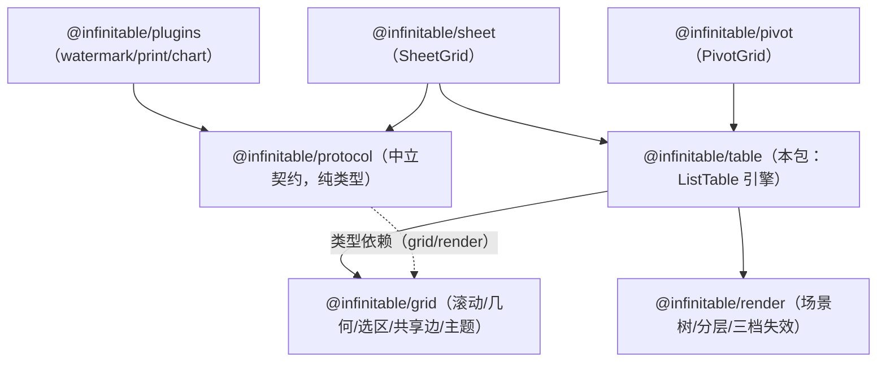

# ListTable 表格引擎（@infinitable/table）

自研 canvas 表格引擎的主体与装配层：四层 canvas（ground/body/media/sky）上的可视窗口场景、Excel 式文本溢出走廊、取值三形态、编辑链路、填充柄与表头装配——实现中立装配协议 EngineAssembly 并承载表格领域面 TableEngine，供 sheet/pivot 等平级引擎与任意宿主消费。代码入口 `packages/table/src/index.ts`（公共 API 显式导出，禁止 `export *`）。返回 [architecture.md](./architecture.md)。

## 在整体架构中的位置

table 是 grid/render 之上、领域适配层之下的**表格领域引擎**：向下消费 `@infinitable/grid` 的通用网格机器（滚动状态机、前缀和/虚拟窗口、选区状态、共享边、合并区、主题投影，见 [grid-kernel.md](./grid-kernel.md)）与 `@infinitable/render` 的渲染窄接口（RenderHost/场景树/分层失效，见 [render-engine.md](./render-engine.md)）；向上以 `TableEngine`（中立本体契约在 `@infinitable/protocol`，见 [engine-assembly-protocol.md](./engine-assembly-protocol.md)）供 sheet 的 SheetGrid（见 [sheet.md](./sheet.md)）与 pivot 的 PivotGrid（见 [pivot-engine.md](./pivot-engine.md)）装配消费；协议插件（watermark/print）与领域面插件（chart）经 `plugins`/`use` 挂载；统一发布形态见 [infinitable-package.md](./infinitable-package.md)。



依赖方向红线：table 只依赖 grid、render、protocol 三个包；sheet/pivot 经 TableEngine 面消费 table（不 import 具体类）；协议插件只依赖 protocol。playground 与测试经公共入口 `@infinitable/table` 消费。

## 核心概念

| 概念 | 类型或类名 | 代码位置 |
| --- | --- | --- |
| 表格引擎主类 | `ListTable implements TableEngine` | `list-table.ts` |
| 构造配置 | `ListTableOptions` / `ColumnDefine` / `DataRecord` | `types.ts` |
| 取值管线（三形态合成） | `CellValuePipeline` / `ResolveDisplayValue` | `cell-value.ts` |
| 外部数据模型 | `TableModel` / `CellChangeEvent`（协议词汇） | `types.ts` |
| 内置内存坐标模型 | `SheetModel implements TableModel` | `sheet-model.ts` |
| 模型订阅与回驱防回环 | `ModelBinding`（echo 收集去重） | `model-binding.ts` |
| 单元格场景节点 | `CellNode`（背景→内容→逐边边框） | `cell-node.ts` |
| 内置渲染器与自定义渲染 hook | `renderTextCell` / `renderCheckboxCell` / `CellRenderer` / `ResolveCellRenderer` | `cell-renderer.ts` |
| 溢出走廊 | `corridorCols` / `textOverflowLimits` / `TextAdvanceTable` | `list-table-scene.ts` / `cell-node.ts` |
| 场景重建与滚动增量窗口 | `rebuildScene` / `updateSceneWindow` | `list-table-scene.ts` |
| 交互接线（指针/触摸/键盘） | `bindInteractionEvents` 等 | `list-table-interaction.ts` |
| sky 交互浮层 | `InteractionOverlay` / `HighlightRange` | `interaction-overlay.ts` |
| 键盘导航 | `nextActiveCell` / `revealAxis` | `keyboard-navigation.ts` |
| 行列 resize | `hitResizeHandle` / `ResizeSession` | `resize.ts` |
| 填充柄原语 | `FillDragEndEvent` / `clampToAnchorAxis` 等 | `fill-handle.ts` |
| 编辑状态唯一源 | `EditManager` / `createTextEditor` | `editing/edit-manager.ts` / `editing/text-editor.ts` |
| 编辑器注册表 | `EditorRegistry` / `CellEditor`（预留接口） | `editor-registry.ts` |
| 图片/图表格装配 | `appendImageCell` / `appendChartCell` | `list-table-media.ts` |
| cell 级位图 LRU | `MediaCache<LoadedImage>`（bytes+count 双预算） | `media/media-cache.ts` |
| 表格领域协议面 | `TableEngine extends EngineAssembly` | `engine.ts` |
| painter 槽位承载节点 | `GroundPainterNode` / `OverlayPainterNode` | `list-table.ts` |

## 模块分层

| 层 | 模块 | 说明 |
| --- | --- | --- |
| 主体与装配 | `list-table.ts` / `list-table-scene.ts` / `list-table-internal.ts` | ListTable 主类（2011 行）：构造建层、滚动主循环、refreshCell 局部刷新、冻结/合并运行时变更、painter 槽位；scene 拆出场景全量重建/滚动增量窗口/分带建格/表头装配/溢出走廊支撑；internal 为共享常量（`HEADER_COORD = -1`、合并越界校验、表头高亮判定） |
| 取值与样式 | `cell-value.ts` / `cell-style.ts` / `types.ts` | 三形态合成、样式投影链（`projectCellStyle` 逐字段覆盖 + 边框逐边合并）、公共类型 |
| 渲染单元 | `cell-node.ts` / `cell-renderer.ts` | 场景节点与内容绘制：text/checkbox 内置渲染、自定义渲染 hook、逐边边框线型、文本测量缓存 |
| 交互 | `list-table-interaction.ts` / `interaction-overlay.ts` / `keyboard-navigation.ts` / `resize.ts` / `fill-handle.ts` | 指针/触摸/键盘/contextmenu 接线、sky 浮层绘制（选区/填充柄/resize 线/滚动条）、纯逻辑导航与命中 |
| 编辑 | `editing/edit-manager.ts` / `editing/text-editor.ts` / `editor-registry.ts` / `sheet-model.ts` / `model-binding.ts` | 会话生命周期、DOM 文本编辑器浮层、编辑器注册与格级路由、内置模型、模型绑定 |
| 媒体 | `list-table-media.ts` / `media/image-cell-node.ts` / `media/chart-cell-node.ts` / `media/media-cache.ts` | L2 media 层惰性创建、图片/图表格装配与局部刷新、窗口化加载调度、位图 LRU |
| 协议面 | `engine.ts` / `index.ts` | TableEngine 签名集合；公共导出面显式收口 |

协作模块（scene/media/interaction/internal）以 ListTable 实例为参数、只触碰 `@internal` 标注成员，均不进公共入口；`@internal` 成员不构成公共 API。

## 关键机制走读

### 装配与生命周期

构造（`new ListTable(options)`）按序完成：

1. **几何与配置归一化**：主题 `extendsTheme(options.theme)` 派生；`showColHeader/showRowHeader: false` 归一化为 `headerHeight/rowHeaderWidth = 0`（关闭侧内容原点上移/左移，命中/resize/全选自动走表体分支）；滚动条配置 `resolveScrollbarConfig`（`mode: 'native'` 时装配 `NativeScrollbarHost` 真实 DOM 滚动容器）；列宽/行高前缀和（`computeColOffsets/computeRowOffsets`）；冻结数 `clampFrozenCount` 夹取；合并区 `sanitizeMerges`（重叠保留先声明、丢弃冲突项并 console 提示，越界 `assertMergesWithinTable` 抛错）。
2. **四层 canvas 建层**：body 与 sky 在构造期恒建（`host.createLayer({ kind: 'body', consumption: 'regions' })` / `{ kind: 'sky', consumption: 'always-full' }`）；media 层随首个图片/图表格惰性创建；ground 层随首个 underlay painter 写入惰性创建（此前零开销）。canvas 创建经文档源 `options.doc`（SSR/无头注入替身，缺省 `globalThis.document`）；dpr 经 `options.resolveDevicePixelRatio`（缺省浏览器 `devicePixelRatio`，无 window 回落 1），`hostOptions.dpr` 显式注入最优先。
3. **状态源接线**：`ScrollManager` 唯一滚动状态源（滚动位置定义在「总内容 − 冻结区」上）；`ImageService.onImageLoad → onImageServiceLoad` 定向失效可见图片格；模型形态挂 `ModelBinding`；`EditManager` 拿到回写目标/取值/几何/事件全部注入；`bindInteractionEvents` 接线场景事件。
4. **插件先于首帧挂载**：`options.plugins` 逐个 `use(plugin)`（注册即 mount），图表格路由等渲染接线参与首帧场景。
5. **首帧**：`rebuildScene` 全量建窗口场景 → body 层 full 失效 → `refreshOverlay` 装配 sky 首帧内容（空浮层零失效提交）。

滚动主循环（`onScroll`）：状态源广播 → `updateSceneWindow` 增量维护窗口 → 按滚动方向提交分层 band 失效（纵向只重绘冻结行以下横带、横向只重绘冻结列以右纵带，冻结角与对侧冻结区不重绘）→ `updateImageWindow` 窗口化加载调度 → 浮动对象 `syncPositions` 帧级跟随 → `refreshOverlay` → `onScrollFrame` 帧级广播（同帧多次滚动收敛一次）。

场景窗口增量维护（`updateSceneWindow`）：滚出节点摘除（`sweepWindowNodes` 批摘 + 图片格释放 ImageService 引用）、存活节点原地平移（零重建）、滚入行整行按列降序补建、滚入列补建、窗外溢出源窗缘反查补建、行内溢出 z 序规范（`canonicalizeRowOverflowOrder`）、部分可见合并主格补建、冻结带 z 序收口、表头容器内增量维护——场景内容与全量重建逐点等价，滚动帧成本从 O(窗口格数) 降到 O(滚入格数)。`overscanRows/overscanCols` 只扩大装配窗口（建格摊到缓冲区），不改变滚动边界。

几何变更（setColWidth/setRowHeight/setRowCount/setColCount/冻结数/合并区替换/resize）统一收敛 `applyGeometryChange`：冻结区尺寸与滚动边界重算 → 全量重建 → body（及 media）整层失效。`resize(width, height)` 原地调整视口，滚动位置与选区保留、不重建实例。`destroy` 幂等：逆序卸载插件 → 解绑事件 → 销毁编辑会话/模型绑定/浮动层/图片服务 → 自建 host 才销毁。

### 取值三形态

数据供给三形态由 `CellValuePipeline`（`cell-value.ts`）合成，**基础值优先级：模型 > records 字段**，`resolveDisplayValue` 作用于管线末端、可与任一形态叠加：

| 形态 | 配置 | 基础值来源 | 行数来源 | 适用场景 |
| --- | --- | --- | --- | --- |
| ① records/columns 数组 | `records` + `columns[].field` | `records[row][field]`（列未给 field 则该列无数组值） | `records.length`（恒等，setRowCount 增长无效） | 静态数据/一次性灌入；回写直接改行对象 field |
| ② 纯按格 hook | `rowCount` + `resolveDisplayValue` | 无基础值（hook 自行取数） | `rowCount` 兜底（`setRowCount` 动态抬高） | 万行级生成式数据（无存储成本）、外部异步源投影 |
| ③ 模型事件订阅 | `model: TableModel` | `model.getCellValue(col,row)` | `model.rowCount ?? 0` 与兜底取 max | 外部真相源（公式引擎/联动模型）；编辑回写、变更事件驱动局部刷新 |

叠加规则（源码口径，`cell-value.ts`）：

- `resolveText(col,row)` = `resolveDisplayValue(col,row,基础值)`，未配置 hook 时基础值 `null/undefined → ''`、其余 `String(value)`。
- `resolveValue(col,row)` 返回**基础值**（不过显示 hook）——checkbox 勾选态、编辑初值、`getCellValue`/`getCellText` 的两套口径都源于此：`getCellText` 走显示链、`getCellValue` 走数据面，合并区都路由主格。
- 模型形态的行数 = `max(model.rowCount ?? 0, fallbackRowCount)`（宿主先增长模型再 `setRowCount` 触发重算）；records 形态行数恒等于数组长度。
- 模型形态的写入：编辑提交/`updateCell` 经 `ModelBinding.writeBack` 调 `model.setCellValue`，写期间模型同步 echo 的变更事件**收集去重**（防回环）并在回驱窗口结束后统一逐格局部刷新——同步重算的派生格（公式依赖）不丢通知。records 形态无 binding，`updateCell` 直接返回；宿主改行对象后自行 `refreshCell`。

### 溢出走廊

超宽文本不截断时的 Excel 式跨格绘制，设计依据与语义终判见 [overflow-rendering-research.md](./overflow-rendering-research.md)。table 侧落地（`list-table-scene.ts` + `cell-node.ts`）：

- **走廊定义**（`corridorCols`）：先按内容盒与对齐方向求文本左右缘（锚点 `cellTextAnchorX` 与 `renderTextCell` 绘制同源），再向溢出方向逐格推进——只覆盖「列边界落在文本缘内」的空格。溢出方向按对齐：left（缺省）向右、right 向左、center 双向；阻断判定按 Univer 语义（left 只看右壁、right 只看左壁、center 两壁皆阻断才算阻断——单侧空即向空侧溢）。
- **不溢出的格**：设置了 `textOverflow: 'ellipsis' | 'clip'`、`textWrap: true`、checkbox/自定义渲染/图片/图表/合并覆盖格、空文本格。走廊遇首个非空格停（含合并、图片、图表、自定义渲染、checkbox 格），不越冻结列带边界（对齐 Excel 冻结窗格）。
- **节点承载**：`CellNode.textMaxX/textMinX`（格内局部坐标的文本可绘制右/左界）；`paintedBounds()` 把自身包围盒并入溢出文本缘——溢出源滚出窗后其伸入窗内的走廊段不被脏区剔除。
- **竖线跳画**（WPS 口径）：`CellNode.corridorInterior` 标记该格是否在走廊内（值取覆盖本格各走廊的最大右端列号），`paintBorders` 对 `corridorInterior > col + 1` 的格跳画 right 共享边；`markRowCorridorInterior` 先清后标，全量重建/增量补建/refreshCell 三路径同口径。
- **z 序不变量**：溢出源后画于同条带全部走廊节点——全量重建 `remountOverflowSources` 按行内列升序重挂树尾；增量路径 `canonicalizeRowOverflowOrder` 同序。
- **失效配合**（`refreshCellNodeContents`）：本格刷新时旧走廊并入失效区（防文字变短残影）、新走廊补画；本格变空/变非空时向两侧重算最近溢出来源（`overflowSourceCol/overflowSourceColRight`）的走廊并并入其新旧溢出区；获得溢出能力的节点重挂树尾。
- **窗外溢出源（窗缘反查）**：走廊伸入窗内但源格在窗外的，反查命中即按装配路径补建节点（位置在窗外、绘制靠 paintedBounds 上屏）；滚动窗口滑动期间「走廊仍与可视列窗相交」的窗外源保留。
- **测宽快路径**：`TextAdvanceTable` 按 font 串缓存逐字符推进宽，字符推进宽上界 × 1.01 + 0.5px 安全余量代入锚点函数证明文本双缘不出格即免 `measureText`（数字/短文本滚动帧零测量）；证不出回落精测，走廊端点与绘制恒同源。

### 填充柄

焦点段右下角 8px 方点（`FILL_HANDLE_SIZE`，骑在角点上向内外各伸一半），绘制在 sky 浮层、不触发 body 重绘。**填充生成算法不在内核**——引擎只给几何与事件，写入由宿主实现：

| 事件 | 载荷 | 语义 |
| --- | --- | --- |
| `onFillHandleDown` | `{ range }`（柄所在选区段，start/end 可反向） | 按下柄（携带焦点段） |
| `onFillDragEnd` | `{ anchor, target }`（均 min/max 序 `RangeBounds`） | 拖拽结束；target 从锚定段右下角格起算到终点格 |
| `onFillHandleDoubleClick` | `{ range }` | 双击（Excel「相邻数据块自动填充」触发点）；与拖拽结束互斥 |

焦点段 = 包含焦点格的选区段（焦点不在段内取末段，`resolveFocusRange`）。拖拽轴锁定（`clampToAnchorAxis`）：行/列位移绝对值大者为主轴（相等取纵向），副轴夹回锚定段跨度；拖拽预览区为虚线边框（`resolveFillPreview`，target 减锚定段重叠的纯扩展区）；指针驻留画布边缘时按帧自动滚动。选区交互关闭（`interactiveSelection: false`）时填充柄绘制与命中一并关闭。

### 表头装配

- **列平面**：表头层数恒 1（`getHeaderLevelCount()` 固定返回 1，多级表头不在能力内）；列定义来自 `options.columns`（运行时可经 `setColCount(count, template?)` 原地 push/截断，pipeline/编辑路由持同一数组引用即见新列），列头文本 `columns[col].title ?? options.resolveColTitle(col) ?? ''`（电子表格宿主可给增出列配 A/B/C 字母表头）；行号列文本 `String(row + 1)`。
- **主题分区**：三类表头分区样式（`headerStyles`）——列头 `theme.header`、行号列 `theme.rowHeader`、左上角 `theme.corner`（缺省随 header 派生），均叠加 `textOverflow: 'ellipsis'`（表头不溢出）；表头带内同样走共享边裁决（列头横排互裁、行号竖排互裁、角格拥有列头 0 的 left 与行号 0 的 top）。
- **z 序**：表头收进单一容器节点 `headerGroup`（`pickable: false`、全表包围盒），恒为 body root 末子节点（表头最上，合并主格上缘可伸进列头带）；滚动帧有新建数据格时只重挂此单节点。表头高亮（整轴选区覆盖或焦点格所在行列，合并区按主格、选区段按合并盒扩展）高亮背景与铬底预混为不透明色（`opaqueHeaderHighlight`），半透明 token 下其下滑入内容不再透出。
- **关闭侧**：`showColHeader/showRowHeader: false` 构造期归一化为零高/零宽，场景与命中不再出现该侧表头；resize 手柄（列手柄在列头区列右缘、行手柄在行号列区行下缘）在关闭侧带退化为一条线不可命中。

### 编辑链路

`EditManager`（`editing/edit-manager.ts`）为编辑状态唯一源，同一时刻至多一个会话：

- **进入**：双击（含触控双击，400ms/10px 判定窗口）或 `startEdit(col,row)`（先选中并滚动锚定格完整可见）。**可编三级判定**：① 编辑器路由命中（`EditorRegistry.resolveEditor`：route hook 优先、回退列定义 `editor`，名字未注册即不可编）∧ ② `resolveEditable(col,row)` 未拒绝 ∧ ③ 有回写目标（model 形态恒有；records 形态列须有 `field` 且行对象存在）。全通过才开 DOM 浮层并返回 true。`editCellOnEnter` 开启后非编辑态按 Enter 进焦点格编辑。
- **编辑器**：当前会话实现为内置文本编辑器（`createTextEditor`：列 `editorMultiline: true` 走 textarea，缺省单行 input；字符上限列级 `editorMaxLength` 覆盖 options 级）。`CellEditor` 接口与 `EditorRegistry.registerEditor` 是**预留扩展位**——注册表决定可编判定与格级路由，注册任意对象即通过判定；具体编辑器形态是后续扩展缝。
- **初值**：基础值口径（`resolveValue`，未过 `resolveDisplayValue`）；`null/undefined → ''`。
- **跟随**：浮层挂表格容器内、随锚定格视口矩形定位；编辑中订阅滚动帧逐帧对齐，锚定格滚出视口按 Enter 语义自动提交。编辑中锚定格 `contentHidden`（格内容连同溢出走廊一并失效隐去，DOM 浮层取代渲染）。`editorInsideBorder: true` 时浮层按四周可视边框内缩（Excel/WPS 表现）。
- **键位**：Enter 提交并下移、Tab 提交并右移、Esc 取消；提交后 `moveSelectionAfterCommit` 复用键盘导航求邻格并滚动跟随。
- **提交**：`writeCell` 写回数据源（model 经 ModelBinding 回驱、records 改行对象 field）→ 该格局部刷新 → 抛 `onCellChange({col,row,oldValue,newValue})` → 抛 `onEditEnd({committed: true, finalValue})`。**无操作编辑**（提交值与初值同口径相等）跳过写回与 onCellChange，会话生命周期照常。取消不回写不抛 onCellChange，`onEditEnd` 带 `committed: false`。
- **失焦**：焦点移出画布按提交语义终止（不抢回焦点）；编辑拾取模式（`editPickMode`，公式引用拾取）失焦不终止，点选其它格不提交、选区流动由宿主消费为引用。

### 交互

- **选区**：`SelectionState`（grid）多段选区 + 焦点格。指针拖选锚点按下定格（防反向拖越锚点后选区塌缩）；`ctrlMultiSelect` 开启 Ctrl/Cmd 点选加段；shift 点选扩展锚点可经 `resolveShiftSelectAnchor` 自持；`interactiveSelection: false` 整体关闭指针/键盘选区驱动（选区退化为 `applyExternalSelection` 回写的高亮面，透视表等平级引擎用）。程序化：`selectCell/selectCells/selectRow/selectCol/selectAll/clearSelection`；`onSelectionChange` 订阅。
- **行列 resize**：`hitResizeHandle` 在 4px 阈值带内二分定位手柄；`canResizeCol/canResizeRow` 逐行/列开关；`MIN_COL_WIDTH/MIN_ROW_HEIGHT = 20` 夹取；会话结束 `onColResizeEnd({col,width})/onRowResizeEnd({row,height})`（夹取后生效值），拖拽指示线画在 sky 浮层。末列右侧空白没有可拾取节点，未命中事件只从 sky 根派发，resize / 滚动条会话期间由 sky 根把 move/up 接回交互层（指针仍在容器内也能向右加宽）；指针移出容器后另走画布外接续（浏览器窗外松手由 `buttons === 0` 的 move 兜底提交）。越界指示线钳在数据视口边缘（内缩 1px，只影响绘制，提交尺寸仍按指针位移）。程序化 `setColWidth/setRowHeight`。
- **键盘导航**：方向键四向、Tab/Shift+Tab 横移（`nextActiveCell` 纯函数，越界夹取到表缘）；滚动跟随 `revealAxis`（已可见不动）。
- **滚动条**：canvas 档三态滑块（拖拽激活 > hover > 默认）+ 显隐档（缺省 `'hover'` 档：悬停表格内或滚动时显示、静止 hideDelay 后隐藏；`false` 关 / `true` 常驻旧语义 / 对象形态 `{visibility: 'always'|'scrolling'|'hover', hideDelay}` / `{mode: 'native'}` 浏览器原生滚动条，此时宿主滚轮接线按 `usesNativeScrollbar` 让位防双滚）；滚轮不内置，canvas 档宿主自行接线 `scrollBy`。
- **链接**：`resolveCellLink` 命中的格获得默认链接外观（主题 `linkColor` 蓝字 + 下划线，被 `resolveCellStyle` 覆盖）与 hover/leave/单击事件（`onCellLinkHover/onCellLinkLeave/onCellLinkClick`，框选拖拽/键盘选中不触发）；`openCellLinkOnClick`（缺省 true）控制引擎默认打开，`openCellLink` 注入替身。图片链接（浮动图/嵌入图）单击派发 `onImageLinkClick`（kind 判别两来源）。
- **其它**：`onContextMenu`（region 区分 body/row-header/col-header，角点归 body 且 cell 为 null）；`batchUpdate(fn)` 内多次变更收敛一次 band 提交；`setHighlightRanges`（公式引用染色框）与 `setSelectionAnchor`（编辑拾取锚定格持续绘制）为 sky 浮层宿主内容源。

### 媒体：图片与图表同一管线

图片与图表 cell 同走 L2 media 层 + cell 级 `MediaCache` LRU 位图缓存（bytes 默认 256MB + 条数默认 1000 双预算淘汰），无闪协议一致：**缓存/ImageService 已就绪 → 首帧直接画真实位图；未就绪 → placeholderDelay 内连占位都不画，落成后定向失效本格、单帧切换**；滚动滚回命中即首帧直贴。

| 维度 | 图片格 | 图表格 |
| --- | --- | --- |
| 声明 hook | `resolveCellImage`（返回 URL）+ `resolveCellImageFit`（fill/contain，缺省 contain） | `chartMediaResolver` 引擎预留位（table 不含图表语义；chart 插件 mount 时注入，声明 hook 为插件构造缝 `createChartPlugin({ resolveCellChart })`） |
| 位图来源 | `ImageService`（窗口化加载：可视区 ±240px 余量，滚入提权、滚出取消；`imageServiceOptions` 可注入 loadImage/并发/占位延迟） | `CellChartMedia.produce(size)` 插件侧离屏出图（首次含库加载异步） |
| 缓存 key | `image:col:row:WxH`（换 URL/摘除即失效旧位图） | `chart:内容key:WxH@dpr`（内容/尺寸/DPR 任一变更自然换 key；同 key 并发出图由 `chartRenderTasks` 单飞收敛为一次 produce） |
| 刷新 | `refreshImageCell`：URL 变原位重建、消失摘除、首次出现按 body 几何补建 | `refreshChartCell`：换 key 原位重建、声明消失摘除、key 未变不重建 |

media 层画在 body 之上、绘制内缩本格生效边框线宽（不盖边框），边缘半格经 body 视口裁剪、滚动区格再钳掉冻结带（滑入冻结带部分不画）。同格双声明（图片+图表）时图片优先、图表让位——两通道互斥。浮动图片/图表走 `floatObjects`（FloatObjectLayer 挂 sky 层最顶，锚定格几何 + 拖拽/缩放/旋转变换会话，事件载荷 `FloatObject`/`FloatTransformEndEvent` 等已导出）。

### TableEngine 领域面与插件预留位

`ListTable implements TableEngine`（`engine.ts`）：中立本体 `EngineAssembly`（渲染宿主/数据面/主题/painter 槽位/插件槽位/生命周期，契约在 `@infinitable/protocol`）+ 表格领域公共操作签名集合（视口几何、滚动命中、冻结合并、选区、编辑、事件、媒体）——全部成员是 ListTable 既有公共 API，协议只做签名收敛。SheetGrid/PivotGrid 经本面消费引擎、不触碰具体类；`get read()` 返回 `EngineReadView` 导出读取面（print 等导出类插件读取有效数据/样式/几何/合并区）。

插件可写引擎预留位（写引擎内部槽位、不进公共面）：

| 预留位 | 写入方 | 语义 |
| --- | --- | --- |
| `chartMediaResolver` | chart 插件 mount 注入 / unmount 置 null | 图表格声明路由（图表语义全在插件侧） |
| `setUnderlayPainter(painter)` | watermark 等插件 | ground 层（L0）整层绘制，锚定视口不随滚动平移，恒在最底 |
| `setOverlayPainter(painter)` | watermark 等插件 | sky 层最顶整层绘制（不新增 canvas 层），覆盖在全部内容之上 |

协议插件挂载一行带过：`plugins: [createWatermarkPlugin({ text: '...' })]`（mount 只收 EngineAssembly，任意引擎可挂，见 [engine-assembly-protocol.md](./engine-assembly-protocol.md) 与 [plugin-interface-map.md](./plugin-interface-map.md)）。

## 示例集

以下示例改编自 `packages/table/tests/` 与 `playground/src/sections/`，每个标注取材来源；标识符均与 `packages/table/src/index.ts` 导出面对照（插件 API 来自 `@infinitable/plugins`）。

### 1. 最小 ListTable（DOM 挂载）

取材 `playground/src/mount.ts` 与 `agent-docs/apis/list-table.md`。

```ts
import { ListTable } from '@infinitable/table'

// 容器 position 非 static（四层 canvas 绝对定位叠放其内）
const container = document.querySelector<HTMLDivElement>('#table')!
container.style.position = 'relative'

const table = new ListTable({
  width: 800,
  height: 400,
  columns: [
    { field: 'name', title: '名称', width: 160 },
    { field: 'score', title: '分数', width: 100 },
  ],
  records: Array.from({ length: 100_000 }, (_, i) => ({ name: `行 ${i}`, score: i })),
  hostOptions: { container }, // 不传 host 时引擎经 hostOptions 自建 RenderHost
})

// 滚轮滚动不内置（canvas 档）：宿主自行接线 scrollBy
container.addEventListener(
  'wheel',
  (e) => {
    e.preventDefault()
    table.scrollBy(e.deltaX, e.deltaY)
  },
  { passive: false },
)

table.destroy() // 卸载：逆序卸载插件、解绑事件、销毁自建 host
```

### 2. 取值形态①：records/columns 数组

取材 `playground/src/sections/data-forms.ts`（records 区）。

```ts
import { ListTable } from '@infinitable/table'

const table = new ListTable({
  width: 720,
  height: 220,
  columns: [
    { field: 'name', title: '姓名', width: 160 },
    { field: 'qty', title: '数量', width: 120 },
    { field: 'done', title: '完成', width: 100, cellType: 'checkbox' }, // 勾选态读基础值
  ],
  records: Array.from({ length: 5000 }, (_, row) => ({
    name: `用户-${row}`,
    qty: row % 97,
    done: row % 2 === 0,
  })),
  hostOptions: { container },
})
// 行数恒等于 records.length；改数据直接改行对象字段后 refreshCell(col, row)
```

### 3. 取值形态②：纯按格 hook（rowCount + resolveDisplayValue）

取材 `playground/src/sections/data-forms.ts`（hooks 区）与 `watermark.ts`。

```ts
import { ListTable } from '@infinitable/table'

const table = new ListTable({
  width: 720,
  height: 220,
  columns: Array.from({ length: 5 }, (_, col) => ({ title: `列${col}`, width: 130 })),
  rowCount: 5000, // 无 records、模型也未给 rowCount 时的行数兜底
  resolveDisplayValue: (col, row) => `格(${col},${row})=${row * 100 + col}`,
  resolveCellStyle: (_col, row) => (row % 5 === 0 ? { background: '#eef2ff' } : null),
  hostOptions: { container },
})
table.setRowCount(8000) // 纯 hook 形态由此直接抬高兜底行数
```

### 4. 取值形态③：模型事件订阅（SheetModel 与自定义 TableModel）

取材 `playground/src/sections/data-forms.ts`（DemoModel）与 `editing.ts`；测试对照 `tests/engine.test.ts`。

```ts
import { ListTable, SheetModel, type CellChangeEvent, type TableModel } from '@infinitable/table'

// 自定义外部模型：Map 存储 + 变更事件订阅（rowCount 可选，动态模型可后增）
class DemoModel implements TableModel {
  readonly rowCount = 1000
  private readonly values = new Map<string, unknown>()
  private readonly listeners = new Set<(change: CellChangeEvent) => void>()
  getCellValue(col: number, row: number): unknown {
    return this.values.get(`${col}:${row}`) ?? `M(${col},${row})`
  }
  setCellValue(col: number, row: number, value: unknown): void {
    const oldValue = this.values.get(`${col}:${row}`)
    this.values.set(`${col}:${row}`, value)
    for (const listener of this.listeners) {
      listener({ col, row, oldValue, newValue: value }) // 外部变更 → 表格局部刷新
    }
  }
  onCellChange(listener: (change: CellChangeEvent) => void): () => void {
    this.listeners.add(listener)
    return () => this.listeners.delete(listener)
  }
}

const table = new ListTable({
  width: 720,
  height: 220,
  columns: Array.from({ length: 4 }, (_, col) => ({ title: `模型列${col}`, width: 160 })),
  model: new DemoModel(),
  hostOptions: { container },
})

// 表格回驱模型（编辑提交内部同路径）：echo 收集去重，派生格统一局部刷新
table.updateCell(0, 0, '新值')

// 或直接用内置坐标模型（构造即拷贝初始二维数组）
const sheet = new SheetModel([
  ['名称-0', '备注-0'],
  ['名称-1', '备注-1'],
])
sheet.setCellValue(0, 0, '改名') // 写值同步通知订阅者（即上表局部刷新）
```

### 5. 冻结行列 + 合并 + 主题定制 + 自定义渲染

取材 `playground/src/sections/display.ts`（10 万行演示区）。

```ts
import { ListTable, type CellRenderer } from '@infinitable/table'

// 自定义渲染 hook：评分列紫色条形（凭 col/row 自渲染，与取值管线解耦）
const ratingRenderer: CellRenderer = ({ ctx, width, height, value }) => {
  const ratio = typeof value === 'number' ? value : 0
  const barWidth = Math.round((width - 16) * ratio)
  if (barWidth <= 0) return
  ctx.fillStyle = '#7c3aed'
  ctx.fillRect(8, (height - 10) / 2, barWidth, 10)
}

const table = new ListTable({
  width: 760,
  height: 420,
  columns: [
    { field: 'id', title: 'ID', width: 80 },
    { field: 'name', title: '名称', width: 140 },
    { field: 'qty', title: '数量', width: 80 },
    { field: 'rating', title: '评分', width: 120 },
    { field: 'done', title: '完成', width: 80, cellType: 'checkbox' },
  ],
  records: Array.from({ length: 100_000 }, (_, row) => ({
    id: `ID-${row}`,
    name: `商品-${row}`,
    qty: row % 97,
    rating: ((row * 7) % 10) / 10,
    done: row % 2 === 0,
  })),
  frozenColCount: 1, // 左侧冻结第 0 列
  frozenRowCount: 1, // 顶部冻结第 0 行
  mergeCells: [{ startCol: 2, startRow: 2, endCol: 3, endRow: 3 }], // 闭区间，跨冻结边界合法
  theme: { header: { background: '#dbeafe' } }, // 主题 extends：只覆盖列头底色 token
  resolveCellStyle: (col, row) => {
    if (col === 0) return { background: '#f5f3ff' } // 冻结列底色（滚动中不变可观测）
    if (row % 2 === 1) return { background: '#f8fafc' } // 斑马纹
    return null // 沿用基础样式
  },
  resolveCellRenderer: (col) => (col === 3 ? ratingRenderer : null),
  hostOptions: { container },
})

table.setFrozenColCount(2) // 运行时改冻结（跨冻结边界的既有合并区合法，主格重钉）
```

### 6. 选区与事件订阅

取材 `packages/table/tests/list-table-interaction.test.ts` 口径与 `playground/src/sections/interaction.ts`。

```ts
import { ListTable } from '@infinitable/table'

const table = new ListTable({ /* 同示例 2 的 records 配置 */ hostOptions: { container } })

// 程序化选区：点选（选中并滚动到完整可见）/ 多段整组替换 / 行列全选
table.selectCell(1, 10)
table.selectCells([{ start: { col: 0, row: 0 }, end: { col: 1, row: 3 } }])
table.selectCol(0)
table.selectAll()

// 订阅选区变更（快照 { ranges: 选区段数组, focus: 焦点格 }）；返回退订函数
const unsubscribe = table.onSelectionChange((snapshot) => {
  console.log('段数', snapshot.ranges.length, '焦点', snapshot.focus)
})

// 当前选区段副本（start 锚点 / end 焦点，可反向）
for (const range of table.getSelectedCellRanges()) {
  console.log(range.start.col, range.start.row, '→', range.end.col, range.end.row)
}

// 命中与几何：视口坐标 → 数据格；数据格 → 视口矩形
const cell = table.getCellAtRelativePosition(120, 60)
const rect = cell ? table.getCellRelativeRect(cell.col, cell.row) : null

// 右键事件（region 区分 body / row-header / col-header）
table.onContextMenu((event) => {
  console.log(event.region, event.cell) // 角点归 'body' 且 cell 为 null
})

unsubscribe()
table.clearSelection()
```

### 7. 排序（宿主侧数据重排）+ 列宽拖拽

内核不内置排序（数据供给在宿主）：重排 records 数组（管线持同一引用）后批量刷新可视区。取材 `playground/src/sections/interaction.ts`（canResizeCol/Row）。

```ts
import { ListTable, type DataRecord } from '@infinitable/table'

const records: DataRecord[] = Array.from({ length: 2000 }, (_, row) => ({
  c0: `v-0-${row}`,
  c1: row,
}))
const table = new ListTable({
  width: 720,
  height: 320,
  columns: [
    { field: 'c0', title: '名称', width: 100 },
    { field: 'c1', title: '数值', width: 100 },
  ],
  records,
  canResizeCol: (col) => col !== 0, // 第 0 列禁拖宽（canResizeRow 同构管行高）
  canResizeRow: (row) => row !== 0,
  hostOptions: { container },
})

// 排序：原地重排同一数组引用 → 可视区逐格刷新收敛为一次 band 提交
function sortByC1(desc: boolean): void {
  const view = table.getBodyVisibleCellRange() // [start, end)，冻结行列并入
  table.batchUpdate(() => {
    records.sort((a, b) => (desc ? (b.c1 as number) - (a.c1 as number) : (a.c1 as number) - (b.c1 as number)))
    for (let row = view.rows.start; row < view.rows.end; row++) {
      for (let col = view.cols.start; col < view.cols.end; col++) {
        table.refreshCell(col, row)
      }
    }
  })
}

// 列宽拖拽会话结束事件（width 为夹取后的最终生效值；行高同构 onRowResizeEnd）
table.onColResizeEnd((event) => {
  console.log(`列 ${event.col} 调宽至 ${event.width}`) // 拖拽本身已生效，事件供持久化
})
```

### 8. 编辑：内置编辑器 + EditorRegistry 注册与格级路由

取材 `playground/src/sections/editing.ts` 与 `packages/table/tests/editor-registry.test.ts`。

```ts
import { EditorRegistry, ListTable, SheetModel } from '@infinitable/table'

const registry = new EditorRegistry()
registry.registerEditor('text', {}) // 注册名与列定义 editor 对应（空对象即占位编辑器）

// 格级路由 hook（构造参数，优先于列定义）：仅 (0,0) 用专用编辑器名
const routed = new EditorRegistry((col, row) => (col === 0 && row === 0 ? 'primary' : undefined))
routed.registerEditor('primary', { name: 'primary' })
routed.registerEditor('text', {})

const model = new SheetModel(Array.from({ length: 16 }, (_, r) => [`名称-${r}`, `备注-${r}`]))
const table = new ListTable({
  width: 620,
  height: 220,
  columns: [
    { title: '名称', width: 160, editor: 'text' },
    { title: '备注（多行）', width: 220, editor: 'text', editorMultiline: true }, // textarea
    { title: '展示列', width: 140 }, // 无 editor 声明：双击无反应（纯展示）
  ],
  model,
  editorRegistry: registry, // 也可事后 table.editorRegistry.registerEditor(...)
  resolveEditable: (col, row) => !(col === 0 && row === 2), // 格级禁编对照格
  editCellOnEnter: true, // 非编辑态按 Enter 进焦点格编辑
  hostOptions: { container },
})

// 编程式会话 API：startEdit 三级判定通过才开浮层；双击（含触控双击）同判定
table.startEdit(0, 3) // true：打开浮层（初值为基础值口径）
table.commitEdit() // true：回写模型 + refreshCell + 抛 onCellChange
table.cancelEdit() // 取消：不回写不抛 onCellChange
table.isEditing()

// 事件链：提交 → onCellChange（col/row/oldValue/newValue）→ onEditEnd（committed 区分提交/取消）
table.onCellChange((change) => {
  console.log(`${change.col},${change.row}: ${String(change.oldValue)} → ${String(change.newValue)}`)
  // undo 可据此实现
})
table.onEditStart((event) => console.log('编辑开始', event.col, event.row, event.initialValue))
table.onEditEnd((event) => console.log('编辑结束', event.committed, event.finalValue))
```

### 9. 填充柄（拖拽结束回写）

填充生成不在内核：宿主消费 `onFillDragEnd` 的锚定段与目标段自行写模型。取材 `packages/table/tests/fill-handle.test.ts` 语义与 `fill-handle.ts` 事件载荷。

```ts
import { ListTable, SheetModel } from '@infinitable/table'

const model = new SheetModel(
  Array.from({ length: 20 }, (_, r) => [`A-${r}`, `B-${r}`]),
)
const table = new ListTable({
  width: 400,
  height: 260,
  columns: [
    { title: 'A', width: 120 },
    { title: 'B', width: 120 },
  ],
  model,
  hostOptions: { container },
})

table.onFillDragEnd((event) => {
  const { anchor, target } = event // 均为 { minCol, minRow, maxCol, maxRow }（轴锁定后）
  // 纵向向下填充示例：锚定段每列的末行值复制到扩展区各行（宿主语义自定义）
  if (target.maxRow > anchor.maxRow) {
    for (let col = anchor.minCol; col <= anchor.maxCol; col++) {
      const source = model.getCellValue(col, anchor.maxRow)
      for (let row = anchor.maxRow + 1; row <= target.maxRow; row++) {
        model.setCellValue(col, row, source) // 模型事件 → 表格局部刷新
      }
    }
  }
})

table.onFillHandleDoubleClick((event) => {
  // Excel 语义「相邻数据块自动填充」的触发点：宿主按 event.range 自行实现
})
```

### 10. 单元格图片（L2 media 层 + 无闪协议）

取材 `playground/src/sections/media.ts`（本地加载器注入，零网络）。

```ts
import { ListTable } from '@infinitable/table'

const table = new ListTable({
  width: 720,
  height: 320,
  columns: Array.from({ length: 6 }, (_, col) => ({ title: `列${col}`, width: 100 })),
  rowCount: 500,
  resolveDisplayValue: (col, row) => `m-${col}-${row}`,
  // 第 1 列偶数行为图片格；返回 null 的格走常规文本管线
  resolveCellImage: (col, row) => (col === 1 && row % 2 === 0 ? `https://cdn.example.com/${row}.png` : null),
  resolveCellImageFit: (col, row) => (row % 4 === 0 ? 'fill' : null), // 缺省 contain 保比例
  imageServiceOptions: { placeholderDelay: 80 }, // 占位延迟内连占位都不画（防滚动闪烁）
  hostOptions: { container },
})
// 窗口化加载：可视区 ±240px 余量内提权加载、滚出取消；cell 级位图 LRU 滚回直贴无闪
```

### 11. 单元格图表（chart 插件挂载 + cell 级缓存）

取材 `playground/src/sections/chart.ts`；图表语义全在插件侧，table 只认 `CellChartMedia`（内容 key + 位图生产者）。

```ts
import { ListTable } from '@infinitable/table'
import { createChartPlugin, type ChartCellDeclaration } from '@infinitable/plugins'

const declarations: ChartCellDeclaration[] = Array.from({ length: 6 }, (_, variant) => ({
  type: 'bar',
  labels: ['一月', '二月', '三月', '四月'],
  datasets: [{ label: '销量', data: [20 + variant * 6, 14, 28, 18] }],
}))

const chartPlugin = createChartPlugin({
  resolveCellChart: (col, row) => (col === 1 ? declarations[row % 6] ?? null : null),
})

const table = new ListTable({
  width: 480,
  height: 320,
  columns: [
    { title: '地区', width: 160 },
    { title: '销量（柱状）', width: 150 },
  ],
  rowCount: 400,
  rowHeight: 84,
  resolveDisplayValue: (col, row) => (col === 0 ? `地区-${row}` : ''),
  plugins: [chartPlugin], // mount 时注入 chartMediaResolver 预留位
  hostOptions: { container },
})
// 同 key（同声明内容×格尺寸×DPR）并发出图单飞收敛；内容变更换 key → refreshCell 即重绘
```

### 12. 溢出行为配置（Excel 式溢出 / ellipsis / clip / 换行）

缺省为 Excel 式溢出走廊（见「溢出走廊」节）；`resolveCellStyle` 或列 `textWrap` 改写行为。取材 `packages/table/tests/list-table-text-overflow.test.ts` 口径与 `ColumnDefine` 注释。

```ts
import { ListTable, type CellStyle } from '@infinitable/table'

const table = new ListTable({
  width: 600,
  height: 260,
  columns: [
    { field: 'name', title: '默认', width: 100 }, // 超宽文本向右侧空格溢出（走廊）
    { field: 'brief', title: '省略号', width: 100 },
    { field: 'clip', title: '裁剪', width: 100 },
    { field: 'note', title: '换行', width: 120, textWrap: true }, // 列级换行：格内断行不溢出
  ],
  records: [
    { name: '很长很长的文本内容', brief: '很长很长的文本内容', clip: '很长很长的文本内容', note: '很长很长的文本内容' },
  ],
  resolveCellStyle: (col, _row): CellStyle | null => {
    if (col === 1) return { textOverflow: 'ellipsis' } // 前缀 + … 截断
    if (col === 2) return { textOverflow: 'clip' } // 内容盒内直接裁剪
    return null
  },
  hostOptions: { container },
})
// 溢出方向随对齐：left（缺省）向右、right 向左、center 双向；遇首个非空格/冻结带边界止
```

### 13. 超链接格

取材 `packages/table/tests/cell-link.test.ts`（ListTable 级用法；SheetGrid 桥接见 `playground/src/sections/hyperlink-image.ts`）。

```ts
import { ListTable, type CellLink } from '@infinitable/table'

const link: CellLink = { url: 'https://example.com', text: '示例链接' }
const table = new ListTable({
  width: 400,
  height: 260,
  columns: [
    { field: 'a', title: 'A' },
    { field: 'b', title: 'B' },
  ],
  records: Array.from({ length: 8 }, (_, i) => ({ a: `r${i}`, b: `r${i}` })),
  resolveCellLink: (col, row) => (col === 1 && row === 2 ? link : null),
  openCellLinkOnClick: false, // 关闭引擎默认打开，单击行为由宿主接管
  hostOptions: { container },
})

// 命中链接的格自动获得默认链接外观（主题 linkColor 蓝字 + 下划线）与 pointer 悬停光标
table.onCellLinkHover((event) => showTooltip(event.url, event.x, event.y)) // tooltip 由宿主渲染
table.onCellLinkLeave((event) => hideTooltip(event.col, event.row))
table.onCellLinkClick((event) => window.open(event.url, '_blank', 'noopener'))
```

### 14. 协议插件挂载（watermark 一行带过）

```ts
import { createWatermarkPlugin } from '@infinitable/plugins'
// plugins: [createWatermarkPlugin({ enabled: true, text: 'infinitable 内部资料' })]
// mount 只收 EngineAssembly（经 setOverlayPainter 写 sky 层最顶预留位），任意引擎可挂：
// 详见 engine-assembly-protocol.md 与 plugin-interface-map.md。
```

## 测试与验证入口

| 入口 | 覆盖 |
| --- | --- |
| `packages/table/tests/list-table.test.ts` | 构造/场景/滚动窗口/冻结/合并主路径 |
| `packages/table/tests/engine.test.ts` | EngineAssembly/TableEngine 协议契约（数据面/主题/painter 槽位/插件槽位/读取面/纯 hook 形态） |
| `packages/table/tests/plugin.test.ts` | 插件统一注册路径（构造挂载/use/逆序卸载/幂等 destroy） |
| `packages/table/tests/list-table-text-overflow.test.ts` | 溢出走廊/ellipsis/clip/换行/refreshCell 溢出联动 |
| `packages/table/tests/fill-handle.test.ts` | 焦点段/柄几何与命中/浮层绘制 |
| `packages/table/tests/editing/` | EditManager 生命周期、编辑语义、文本编辑器 |
| `packages/table/tests/editor-registry.test.ts` | 编辑器注册与格级路由 |
| `packages/table/tests/model-binding.test.ts` / `sheet-model.test.ts` | 回驱防回环、内置模型 |
| `packages/table/tests/cell-link.test.ts` / `image-link-click.test.ts` | 链接外观与事件 |
| `packages/table/tests/media/` | 位图 LRU、图片格节点 |
| `packages/table/tests/`（scrollbar*/frozen*/header*/resize 等） | 滚动条档位、冻结滚动、表头高亮、resize |
| playground `DisplayPage` / `DataFormsPage` / `EditingPage` / `InteractionPage` / `MediaPage` / `ChartPage` / `WatermarkPage`（`playground/src/sections/` 同名模块 + `SmokePage` 冒烟） | 浏览器行为可视验证 |

验证命令（bun workspaces + vite-plus 内置 vitest，测试脚本在仓库根）：`bun run test` 全量；单包/单文件以 vitest 过滤（如 `bunx vitest run packages/table/tests/engine.test.ts`）。

## 边界与红线

- **依赖方向**：table → grid/render/protocol 单向；sheet/pivot 经 TableEngine 面消费（不 import ListTable 具体类型）；协议插件只依赖 protocol。布局/交互/滚动等内部原语（CellValuePipeline/ModelBinding/EditManager/InteractionOverlay/MediaCache/CellNode 等）经包内深路径消费，**不占公共面**——公共 API 以 `packages/table/src/index.ts` 显式导出为准，`@internal` 成员不构成公共 API。
- **引擎中立装配与领域面**：EngineAssembly（protocol）承载四类平级引擎的公共装配（数据面/宿主/主题/槽位/生命周期）；表格领域概念（表头层级、行号列、按格渲染器）只出现在 TableEngine 面之下的实现侧。插件挂载参数只依赖协议面（G2/G21），不以 ListTable 具体类型为参数。
- **公开面红线**：新增导出需满足「仓内非测试消费（playground/plugins/跨包公共入口）或 docs/plugin-interface-map.md 红线面」判据；详表见 [plugin-interface-map.md](./plugin-interface-map.md)。事件载荷类型中仅 `FillDragEndEvent`、`CellLink*Event`、`TableContextMenuEvent`、`CellChangeEvent` 等已导出——`EditStartEvent/EditEndEvent/ColResizeEndEvent` 等未导出，示例中以内联形态消费。
- **能力边界**：多级表头不支持（层数恒 1）；排序/筛选不内置（数据供给在宿主）；填充生成不在内核；图表语义不在 table（chart 插件经 `chartMediaResolver` 预留位注入）；滚轮不内置（canvas 档宿主接线，native 档让位）；`updateCell` 仅 model 形态生效；`updateTheme` 不重算已生效几何 token（运行时改行列尺寸走 setRowHeight/setColWidth）。
