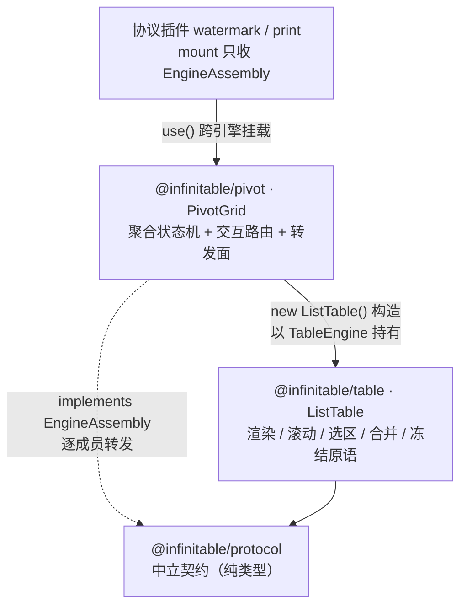

# 透视表引擎（@infinitable/pivot）

与 table 平级的透视表领域引擎 PivotGrid：行方向多列树形布局（每行维度一列、同组跨行合并、折叠组收敛为自带聚合的单行载体）× 列方向多级表头（列维度逐层 + 度量行，以引擎冻结行 + 合并区落地）× 度量交叉聚合——聚合与结构是包内状态机（PivotModel），渲染 / 滚动 / 选区 / 合并 / 冻结全部经 TableEngine 消费 table 引擎，对外转发实现 EngineAssembly。代码入口 `packages/pivot/src/index.ts`。返回 [architecture.md](./architecture.md)。

## 在整体架构中的位置

multi-engine 架构下引擎是平级的：pivot（PivotGrid）与 table（ListTable）、sheet（SheetGrid）同级，不是 table 的插件。PivotGrid 内部 `new ListTable(...)`（引擎唯一构造点）后以 `private readonly table: TableEngine` 持有——与 SheetGrid 同款姿势；所有几何落地（行数 / 列数 / 冻结带 / 列宽 / 合并区）走 TableEngine 的运行时变更 API，不触碰 grid/render 内部。协议概念见 [engine-assembly-protocol.md](./engine-assembly-protocol.md)，被消费的引擎面见 [list-table-engine.md](./list-table-engine.md)。



| 维度 | 口径 |
| --- | --- |
| 包依赖（package.json） | `@infinitable/protocol` + `@infinitable/table`，仅此两个；不直接依赖 grid / render / plugins |
| import 面 | 全部走 `@infinitable/table` / `@infinitable/protocol` 公共入口，零深路径、零引擎内部原语 |
| 对外契约 | `PivotGrid implements EngineAssembly`（转发面见下文）；唯一额外出口 `getTable(): TableEngine`（不暴露 ListTable 具体类型） |
| 协议插件 | watermark / print 经 `pivot.use(plugin)` 挂载即生效（插件收到的 EngineAssembly 是内部 ListTable），playground 透视演示区即此形态 |
| 发布形态 | 经 `infinitable` 聚合包 `./pivot` 子路径转售（见 [infinitable-package.md](./infinitable-package.md)） |
| 后续预留 | 甘特图引擎同构接入：PivotGrid 是「平级领域引擎经装配协议消费 table 引擎」的参考实现 |

## 核心概念

| 概念 | 定义（`packages/pivot/src/`） | 要点 |
| --- | --- | --- |
| `PivotDimension` | `types.ts`：`{ key, title, width }` | 行 / 列维度挂载的分组字段；行维度序列顺序即树层级序，列维度序列同构多级表头；`width` 为行头列宽 |
| `PivotMeasure` | `types.ts`：`{ key, title, field, agg, width }` | 交叉格聚合字段；`key` 与记录字段名无关（勾选引用）；同字段可挂多个不同聚合的度量 |
| `PivotAggregator` | `types.ts`：`'sum' \| 'count' \| 'avg' \| 'min' \| 'max'` | 五类聚合器：count 忽略 field 记记录数，其余按 field 数值聚合 |
| `PivotRecord` | `types.ts`：`type PivotRecord = DataRecord` | 字段 key → 值，与引擎 DataRecord 同形（自 `@infinitable/table` 转入） |
| `PivotRow` | `pivot-model.ts`：`{ type: 'branch' \| 'leaf' \| 'grand', path, depth, expanded, hasChildren }` | 展平数据行：leaf 最深维度值、branch 折叠组载体行（自带聚合即小计）、grand 总计行 |
| `PivotColumn` | `pivot-model.ts`：`{ kind: 'row-header', title, width }` 或 `{ kind: 'measure', colPath, measure }` | 行维度列（冻结带）或数据列（列维度路径 × 度量） |
| `PivotGridOptions` | `types.ts` | 装配选项：container / 宽高 / dpr / 维度池 / 度量池 / records / 初始勾选三序列 / showGrandTotal（缺省 true）/ collapsible（缺省 true）/ theme |
| `PivotCellDrillEvent` | `pivot-grid.ts`：`{ col, row, records }` | 双击下钻事件：数据格双击携带该格聚合覆盖的原始记录 |

包常量（`pivot-grid.ts` 导出，冒烟像素断言锚点）：`PIVOT_ROW_HEIGHT = 32`（数据行高）、`PIVOT_HEADER_BACKGROUND = '#f5f6f7'`（表头冻结行底色）、`PIVOT_SUBTOTAL_BACKGROUND = '#f1f5f9'`（折叠载体 / 小计行底色）、`PIVOT_GRAND_BACKGROUND = '#e2e8f0'`（总计行底色）。未导出的内部常量：展开钮颜色 `TREE_TOGGLE_COLOR = '#57606a'`、钮命中带 `TREE_TOGGLE_HIT_X = 20` / `TREE_TOGGLE_HIT_Y = 12`、单击位移阈值 `TREE_CLICK_SLOP = 10`。

公共导出面（`src/index.ts` 显式导出，禁止 `export *`）：值导出 `PivotGrid` / `PivotModel` + 上述 4 常量；类型导出 `PivotCellDrillEvent` / `PivotColumn` / `PivotRow` / `PivotAggregator` / `PivotDimension` / `PivotGridOptions` / `PivotMeasure` / `PivotRecord`。

## 双核走读之一：PivotModel（聚合状态机）

`pivot-model.ts` 的 `PivotModel implements TableModel`（引擎经 `ListTableOptions.model` 直挂消费，只读模型——`onCellChange` 空实现，交叉格为聚合值不回写）。职责：把 records 展平为「行序列 × 列序列 × 聚合矩阵 + 合并区」这一引擎可直读的唯一行列矩阵。

### rebuild 管线（一切结构变化的公共出口）

任何结构变化（维度 / 度量勾选、聚合切换、折叠 / 展开、数据刷新）都整体重算，由 PivotGrid 经 `batchUpdate` 一次性落地引擎几何：

| 步骤 | 产物 | 规则 |
| --- | --- | --- |
| ① 表头行数 | `headerRows = columnDimKeys.length + 1` | 列维度逐层一行 + 度量标题行；无列维度仅度量行（headerRows = 1），以引擎冻结行落地 |
| ② 列序列 `columnList` | 行维度列（每维度一列，取 `dimension.width`）+ 数据列 | 数据列 = 列维度叶子路径（DFS 逐层按维度值码点序）× 度量（调用方顺序）——同一路径下度量相邻 |
| ③ 行序列 `rowList` | leaf + branch 载体 + grand | `buildRows` 递归：桶内按维度值**码点序**（`[...groups.keys()].sort()`，不走 localeCompare，跨环境确定）；最深层出 leaf；非最深层展开时**无自有行**（组格由行侧合并区跨行呈现），折叠时出 branch 载体；`showGrandTotal`（缺省 true）追加 grand |
| ④ 聚合矩阵 `matrix` | 数据行 × 数据列 → `number \| undefined` | 每行先取记录桶（`recordsFor`：leaf 全路径匹配、branch 前缀匹配——路径之外的深层不过滤、grand 全体），再逐数据列按 `colPath` 逐层过滤后聚合 |
| ⑤ 合并区 `mergeList` | `CellRange[]`（引擎坐标） | 四族合并区，见下表 |

聚合口径（`aggregate`）：非 number / 非有限值跳过；`count` 返回记录数（忽略 field）；空数值集 `sum` / `count` 为 0，`avg` / `min` / `max` 为 `undefined`（显示层出空）。维度值空值归 `'(空)'` 组（`null` / `undefined` / `''` / 对象；number / boolean 转 String）——`'(空)'` 码点序排最前。折叠态节点键以 `'\u0000'` 连接路径（`NODE_KEY_SEP`）。

### 引擎坐标换算（表头行偏移）

模型行坐标即引擎坐标：前 `headerRows` 行为表头伪行，其下才是数据行。模型全部对外几何都带这个偏移：

| 换算 | 公式 / 说明 |
| --- | --- |
| 总行数 | `rowCount = headerRows + rowList.length`（`getCellValue` 中 `index = row - headerRows`） |
| 表头取值 | `row < headerRows`：行维度列出 `row === 0 ? title : ''`（标题竖条主格，被覆盖格出空）；数据列出 `colPath[row]`（列维度层）或 `measure.title`（度量行） |
| 组块 `groupRange(path)` | 返回 `{ startRow, endRow }` 已加 headerRows 偏移；树上无此组返回 null |
| 合并区 `computeMerges()` | 全部区间直接按引擎坐标构造 |

### 合并区四族（`computeMerges`，各区间按构造不相交）

| 族 | 位置 | 规则 |
| --- | --- | --- |
| ① 标题竖条 | 表头区 × 每个行维度列 | `headerRows > 1` 时整列纵向合并到首行主格（rows 0..headerRows-1） |
| ② 表头列维度层 | 表头行 `level` × 数据列 | 同层前缀一致的连续数据列横向合并（单列组无区间）；度量行不并 |
| ③ 行组跨行 | 数据区 × 行维度列（非最深列） | 同前缀（到该层）的连续数据行跨行合并——展开组格纵跨其全部可见后代行 |
| ④ 载体 / 总计横并 | branch / grand 行 × 行头 | branch 从 `path.length - 1` 列横并到最后一行头列（收敛为一块宽格）；grand 在行头列数 > 1 时整块横并 |

### 结构操作语义（返回 true 表示结构变化，由 PivotGrid 落地引擎几何）

| API | 语义 | 折叠态 |
| --- | --- | --- |
| `setRowDimensions(keys)` | 勾选行维度序列（调用方顺序即层级序；至少一个，空 / 无变化返回 false；非法 key 剔除） | 清空 |
| `setColumnDimensions(keys)` | 勾选列维度序列（空序列合法 → 度量直排） | 清空 |
| `setMeasures(keys)` | 勾选度量序列（至少一个） | 清空 |
| `updateMeasure(key, patch)` | 改聚合 / 标题 / 列宽，不改勾选序列 | **保留**（树展开态不动） |
| `setRecords(records)` | 数据刷新（仅 PivotModel 面上，PivotGrid 未转发） | **保留** |
| `toggleNode(path)` / `expandAll()` / `collapseAll()` | 折叠态操作；toggle 只对树上存在且当前可见的节点生效（被折叠祖先隐藏的返回 false）；collapseAll 整树收拢到一级（含嵌套） | — |
| `setCollapsible(enabled)` | 关闭时既有折叠态清空（整树平铺）并重算；开启时从平铺态起步 | — |

结构查询面：`rows` / `columns`（快照）、`rowHeaderCount`（= 行维度数，引擎冻结列数）、`headerRowCount`（引擎冻结行数）、`dataColumnCount`、`branchRowCount`、`recordCount`、`mergeRanges`、`activeRowDimensions` / `activeColumnDimensions` / `activeMeasures`、`getColumnWidth(col)`、`collapsible`，以及选区几何源 `groupRange(path)` 与 `headerColumnRange(col, row)`（表头格所在列组区间：命中行侧合并区取其跨度，单列回落自身；行头列与非表头行返回 null）。

## 双核走读之二：PivotGrid（领域装配与交互路由）

`pivot-grid.ts` 的 `PivotGrid implements EngineAssembly`。三件事：装配内部引擎并落地结构、树格自绘与点击路由、协议转发。

### 内部引擎构造（`new ListTable`，引擎唯一构造点）

| ListTableOptions | 取值 | 目的 |
| --- | --- | --- |
| `model` | `this.model`（PivotModel 直挂） | 数据面完全由模型供给 |
| `columns` | 占位模板 `{ field: '__pivot__', width: 120 }` × 初始列数 | 列结构全动态，`applyStructure` 对齐实际列数 / 列宽 |
| `showColHeader` / `showRowHeader` | `false` / `false` | 多级表头走冻结行 + 合并区自绘，引擎自带单行列头与行号列关闭 |
| `interactiveSelection` | `false` | 选区不复用 sheet 交互面：无拖选 / 表头拖选 / 键盘移动 / 填充柄，选区只作本层领域高亮 |
| `resolveEditable` | `() => false` | 只读引擎（交叉格为聚合值） |
| `resolveDisplayValue` / `resolveCellStyle` / `resolveCellRenderer` | 逐格投影钩子 | 聚合值千分位、行类型底色、树格自绘（见下） |
| `rowHeight` | `PIVOT_ROW_HEIGHT`（32） | 数据行与表头冻结行同高（图标命中带推导依赖统一行高） |
| `theme` | `{ ...options.theme, interaction: { selectionBorderWidth: 0, ...options.theme?.interaction } }` | 高亮纯填充无边框；宿主 `theme.interaction` 显式键（含 selectionBorderWidth 本身）展开在后仍可覆盖 |
| `hostOptions` | `{ container, dpr? }` | 四层画布与编辑浮层落点；dpr 供像素断言锁 1 |
| `width` / `height` | 选项缺省取容器 clientWidth / clientHeight，再缺省 760 / 480 | — |

### 结构原地落地（`applyStructure`）

结构变化不重建实例，一次 `batchUpdate` 内五步 + 清空选区：

```ts
this.table.batchUpdate(() => {
  this.table.setRowCount(this.model.rowCount)
  this.table.setColCount(this.model.columns.length, COLUMN_TEMPLATE)
  this.table.setFrozenColCount(this.model.rowHeaderCount)   // 行维度列 = 冻结带
  this.table.setFrozenRowCount(this.model.headerRowCount)   // 表头行 = 冻结带
  for (let col = 0; col < this.model.columns.length; col++) {
    const width = this.model.getColumnWidth(col)
    if (width !== undefined) this.table.setColWidth(col, width)
  }
  this.table.setMergeCells(this.model.mergeRanges)
})
this.table.applyExternalSelection({ ranges: [], focus: null }) // 旧坐标失效，防选区滞后于结构
```

### resolveCellRenderer 树格自绘（`treeCell`）

钩子只对「数据区 × 行头列」返回渲染器（`col < rowHeaderCount && row >= headerRowCount`），其余格走引擎默认绘制。合并区只有主格进渲染（被覆盖格不绘制），主格行取组内首个可见行：

- **展开钮**：小三角画在组格左缘 `x = 9`、合并区域竖直中线 `midY = height / 2 + 1`；可见组出 ▾（展开态），折叠载体行主格出 ▸；最深维度列、总计行与空标签格无钮；`collapsible` 关闭时不绘（标签回到 8px 普通内边距，有钮时 18px）。
- **标签**：`pivotRow.path[col]`（grand 为「总计」），字体走引擎 `style.font` 投影。

### 显示与样式投影

`resolveDisplayValue`：模型字符串直接透传；number 走 `formatNumber`（整数 en-US 千分位，非整数 `toFixed(1)`）。`resolveCellStyle`：表头行 → `PIVOT_HEADER_BACKGROUND` + 居中；grand 行 → `PIVOT_GRAND_BACKGROUND` + 加粗（数据列右对齐）；branch 载体行 → `PIVOT_SUBTOTAL_BACKGROUND` + 加粗（数据列右对齐）；leaf 数据列右对齐。

### 点击路由（`bindClick`，容器 DOM click + 引擎命中换算）

pointerdown 记锚，down/up 位移超 `TREE_CLICK_SLOP`（10px）视为拖拽直接忽略（透视表无拖选能力，拖拽释放不得改高亮）。命中经 `getCellAtRelativePosition`（表头行 / 行头列都是引擎普通格，冻结带可命中；合并区命中即主格），四类落点全部经 `applyExternalSelection` 回写：

| 落点 | 判定 | 高亮几何（ranges） | focus |
| --- | --- | --- | --- |
| 数据格 | `col >= rowHeaderCount && row >= headerRowCount` | 单元格自身 1×1 | 命中格 |
| 列维度表头 | 表头区 × 数据列 | `headerColumnRange`（列组合并跨度，度量行单列）× `headerRowCount..rowCount-1` 全部数据行 | 命中表头格 |
| 行维度标题竖条 | 表头区 × 行头列 | 无操作 | — |
| 行维度组格 | 数据区 × 行头列 | 路径按「命中列 = 组深度」截断前缀 → `groupRange`（组可见行块），从命中维度列起延展到最后一列；grand 行高亮该行 | 命中格 |

图标命中在组格路由内先行判定：`x - cellRect.x <= TREE_TOGGLE_HIT_X(20)` 且 `|y - (cellRect.y + 组跨行数 × PIVOT_ROW_HEIGHT / 2)| <= TREE_TOGGLE_HIT_Y(12)`（主格矩形经 `getCellRelativeRect` 读取，区域高 = 组块行数 × 统一行高）→ `toggleNode(path)` 折叠 / 展开，结构落地后**按新结构重算组块再回写高亮**（折叠收敛为载体行、展开恢复全组行，不残留旧区间——`pivot-grid-interaction.test.ts` 锚定该缺陷修复）。

其余接线：`bindDrill`（dblclick 数据格 → `getCellRecords` → 派发 `PivotCellDrillEvent`，空明细不派发）；`bindWheel`（引擎无内置滚轮：`scrollBy` 后仅在实际消费滚动时 preventDefault，shift+纵向滚轮转横向——与 SheetGrid 同口径；`usesNativeScrollbar` 时让位）。

### EngineAssembly 转发面（逐成员）

| 协议成员 | PivotGrid 实现 |
| --- | --- |
| `host` | `get host() { return this.table.host }` |
| `rowCount` / `getCellValue` | 转发**领域模型** `this.model.rowCount` / `this.model.getCellValue`（聚合矩阵是本层状态机，非引擎透传） |
| `updateCell` / `onCellChange` | 转发 `this.table.updateCell` / `this.table.onCellChange` |
| `getTheme` / `updateTheme` | 转发 `this.table`（updateTheme 原样深覆盖，不重压 selectionBorderWidth） |
| `setUnderlayPainter` / `setOverlayPainter` | 转发 `this.table` |
| `use(plugin)` | 转发 `this.table.use(plugin)` → `plugin.mount(listTable)` |
| `read` | `get read() { return this.table.read }`（table 恒提供） |
| `destroy()` | `released` 幂等守卫 + 逐 disposers 解绑（click / dblclick / wheel / ResizeObserver 由宿主自理）+ `this.table.destroy()` |

于是 `pivot.use(watermark)` 链路：PivotGrid.use → ListTable.use → mount 收到 EngineAssembly（即 ListTable）→ `setOverlayPainter` 落在 table 引擎 sky 层——插件全程不感知底下是 ListTable，这就是协议插件跨引擎挂载的机制证明。

### 领域 API 全景（PivotGrid 公共方法）

| 分组 | 成员 |
| --- | --- |
| 动态勾选 / 度量 | `setRowDimensions(keys)`、`setColumnDimensions(keys)`、`setMeasures(keys)`、`updateMeasure(key, patch)` |
| 折叠控制 | `toggleNode(path)`、`expandAll()`、`collapseAll()`、`getCollapsible()`、`setCollapsible(enabled)` |
| 结构查询 | `getVisibleRowCount()`、`getDataColumnCount()`、`getRowHeaderCount()`、`getHeaderRowCount()`、`getSubtotalRowCount()`、`getRecordCount()`、`getRowDimensionKeys()`、`getColumnDimensionKeys()`、`getMeasureKeys()`、`getMeasures()` |
| 明细下钻 | `getCellRecords(col, row)`、`onCellDrill(listener)` |
| 协议出口 | `getTable(): TableEngine` + 上表 EngineAssembly 转发面 |

## 交互语义

### 折叠 / 展开

- **图标位置**：组格左缘（绘制 x=9）、合并区域竖直中线；命中带横向 20px × 纵向 ±12px。点击组格其余区域不折叠，而是高亮该组整行带。
- **形态**：展开组 ▾ / 折叠载体 ▸；折叠组收敛为单行载体——行头横并为一块宽格、数据格是该前缀路径全体记录的聚合（小计），底色 `PIVOT_SUBTOTAL_BACKGROUND` 加粗；展开时组恢复全部后代行、组格纵跨合并。
- **collapsible 平铺**：构造 `collapsible: false` 不绘展开钮、点击不折叠、`toggleNode` / `collapseAll` 恒拒绝，始终平铺（结构勾选变化仍生效）；`setCollapsible(false)` 关闭时清空既有折叠态，`setCollapsible(true)` 从平铺起步。
- **折叠态生命周期**：维度 / 度量勾选等结构变更清空折叠态；数据刷新（模型 `setRecords`）保留。

### 三类命中与高亮（选区即领域高亮，非 sheet 交互面）

引擎 `interactiveSelection` 关闭，无拖选 / 表头拖选 / 键盘移动 / 填充柄；主题 `selectionBorderWidth` 压 0——高亮为**纯填充无边框**，全部由点击路由经 `applyExternalSelection` 回写（不广播防回环）：组格高亮从命中维度列起的整行带（该组所有层级的维度数据）、列维度表头高亮列组 × 全部数据行、数据格高亮自身。结构变化清空旧高亮；图标折叠 / 展开后按新结构重放。

### 双击下钻

数据格（数据列 × 数据行）双击 → `getCellRecords(col, row)` 取该格聚合覆盖的原始记录（leaf 全路径匹配、branch 前缀路径全体；有列维度时再按 colPath 逐层过滤）→ `onCellDrill` 订阅者收 `{ col, row, records }`。表头行 / 行头格 / 空明细不派发；返回退订函数。

### 水印跨引擎挂载

`createWatermarkPlugin({ enabled, text })`（`@infinitable/plugins`）返回 EnginePlugin 兼运行时句柄（`updateConfig` / `getConfig` / `isEnabled`）；`pivot.use(watermark)` 经转发面挂到内部 ListTable 的 sky 层 overlay 槽位，`updateConfig({ enabled: true })` 一帧内重绘生效。

### 只读口径

`resolveEditable` 恒 false、模型 `onCellChange` 空实现——交叉格是聚合值，编辑面整体关闭；协议面 `updateCell` / `onCellChange` 仍完整转发（契约完备，宿主不当以此改聚合值）。

## 示例集

以下示例逐标识符对照公共导出面（`packages/pivot/src/index.ts`、`@infinitable/table` / `@infinitable/plugins` 公共入口），可直接改编运行。

### 示例 1：最小透视表装配

records + 行维度 + 度量的最小形态（无列维度 → 表头仅度量行，度量直排）。取材 `packages/pivot/tests/pivot-model.test.ts` fixture。

```ts
import { PivotGrid } from '@infinitable/pivot'

const pivot = new PivotGrid({
  container: document.querySelector<HTMLDivElement>('#pivot')!,
  dimensions: [
    { key: 'region', title: '区域', width: 110 },
    { key: 'product', title: '产品', width: 90 },
  ],
  measures: [
    { key: 'qty-sum', title: '数量和', field: 'qty', agg: 'sum', width: 110 },
    { key: 'record-count', title: '记录数', field: '', agg: 'count', width: 100 },
  ],
  records: [
    { region: '东', product: 'A', qty: 1 },
    { region: '东', product: 'B', qty: 3 },
    { region: '西', product: 'A', qty: 4 },
  ],
  rowDimensions: ['region', 'product'], // 缺省全部维度；层级序：区域 → 产品
  // columnDimensions 缺省 []：度量直排；activeMeasures 缺省全部度量
})

pivot.getRowHeaderCount()    // 2（行维度数 = 冻结列数）
pivot.getHeaderRowCount()    // 1（无列维度：仅度量行）
pivot.getVisibleRowCount()   // 4（3 leaf + 总计；不含表头行）
pivot.getDataColumnCount()   // 2
pivot.getRecordCount()       // 3
pivot.getCellRecords(2, 1)   // 东·A 行 × 数量和列 → 1 条明细
```

### 示例 2：两级列维度表头（年份 / 月份层级）

初始即两级列维度：表头 = 年份层 + 月份层 + 度量行（3 行冻结），同层前缀连续列横向合并；表头区行维度列为标题竖条。取材 `playground/src/sections/pivot.ts`（mountPivot）。

```ts
const pivot = new PivotGrid({
  container,
  dimensions: [
    { key: 'status', title: '状态', width: 110 },
    { key: 'priority', title: '优先级', width: 100 },
    { key: 'year', title: '年份', width: 90 },
    { key: 'month', title: '月份', width: 90 },
  ],
  measures: [
    { key: 'amount-sum', title: '金额和', field: 'amount', agg: 'sum', width: 130 },
    { key: 'record-count', title: '记录数', field: '', agg: 'count', width: 100 },
  ],
  records, // 含 year ∈ {2024年, 2025年} × month ∈ {7月, 8月} 的确定性记录
  rowDimensions: ['status', 'priority'],
  columnDimensions: ['year', 'month'], // 层级序即表头层级：年份在上、月份在下
  activeMeasures: ['amount-sum', 'record-count'],
})

pivot.getHeaderRowCount()   // 3：年份层 + 月份层 + 度量行
pivot.getDataColumnCount()  // 8：年 2 值 × 月 2 值 × 度量 2
// 几何落地：setFrozenRowCount(3) + setFrozenColCount(2) + 表头横并（年份层跨 4 列、
// 月份层跨 2 列）+ 标题竖条（状态/优先级列各整列合并）经 setMergeCells 一次提交
```

### 示例 3：setRowDimensions / setColumnDimensions 动态勾选维度

勾选序列按调用方顺序生效（不回池序）；行维度序列位置即树层级，列维度可清空为度量直排。取材 `pivot-model.test.ts`（动态勾选组）与 `playground/src/app/views/PivotPage.tsx`（DimChip 上移 / 下移 / 移除 / 追加）。

```ts
pivot.setRowDimensions(['priority', 'status']) // 层级换序：优先级升为一级（标题竖条跟随）
pivot.setRowDimensions(['status'])             // 收敛单层树
pivot.setRowDimensions([])                     // 无操作：行维度至少一个，模型返回 false
pivot.setColumnDimensions([])                  // 清空列维度 → 度量直排（表头只剩度量行）
pivot.setColumnDimensions(['year', 'month'])   // 重建两级表头
pivot.getColumnDimensionKeys()                 // ['year', 'month']——面板态从引擎回读（唯一事实源）
// 维度池之外的 key 剔除且保持相对序；结构变化清空折叠态、原地落地不重建实例
```

### 示例 4：setMeasures / updateMeasure 聚合方式切换（五类聚合器各示其一）

同一字段可挂多个不同聚合的度量；`updateMeasure` 运行时改聚合不重挂实例、树展开态保留。取材 `pivot-model.test.ts`（updateMeasure 组）与 PivotPage（MeasureChip 聚合 Select）。

```ts
import type { PivotMeasure } from '@infinitable/pivot'

const measures: PivotMeasure[] = [
  { key: 'amount-sum', title: '金额和', field: 'amount', agg: 'sum', width: 130 },
  { key: 'record-count', title: '记录数', field: '', agg: 'count', width: 100 }, // 忽略 field
  { key: 'rating-avg', title: '评分均', field: 'rating', agg: 'avg', width: 110 },
  { key: 'amount-min', title: '金额最小', field: 'amount', agg: 'min', width: 120 },
  { key: 'amount-max', title: '金额最大', field: 'amount', agg: 'max', width: 120 },
]
const pivot = new PivotGrid({ container, dimensions, measures, records })

pivot.setMeasures(['record-count', 'amount-sum']) // 勾选序列 = 数据列分组序
pivot.updateMeasure('qty-sum', { agg: 'count', title: '数量计数' }) // 换聚合 + 联动标题
pivot.getMeasures() // 当前度量定义快照（含运行时改过的聚合；副本防外改池）
// 聚合口径：空数值集 sum/count → 0，avg/min/max → 无值（格出空）；非有限数值跳过
```

### 示例 5：toggleNode / expandAll / collapseAll 折叠控制

折叠组收敛为自带聚合的单行载体（小计）。取材 `pivot-model.test.ts`（展开 / 折叠组）。

```ts
// 默认形态：行维度 [region, product] × 列维度 [channel]，4 leaf + 总计
pivot.toggleNode(['东'])       // 折叠：东 → 单行载体，交叉格 = 前缀路径全体聚合（小计）
pivot.getVisibleRowCount()     // 5 → 4（东载体 + 西/A + 西/B + 总计）
pivot.getSubtotalRowCount()    // 1（折叠载体行数，不含总计）
pivot.toggleNode(['东'])       // 再切还原（组格恢复跨行合并）
pivot.collapseAll()            // 整树收拢到一级（含嵌套组；全部 branch 置折叠）
pivot.expandAll()              // 全部展开（无折叠态时为无操作，模型返回 false）
// toggle 只对可见节点生效：折叠 ['东'] 后再 toggle ['东','A'] 被拒绝（隐藏子节点）
```

### 示例 6：collapsible 平铺开关

整棵树的折叠能力可配置关闭——始终平铺（结构勾选变化仍生效）。取材 `pivot-model.test.ts`（collapsible 组）与 PivotPage（「禁止折叠 / 允许折叠」按钮）。

```ts
const pivot = new PivotGrid({
  container, dimensions, measures, records,
  rowDimensions: ['region', 'product'],
  collapsible: false, // 缺省 true；false 时不绘展开钮、点击不折叠
})
pivot.getCollapsible()          // false
pivot.toggleNode(['东'])        // 无操作（模型恒拒绝）
pivot.getSubtotalRowCount()     // 0（无载体行）
pivot.setCollapsible(true)      // 恢复折叠能力，从平铺态起步
pivot.toggleNode(['东'])        // 生效
pivot.setCollapsible(false)     // 关闭时既有折叠态清空、整树平铺
```

### 示例 7：getCellRecords / onCellDrill 明细下钻

双击数据格带出该格聚合覆盖的原始记录（飞书式「双击查明细」）。取材 `PivotPage`（DrillDialog 弹窗渲染 records）与 `pivot-model.test.ts`（交叉格明细组）。

```ts
const off = pivot.onCellDrill((event) => {
  // event: { col, row, records }——该数据格聚合覆盖的全部原始记录
  console.log(`格 (${event.col}, ${event.row}) 明细 ${event.records.length} 条`)
  // 宿主渲染明细表（PivotPage 以 shadcn Dialog + table 列出维度字段与度量字段）
})

// 同一数据源可主动查询（引擎坐标）：
pivot.getCellRecords(2, 1) // leaf 格 → 全路径匹配的记录
pivot.getCellRecords(2, 0) // 表头行 → []（无明细）
// 订阅返回退订函数：off()
```

### 示例 8：水印跨引擎挂载（pivot.use(watermark)）

协议插件判据场景：同一 `createWatermarkPlugin` 挂到透视引擎零改动生效。取材 `playground/src/sections/pivot.ts`。

```ts
import { PivotGrid } from '@infinitable/pivot'
import { createWatermarkPlugin } from '@infinitable/plugins'

const pivot = new PivotGrid({ container, dimensions, measures, records })
const watermark = createWatermarkPlugin({ enabled: false, text: 'infinitable 透视表' })
pivot.use(watermark) // 转发面 → 内部 ListTable.use → mount 只收 EngineAssembly，插件不感知
watermark.isEnabled()                  // false
watermark.updateConfig({ enabled: true }) // sky 整层失效，一帧内重绘
// 宿主亦可直接调协议成员（同样走转发面）：pivot.setOverlayPainter(...) / pivot.updateTheme(...)
```

### 示例 9：主题定制（selectionBorderWidth 压 0 的领域高亮口径）

构造期把 `interaction.selectionBorderWidth` 压 0（高亮纯填充无边框），宿主显式键仍可覆盖——展开顺序在后。取材 `pivot-grid-interaction.test.ts`（主题默认无边框用例）。

```ts
const pivot = new PivotGrid({
  container, dimensions, measures, records,
  theme: { interaction: { selectionBorderWidth: 2 } }, // 显式覆盖：宿主键展开在压 0 之后
})
pivot.getTable().getTheme().interaction.selectionBorderWidth // 2（不传为 0）
pivot.updateTheme({ interaction: { selectionBorderWidth: 0 } }) // 运行时深覆盖（原样转发，不重压）
// 领域底色常量可复用为宿主图例 / 断言锚点：
// PIVOT_HEADER_BACKGROUND / PIVOT_SUBTOTAL_BACKGROUND / PIVOT_GRAND_BACKGROUND / PIVOT_ROW_HEIGHT
```

### 示例 10：逐标识符核对导出面

公共导出面全量消费（编译即核对；对照 `packages/pivot/src/index.ts`）。

```ts
import {
  PIVOT_GRAND_BACKGROUND,
  PIVOT_HEADER_BACKGROUND,
  PIVOT_ROW_HEIGHT,
  PIVOT_SUBTOTAL_BACKGROUND,
  PivotGrid,
  PivotModel,
  type PivotAggregator,
  type PivotCellDrillEvent,
  type PivotColumn,
  type PivotDimension,
  type PivotGridOptions,
  type PivotMeasure,
  type PivotRecord,
  type PivotRow,
} from '@infinitable/pivot'

// 值导出：PivotGrid / PivotModel + 4 常量（冒烟像素断言锚点）
const H = PIVOT_ROW_HEIGHT // 32

// 类型导出：领域类型 5 + 模型行/列 2 + 下钻事件 1
const agg: PivotAggregator = 'min'
const dim: PivotDimension = { key: 'region', title: '区域', width: 110 }
const measure: PivotMeasure = { key: 'm', title: '金额', field: 'amount', agg, width: 120 }
const record: PivotRecord = { region: '东', amount: 1 }
const options: PivotGridOptions = {
  container: document.body, dimensions: [dim], measures: [measure], records: [record],
}
const row: PivotRow = { type: 'leaf', path: ['东'], depth: 0, expanded: true, hasChildren: false }
const col: PivotColumn = { kind: 'row-header', title: '区域', width: 110 }
const drill: PivotCellDrillEvent = { col: 1, row: 1, records: [record] }

// PivotModel 可脱离引擎单测（纯状态机，vitest 直接消费）
const model = new PivotModel({ dimensions: [dim], measures: [measure], records: [record] })
model.rowCount // 表头 1 行 + 1 leaf + 总计 = 3

const grid = new PivotGrid(options)
grid.getTable().resize(760, 480) // 视口变化原地调整（滚动位置与高亮保留）
grid.destroy()
void [H, row, col, drill]
```

## 测试与验证入口

| 入口 | 覆盖 | 备注 |
| --- | --- | --- |
| `packages/pivot/tests/pivot-model.test.ts` | 状态机：多列树形行结构 / 合并区四族 / 展开折叠 / collapsible / 列结构 / 交叉聚合（leaf / 载体小计 / 总计）/ 空维度值 / 明细 / 动态勾选与聚合切换 | vitest 纯模型，六条手算记录，期望值独立推导 |
| `packages/pivot/tests/pivot-grid-interaction.test.ts` | 组高亮回归：纯填充无边框、组格整行带、深层维度带、列头列组带、数据格自身、总计行、图标折叠后按新结构重放（滞后缺陷锚点）、拖拽忽略、结构变化清空 | `@vitest-environment happy-dom`，真实 DOM 事件派发；选区快照经引擎 `getSelection()` 读取（`getTable() as unknown as ListTable`） |
| playground 透视演示区（`playground/src/sections/pivot.ts`，PivotPage 路由） | 全功能演示：跨行合并 + 图标折叠 / 整行高亮、collapsible 开关、行列维度与度量动态勾选排序、两级列维度表头、聚合切换、双击下钻 Dialog、水印跨引擎 | `?smoke=1` 冒烟自检（像素 / 几何断言锚点常量同文件导出） |
| 命令 | 根目录 `vp test run`（`bun run test`）；冒烟为 playground 浏览器模式 | 增量验证优先只跑 pivot 两个测试文件 |

## 边界与红线

- **依赖方向**：pivot 只依赖 `@infinitable/table`（含 `@infinitable/protocol` 契约类型），经 `TableEngine` 协议面消费引擎——不 import grid / render 任何符号、不走深路径、不触碰 ListTable 内部状态；列宽投影用包内 `treeCellFont` 而非深引 table 内置原语。
- **平级引擎定位**：pivot 是与 table 平级的领域引擎，**不是 table 的插件**——不进 `ListTableOptions` 构造缝、不注册 EnginePlugin；聚合 / 折叠 / 下钻 / 领域高亮全部是包内状态机，table 引擎只承担渲染与交互原语（四层 canvas / 滚动 / 合并 / 冻结 / 选区回写）。
- **引擎唯一构造点**：内部 `new ListTable(...)` 后只以 `TableEngine` 类型持有；对外不暴露 ListTable 具体类型（`getTable()` 返回协议面），协议插件收到的 EngineAssembly 是 ListTable 实例。
- **只读领域**：交叉格为聚合值，编辑面整体关闭（`resolveEditable` 恒 false）；宿主不得经 `updateCell` 改聚合值（转发面存在仅为协议完备）。
- **确定性口径**：维度值与列头序用码点比较（不走 localeCompare），聚合空集口径固定（sum/count → 0，avg/min/max → 空），显示格式显式 en-US——冒烟像素 / 几何断言可跨环境依赖。
- **甘特同构预留**：multi-engine 架构（table / pivot / sheet / 甘特）中，PivotGrid 是「平级领域引擎经引擎装配协议接入」的参考实现——后续甘特图引擎复用同一姿势（内部消费 table 引擎 + 对外转发 EngineAssembly + 协议插件零改动跨引擎挂载），见 [engine-assembly-protocol.md](./engine-assembly-protocol.md) 与 [sheet.md](./sheet.md) 的同构对照。
