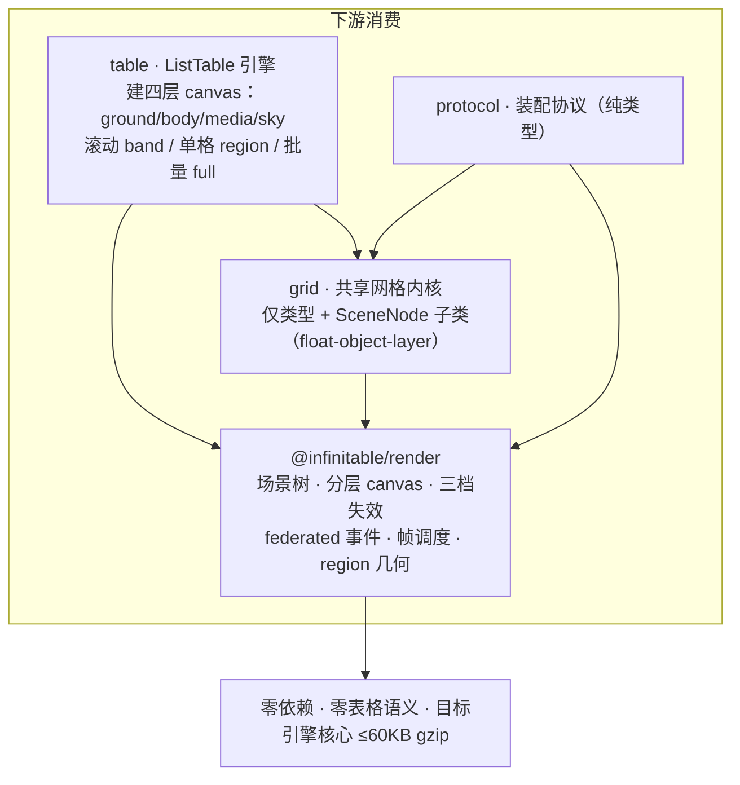

# 渲染引擎（@infinitable/render）

通用 canvas 渲染工具包：场景树 + 分层 canvas + 三档失效 + federated 事件 + 帧调度，零第三方依赖、零表格语义，是全仓自研渲染（零 vrender 依赖）的唯一底座。代码入口 `packages/render/src/index.ts`。

返回 [architecture.md](./architecture.md)

## 在整体架构中的位置

render 位于依赖图最底层，上游只有各包对它的依赖，它不依赖任何业务包。下游消费分两类：**table** 建四层 canvas、把滚动/交互/图片/批量更新全部翻译成失效语言；**grid** 只用类型与 `SceneNode` 子类（float-object-layer 自绘浮动对象），与 render 仅经 RenderHost 窄接口耦合。



要点（详细机制见 [grid-kernel.md](./grid-kernel.md)、[list-table-engine.md](./list-table-engine.md)）：

- grid 的滚动窗口维护与 table 的可视窗口场景全部汇入 render 的失效语言：`ScrollManager`（grid，唯一滚动源）→ table `onScroll` → `host.submitInvalidation('body', { type: 'band', ... })`。
- [engine-assembly-protocol.md](./engine-assembly-protocol.md) 的协议类型只依赖 grid 与 render 的类型，render 不感知协议。

## 核心概念速查

| 概念 | 类型或类 | 代码位置 |
| --- | --- | --- |
| RenderHost 窄接口（外部唯一入口面） | `RenderHost` | `src/types.ts` |
| 宿主创建函数（窄接口唯一实现入口） | `createRenderHost(options)` | `src/render-host.ts` |
| 宿主可注入项（canvas 工厂/帧调度/测量/DPR/容器/事件源） | `RenderHostOptions` | `src/render-host.ts` |
| 层句柄（持层方对单层的全部操作） | `LayerHandle` | `src/types.ts` |
| 层实现（内部，不导出） | `CanvasLayer` | `src/layers/canvas-layer.ts` |
| 层标识与叠序（自底向上） | `LayerKind` = `'ground' \| 'body' \| 'media' \| 'sky'` | `src/types.ts` |
| 三档失效 | `Invalidation`（region / band / full） | `src/types.ts` |
| 失效队列与合并（内部） | `InvalidationQueue` / `RepaintPlan` | `src/invalidation/invalidation-queue.ts` |
| 各层失效消费策略（建层参数化） | `LayerConsumption` = `'band-full-only' \| 'regions' \| 'always-full'` | `src/types.ts` |
| 帧任务 / 帧调度器（调度器内部，经 `RenderHostOptions.scheduleFrame` 注入替身） | `FrameTask` / `FrameScheduler` | `src/types.ts` / `src/frame-scheduler.ts` |
| 场景树节点 | `SceneNode` | `src/scene/scene-node.ts` |
| 内建图元（矩形/文本/路径/图片） | `RectNode` / `TextNode` / `PathNode` / `ImageNode` | `src/scene/primitives.ts` |
| 绘制遍历（含脏区剔除） | `paintTree(node, ctx, cull?)` | `src/scene/paint.ts` |
| 命中测试 | `hitTest(node, x, y)` | `src/scene/hit-test.ts` |
| federated 场景事件 | `SceneEvent` / `SceneEventType` | `src/events/event-system.ts` |
| 事件系统（内部，经 `eventsTarget` 接线） | `EventSystem` | `src/events/event-system.ts` |
| 绘制协议（2D 上下文最小结构化子集） | `RenderContext` / `RenderCanvas` / `RenderImageSource` | `src/types.ts` |
| region 几何工具 | `intersects` `union` `spread` `ceil` `clip` `equals` `contains` | `src/region.ts` |

## 模块分层

| 模块 | 文件 | 进公共导出 | 职责 |
| --- | --- | --- | --- |
| 场景树 `scene/` | `scene-node.ts` `primitives.ts` `paint.ts` `hit-test.ts` | 是（节点/图元/遍历/命中） | 节点模型（父子链、挂载摘除、监听器）、四种内建图元、绘制遍历与脏区剔除、命中测试 |
| 分层 canvas `layers/` | `canvas-layer.ts` | 否（经 `LayerHandle` 面） | 单层 = 一棵场景树 + 一个失效队列 + 一块 canvas；帧末按重绘计划消费脏区 |
| 失效登记 `invalidation/` | `invalidation-queue.ts` | 否 | 三档失效的收集、归一化与合并；按建层注入的消费策略 drain 出重绘计划 |
| federated 事件 `events/` | `event-system.ts` | 类型（`SceneEvent` / `SceneEventType`） | DOM 事件归一化为层坐标场景事件，自顶向下跨层命中后沿父链冒泡 |
| 帧调度 | `frame-scheduler.ts` | 否（经 `RenderHostOptions.scheduleFrame/cancelFrame` 注入） | 多次 request 收敛到同一渲染帧；同任务引用同帧只执行一次 |
| 宿主装配 | `render-host.ts` | 是（`createRenderHost` / `RenderHostOptions`） | 建层、DPR 三级优先与双通道跟随、层叠放挂载、事件接线、文本测量、销毁回收 |
| 基础类型/几何 | `types.ts` `region.ts` | 是 | 窄接口、层、失效、绘制协议等全部类型；矩形几何纯函数 |

## 关键机制走读

### 主循环一句话

内容方写场景树（`LayerHandle.root`）→ 变更处声明三档失效（`host.submitInvalidation` 或 `layer.invalidate`）→ 失效队列合并 + 帧调度收敛为下一帧一次 `flush` → 各层按消费策略 drain 出重绘计划 → 整层或逐脏区 `clearRect` + 裁剪 + `paintTree` 重画 → 浏览器合成上屏。**下游从不直接触发绘制，失效声明是唯一渲染驱动语言。**

### 三档失效与合并语义（`invalidation/invalidation-queue.ts`）

三档定义（`Invalidation`，档名已去表格语义）：

| 档 | 形态 | 语义 | 典型来源 |
| --- | --- | --- | --- |
| `region` | `{ region, prevRegion? }` | 局部矩形脏区；`prevRegion` 可选旧包围盒，内容移动/缩放后双包围盒一次画全 | 单格数据变更、图片加载完成定向失效 |
| `band` | `{ region }` | 视口全宽/全高的一条带，滚动窗口滑动的典型产物 | 滚动（table `onScroll` 按滚动方向分层提交） |
| `full` | `{}` | 整层重绘；**无可信 bounds 时必须用 full，禁止猜小块** | 主题切换、resize、批量更新 |

帧内合并（`InvalidationQueue.push`，常量 `REGION_SPREAD = 10`、`MAX_BANDS = 8`）：

- **region 归一化**：`ceil(union(region, prevRegion))` 得原始脏区 `raw`，再 `spread(raw, 10)` 扩边防增量补画边缘残影（对照 leafer clipSpread）；相同登记区按 `equals` 去重。
- **band 吸收 region，只认完全包含**：新 band 吸收被它完全包含的已有 region（按未扩边的 `raw` 判定）；**仅相交不吸收**——窄 band 与大 region 重叠边缘时，region 的重绘区域远大于 band，按相交吸收会丢掉 band 外的重绘。被已有 band 完全包含的后续 region 也直接丢弃。
- **band 数超上限升级**：`bands.length > 8` → `full`（多条带合并成整层反而更便宜）。
- **full 吸收一切**：置位后清空 regions/bands，其后同帧的增量失效全部忽略。

### 各层失效消费策略（建层参数化，`LayerOpts.consumption`）

帧末 `drain()` 按**建层时注入**的策略把队列收敛为 `RepaintPlan`（`{ full: true }` 或 `{ full: false, regions }`）：

| 策略 | region 档 | band 档 | full 档 | 适用内容 | table 实配 |
| --- | --- | --- | --- | --- | --- |
| `'regions'`（缺省） | 逐脏区增量补画 | 逐脏区补画 | 整层 | 网格内容、图片格 | body、media（惰性建） |
| `'band-full-only'` | **忽略**（drain 出 null，不重绘） | 逐带补画 | 整层 | 背景类内容，不因局部脏区重绘 | ground（水印 underlay，惰性建） |
| `'always-full'` | 整层 | 整层 | 整层 | 重绘便宜的内容层 | sky（选区/浮层交互） |

注意两点：一是 `submitInvalidation` 对未建层会**隐式建层**（走缺省 `'regions'`），要定制消费策略必须先显式 `createLayer`；二是策略是层的属性、不是失效的属性——同一份失效提交给不同层，消费结果不同（见示例 8）。

### 帧调度与单帧收敛（`frame-scheduler.ts` + `render-host.ts`）

`FrameScheduler` 内部是 `Set<FrameTask>` + 单个调度句柄：首个任务触发一次调度（缺省 rAF，非浏览器退化 `setTimeout(16)`），帧回调快照执行后清空；**同一任务引用在同一帧内只执行一次**（Set 去重）。宿主持有稳定引用 `flushTask = () => this.flush()`，因此同帧内任意多次失效（跨层也算）只登记一次帧调度、帧末统一按 ground→body→media→sky 顺序逐层消费。`host.requestFrame(task)` 以同一语义开放给下游（table 的惯性滚动 `InertiaScroller`、grid 的触控滚动都以它驱动动画帧）。测试经 `RenderHostOptions.scheduleFrame/cancelFrame` 注入手动步进（见示例 4）。

### 场景树渲染管线（`scene/scene-node.ts` + `scene/paint.ts` + `layers/canvas-layer.ts`）

- **节点模型**：`SceneNode` 持局部 `x/y/width/height`、`visible`、`pickable`、`parent` 与 `children`；`appendChild` 自动换父（重复挂载先从旧父摘除）、`removeFromParent`、`removeChildren(predicate)` 写指针单趟原地压实（O(children) 一次完成、相对顺序即 z 序不变，供批量窗口更新）。`getGlobalBounds()` 沿父链累加坐标得层坐标包围盒——下游定向失效的标准取材（`node.getGlobalBounds()` 直接喂 region 档）。
- **绘制遍历 `paintTree`**：先绘自身再按 children 顺序绘子节点（后者在上，children 顺序即 z 序）；每节点 `save → translate(x, y) → paint(ctx) → 递归子节点 → restore`，`paint` 覆盖时 ctx 已平移到本节点局部原点。`cull` 参数（层坐标脏区）按 `paintedBounds()`（缺省即节点自身包围盒）做整棵子树剔除——**绘制超出自身几何的节点（向邻格溢出的文本格）覆盖 `paintedBounds` 把溢出段并入**，这是溢出渲染走廊（见 [overflow-rendering-research.md](./overflow-rendering-research.md)）与脏区剔除的接缝。
- **层消费（`CanvasLayer.render`）**：full 计划走 `setTransform(dpr,0,0,dpr,0,0) + clearRect 整层 + paintTree(root)`；regions 计划逐脏区 `clip + clearRect + paintTree(root, ctx, dirty)`（dirty 先 `clip` 到层边界，不相交跳过）。层根节点是宿主构造的 `pickable: false`、尺寸与层一致的场景节点。
- **物理像素**：canvas 物理尺寸 = `Math.round(css × dpr)`，绘制前统一 `setTransform` 缩放，场景坐标全程 CSS 像素。

### federated 事件（`events/event-system.ts`）

宿主构造时提供 `eventsTarget`（缺省取 `container`）即启用：宿主建 `EventSystem`，监听 11 类 DOM 事件（`pointerdown/move/up`、`wheel`、`keydown/keyup`、`contextmenu`、`touchstart/move/end/cancel`）。派发数据流：

1. **归一化**：DOM 事件经 `getBoundingClientRect` 换算为层坐标（CSS 像素）；触摸取第一个触点；键盘事件不换算不命中。
2. **跨层命中**：按 `rootsTopDown()`（sky→media→body→ground）逐层 `hitTest`，取第一个命中；层根列表有缓存，建层/移除层由宿主 `invalidateRoots` 失效。
3. **构造 `SceneEvent`**：`type / target / x / y / deltaX / deltaY / key / shiftKey / ctrlKey / metaKey / button / originalEvent`。
4. **冒泡**：命中节点 → `parent` 链直至层根逐节点 `handleEvent`；未命中/键盘事件从最顶层根开始派发。**`SceneEvent` 无 stopPropagation**——冒泡走完整链；监听器内退订安全（`Set` 迭代）。订阅经节点 `on(type, listener)`，返回退订函数。
5. `wheel` 为预留事件型：仓内无场景级订阅方，宿主滚动直连 `scrollBy`，但事件仍参与归一化派发。

### 命中测试（`scene/hit-test.ts`）

`hitTest(node, x, y)`：x/y 为 node 父坐标系下的点（根节点即层坐标），逐节点做半开区间 `[0, width) × [0, height)` 盒判定，**逆 children 序探测（最上优先）、返回最深层最靠上的可拾取节点**，未命中返回 null。两个关键语义：

- `pickable: false` 的节点自身不返回但**子节点仍可命中**（穿透自身不穿透子树）；层根即 pickable:false，命中落到内容节点。
- 这支撑了「sky 浮动对象不拦截 body 拖选」：grid 的 `FloatObjectNode`（`packages/grid/src/float/float-object-layer.ts`）构造为 `pickable: false`，指针事件穿透到 body 层数据格，浮动对象的点选/拖拽由宿主表格的指针路由优先接管。

### DPR 三级优先与双通道跟随（`render-host.ts`）

| 优先级 | 来源 | 说明 |
| --- | --- | --- |
| 1 | `options.dpr` 显式注入 | 运行期跟随通道**永不覆盖**（确定性场景锁值） |
| 2 | `options.resolveEnvironmentDpr` 注入 | 构造初值、跟随通道、探测武装都经它读取（headless/SSR 接管） |
| 3 | 运行环境（缺省） | `window.devicePixelRatio`，无 window 回落 1 |

运行期跟随走 window `resize` + `matchMedia('(resolution: Ndppx)')` 双通道（浏览器缩放/跨屏走 resize，纯缩放比变更走 resolution 失配；一轮一监听，变化后按新值重武装）。变化后以新 dpr 重设全部已建层物理尺寸（`setSize` 内整层失效，帧末统一重绘），**滚动位置与场景内容不动、实例不重建**。`host.resize(width, height, dpr?)` 显式传 dpr 时同步内部值，已建层与后续新建层都取新值。

## 示例集

以下示例全部改编自 `packages/render/tests/` 与下游包真实用法，取材路径逐个标注；仅使用 `packages/render/src/index.ts` 公开导出的标识符。

### 1. 最小分层 canvas 应用（手工搭 host + 层 + 场景节点）

```ts
import { createRenderHost, RectNode, TextNode } from '@infinitable/render'

// 上屏模式：容器自带 position:relative 与视口尺寸（宿主只设 canvas 的 absolute/left/top）
const container = document.getElementById('stage') as HTMLElement
const host = createRenderHost({ width: 800, height: 600, container })

const body = host.createLayer({ kind: 'body' })       // 同 kind 重复调用幂等返回同一句柄
body.root.appendChild(new RectNode({ x: 10, y: 10, width: 120, height: 40, fill: '#eef', stroke: '#333' }))
body.root.appendChild(new TextNode({ x: 18, y: 16, text: 'hello', font: '14px sans-serif' }))

host.submitInvalidation('body', { type: 'full' })     // 下一帧整层重绘（层 canvas 已按 LAYER_ORDER 挂进容器）
host.destroy()                                        // 取消挂起帧、解绑事件、移除层 canvas（幂等）
```

不传 `container` 即离屏模式（测试/预渲染）：层 canvas 不挂 DOM，靠 `body.canvasElement` 直接消费位图。取材：`packages/render/tests/render-host.test.ts`（createHost + 幂等建层用例）。

### 2. 场景树组装（矩形/文本/路径/图片四种内建图元）

```ts
import { ImageNode, PathNode, RectNode, SceneNode, TextNode } from '@infinitable/render'

const root = new SceneNode({ width: 800, height: 600, pickable: false }) // 分组容器不参与命中
const card = new SceneNode({ x: 20, y: 20, width: 200, height: 80 })
root.appendChild(card)

card.appendChild(new RectNode({ width: 200, height: 80, fill: '#fff', stroke: '#333', lineWidth: 1 }))
card.appendChild(new TextNode({ x: 8, y: 8, text: '标题', font: '12px sans-serif', fill: '#111' }))
card.appendChild(new PathNode({
  x: 160, y: 48,                                    // 节点 x/y 即包围盒摆放位置（命令自动平移到包围盒原点）
  commands: [
    { type: 'moveTo', x: 10, y: 4 }, { type: 'lineTo', x: 20, y: 4 },
    { type: 'lineTo', x: 15, y: 12 }, { type: 'closePath' },
  ],
  fill: '#333',
}))
card.appendChild(new ImageNode({ x: 8, y: 48, source: bitmap, width: 32, height: 32 })) // 尺寸须显式传（位图未就绪时 source 宽高为 0）
```

图元语义速记：`TextNode` 基线锚在局部 `(0, ascent)`，未显式给定的一侧尺寸在首次绘制时经 `measureText` 回写（回写前空盒不可命中）；`PathNode` 包围盒按命令坐标保守推导（曲线计入控制点、圆弧取整圆外接盒），init 的 width/height 不参与；`RectNode` fill 走 `fillRect`、stroke 走 `beginPath + rect + stroke`。取材：`packages/render/tests/scene/primitives.test.ts`。

### 3. 失效登记：三档触发与帧内合并

```ts
// 取材：packages/render/tests/render-host.test.ts「提交失效后单帧收敛」+ invalidation-queue 合并语义
const body = host.createLayer({ kind: 'body' })

// ① region：局部脏区（prevRegion = 内容移动前旧包围盒，双包围盒一次画全，避免残影）
host.submitInvalidation('body', {
  type: 'region',
  region: { x: 100, y: 0, width: 50, height: 30 },
  prevRegion: { x: 0, y: 0, width: 50, height: 30 },
})
// ② band：视口全宽横带（滚动产物）
host.submitInvalidation('body', { type: 'band', region: { x: 0, y: 24, width: 800, height: 40 } })
// ③ full：整层（无可信 bounds 时的兜底，禁止猜小块）
host.submitInvalidation('body', { type: 'full' })

// 同帧三笔提交：只触发一次帧调度；full 吸收前两笔 → 帧末整层重绘一次
```

合并结果速查（region 归一化 = 双包围盒 union + 扩边 10px + 像素对齐；`{ x: 0.5, y: 0.5, w: 10, h: 10 }` + `prevRegion { x: 20, ... }` → 登记区 `{ x: -10, y: -10, width: 50, height: 31 }`）：两个不相交 region 各自补画（两次 clearRect/clip）；region 被 band 完全包含则吸收、仅相交则各自保留；band 超 8 条升级 full。取材：`packages/render/tests/invalidation/invalidation-queue.test.ts`。

### 4. 帧调度：手动步进与 requestFrame 去重

`FrameScheduler` 本身不进公共导出，公开路径是 `RenderHostOptions.scheduleFrame/cancelFrame` 注入替身 + `host.requestFrame`：

```ts
// 取材：packages/render/tests/render-host.test.ts 的 makeManualScheduler
import { createRenderHost } from '@infinitable/render'

const scheduled: Array<() => void> = []
const host = createRenderHost({
  width: 800, height: 600,
  scheduleFrame: (cb) => (scheduled.push(cb), scheduled.length),  // 收集而非等 rAF
  cancelFrame: () => {},
})

let runs = 0
const tick = () => { runs += 1 }
host.requestFrame(tick)
host.requestFrame(tick)        // 同一任务引用：同帧去重
host.requestFrame(() => {})    // 不同任务：照常执行
// scheduled.length === 1（首个任务才触发调度）
scheduled.shift()?.()          // 手动步进一帧：tick 执行一次（runs === 1）

host.submitInvalidation('body', { type: 'full' })  // 失效同样汇入这个单帧收敛
scheduled.shift()?.()          // 步进后：body 整层重绘一次，下一帧无失效则不再调度
```

### 5. hitTest 命中测试

```ts
// 取材：packages/render/tests/scene/scene.test.ts
import { hitTest, RectNode, SceneNode } from '@infinitable/render'

const root = new SceneNode({ width: 100, height: 100 })
const bottom = new RectNode({ width: 50, height: 50, fill: '#eee' })
const top = new RectNode({ width: 50, height: 50, fill: '#fff' })
root.appendChild(bottom)
root.appendChild(top)

hitTest(root, 10, 10)   // top：children 后挂者在上，逆序探测最上优先
top.removeFromParent()
hitTest(root, 10, 10)   // bottom：摘除后露出下层
hitTest(root, 60, 60)   // null：点在父盒外（半开区间 [0, width)）

const passthrough = new SceneNode({ width: 100, height: 100, pickable: false })
const child = new RectNode({ width: 50, height: 50, fill: '#fff' })
passthrough.appendChild(child)
hitTest(passthrough, 10, 10)  // child：pickable=false 穿透自身，子节点仍可命中（层根即此形态）
```

### 6. federated 事件监听

```ts
// 取材：packages/render/tests/events/event-system.test.ts（事件源最小结构 EventTargetLike）
import { createRenderHost, RectNode, type SceneEvent } from '@infinitable/render'

const host = createRenderHost({ width: 800, height: 600, container }) // container 兼任事件源（eventsTarget 缺省取它）
const body = host.createLayer({ kind: 'body' })
const cell = new RectNode({ x: 0, y: 0, width: 50, height: 30, fill: '#eef' })
body.root.appendChild(cell)

const off = cell.on('pointerdown', (e: SceneEvent) => {
  // e.x/e.y 已是层坐标（CSS 像素，扣除容器 getBoundingClientRect 偏移）
  // e.target === cell；e.button 0 主键 / 2 次键；e.originalEvent 可调 preventDefault()
  console.log(e.type, e.target === cell, e.x, e.y)
})
body.root.on('pointerdown', (e) => { /* 冒泡：命中 cell 时这里也会收到（SceneEvent 无 stopPropagation） */ })
body.root.on('pointerdown', (e) => { /* 未命中时只派发到最顶层根：target 为 null */ })
off()  // 退订（on 的返回值）
```

事件类型全集：`pointerdown/pointermove/pointerup`、`wheel`（预留）、`keydown/keyup`（不命中，`target: null`）、`contextmenu`、`touchstart/touchmove/touchend/touchcancel`（取第一个触点归一化）。

### 7. 路径原语自绘（PathNode 声明式 + 自定义 paint 命令式）

```ts
// 取材：packages/render/tests/scene/primitives.test.ts + packages/grid/src/float/float-object-layer.ts
import { PathNode, SceneNode, type RenderContext } from '@infinitable/render'

// A. 声明式：PathNode 回放命令序列（fill 在前 stroke 在后；包围盒保守推导，命中按该盒）
const arc = new PathNode({
  commands: [{ type: 'arc', x: 4, y: 4, radius: 4, startAngle: 0, endAngle: Math.PI, counterclockwise: true }],
  fill: '#000',
})

// B. 命令式：自定义节点直接用 ctx 路径原语（RenderContext 必选成员，真实 2D 上下文天然满足）
class Sparkline extends SceneNode {
  override paint(ctx: RenderContext): void {
    ctx.beginPath()
    ctx.moveTo(0, this.height)
    ctx.lineTo(this.width / 2, 0)
    ctx.lineTo(this.width, this.height * 0.6)
    ctx.strokeStyle = '#2170E7'
    ctx.stroke()
  }
}
```

命令与 `RenderContext` 原语一一对应：`moveTo / lineTo / bezierCurveTo / quadraticCurveTo / arc / closePath`，`stroke` 描边、`fill` 填充。grid 的浮动对象层、table 的单元格节点（`packages/table/src/cell-node.ts`）都是 B 形态：继承 `SceneNode` 覆盖 `paint`（必要时再覆盖 `paintedBounds` 把绘制超出自身几何的部分并入脏区判定）。

### 8. 多层叠放与各层失效消费策略差异

```ts
// 取材：packages/render/tests/render-host.test.ts「consumption 建层注入」
const sky = host.createLayer({ kind: 'sky', consumption: 'always-full' })
const ground = host.createLayer({ kind: 'ground', consumption: 'band-full-only' })

// 同一笔 region 失效，提交给消费策略不同的两层：
host.submitInvalidation('sky', { type: 'region', region: { x: 0, y: 0, width: 10, height: 10 } })
host.submitInvalidation('ground', { type: 'region', region: { x: 0, y: 0, width: 10, height: 10 } })
scheduler.step()  // 手动步进一帧
// sky（always-full）  → clearRect(0, 0, 800, 600) 整层一次
// ground（band-full-only）→ region 档被忽略：drain 出 null，零重绘
```

下游实配即 table 的四层（`packages/table/src/list-table.ts` / `list-table-media.ts`）：body 与 media 为 `'regions'`（网格与图片格逐脏区补画）、ground 为 `'band-full-only'`（水印 underlay 不因局部脏区重绘）、sky 为 `'always-full'`（交互浮层重绘便宜直接整层）。层叠放与创建顺序无关：构造期只建 body/sky、media 惰性创建时，mount 按 `LAYER_ORDER` 声明 z 序插入，DOM 叠放仍为 ground→body→media→sky（测试「mount 按 LAYER_ORDER 叠放」用例守护）。

### 9. RenderHost 窄接口：下游如何消费

RenderHost 只有 6 个方法：`createLayer / submitInvalidation / requestFrame / measure / resize / destroy`。下游组件只认这个接口，宿主实例可外部注入——table 的形态就是 `options.host ?? createRenderHost({...})`（`packages/table/src/list-table.ts`）：

```ts
// 取材：packages/table/src/list-table.ts（建四层 canvas 的参数化用法，节选改写）
import { createRenderHost, type LayerHandle, type RenderHost } from '@infinitable/render'

class MyGridWidget {
  private host: RenderHost
  private body: LayerHandle

  constructor(options: { host?: RenderHost; width: number; height: number; container: HTMLElement }) {
    this.host = options.host ?? createRenderHost({
      width: options.width,
      height: options.height,
      dpr: window.devicePixelRatio,            // 显式注入即锁值，运行期跟随不覆盖
      container: options.container,            // 层 canvas 挂载点 + 事件源
      createCanvas: () => document.createElement('canvas'),
    })
    this.body = this.host.createLayer({ kind: 'body', consumption: 'regions' })
    this.host.createLayer({ kind: 'sky', consumption: 'always-full' })
    // ground / media 惰性创建：首个 underlay / 图片格到来才建层
  }

  // 滚动：视口全宽横带 band 失效（list-table.ts onScroll 的形态）
  onScrollY(headerHeight: number) {
    this.body.invalidate({ type: 'band', region: { x: 0, y: headerHeight, width: 800, height: 600 - headerHeight } })
  }

  // 单点变更：节点包围盒定向 region 失效（list-table-media.ts 图片加载完成的形态）
  refresh(node: { getGlobalBounds(): { x: number; y: number; width: number; height: number } }) {
    this.body.invalidate({ type: 'region', region: node.getGlobalBounds() })
  }

  // 文本测量与动画帧：窄接口的另两个高频出口
  measureCharWidth(char: string, font: string) { return this.host.measure(char, font).width } // table 的 TextAdvanceTable 即此形态
  driveInertia(task: () => void) { this.host.requestFrame(task) }                             // InertiaScroller 的驱动形态
}
```

grid 一侧的接缝是**类型与场景树**而非宿主：`float-object-layer.ts` 构造注入 `LayerHandle`，把 `pickable: false` 的容器子树挂到 `layer.root` 最末（层内最顶），变更处 `layer.invalidate({ type: 'region', region })` 定向失效；`grid-layout.ts` / `media/draw-image.ts` 复用 `Region` / `RenderContext` 类型与 render 共享同一套几何与绘制词汇。

## 测试与验证入口

| 测试文件 | 覆盖 |
| --- | --- |
| `packages/render/tests/render-host.test.ts` | 建层幂等与 dpr 换算、单帧收敛、消费策略差异、requestFrame 去重、measure、setSize/resize、DPR 三级优先与双通道跟随、destroy、mount 按 LAYER_ORDER 叠放 |
| `packages/render/tests/invalidation/invalidation-queue.test.ts` | region 归一化（union/扩边/像素对齐）、band 吸收与不吸收边界、band 上限升级、full 吸收、三策略 drain |
| `packages/render/tests/scene/scene.test.ts` | 挂载/摘除/批量压实、getGlobalBounds、hitTest 语义、paintTree 顺序与 cull（含 paintedBounds 溢出判定） |
| `packages/render/tests/scene/primitives.test.ts` | 四种图元的调用序列、测量回写、包围盒推导与命中 |
| `packages/render/tests/events/event-system.test.ts` | 坐标归一化、跨层命中 z 序、冒泡、未命中派发、键盘/触摸/contextmenu、穿透命中、dispose |
| `packages/render/tests/testing/fake-canvas.ts` | 测试替身：`FakeCanvas` / `FakeContext` 实现 `RenderCanvas` / `RenderContext`，记录全部调用；测量口径每字符 10px 宽、ascent 8 / descent 2 |

全部测试在 node 环境运行（无 DOM）：canvas 工厂注入 `FakeCanvas`、帧调度注入手动步进——`RenderContext` / `RenderCanvas` 设计为结构化最小类型正是为了让假画布可整体替换。

## 边界与红线

- **依赖方向**：render 零第三方依赖（`packages/render/package.json` 无 dependencies，`sideEffects: false`），不依赖任何表格语义包；依赖边只有 grid→render、table→render、protocol→render(类型)，反向禁止。失效档名（region/band/full）、消费策略名（band-full-only/regions/always-full）与层名（ground/body/media/sky）均为通用 canvas 分层词汇，包内不得引入「单元格/行列/滚动区」等表格概念。
- **RenderHost 窄接口语义**：外部只凭 `createLayer / submitInvalidation / requestFrame / measure / resize / destroy` 六个方法完成全部宿主操作；场景内容读写一律经 `LayerHandle.root` 的场景树 API；下游不得触达 `CanvasLayer` / `InvalidationQueue` / `EventSystem` / `FrameScheduler`（均不导出，测试经 src 路径直连属例外）。`submitInvalidation` 的隐式建层走缺省 `'regions'` 消费，定制策略必须显式建层。
- **失效纪律**：无可信 bounds 必须提交 `full`，禁止猜小块；同帧多次提交由失效队列与帧调度收敛，下游无需自行去重（table 的 batchUpdate 也只做「批末一次 band 提交」而非逐帧节流）。
- **体积目标**：整个引擎核心（render 为地基）目标 ≤60KB gzip——render 不引第三方渲染库（零 vrender/leafer/pixi 依赖），region 几何等纯函数自持；新增能力先过「是否必须进核心」这一关。
