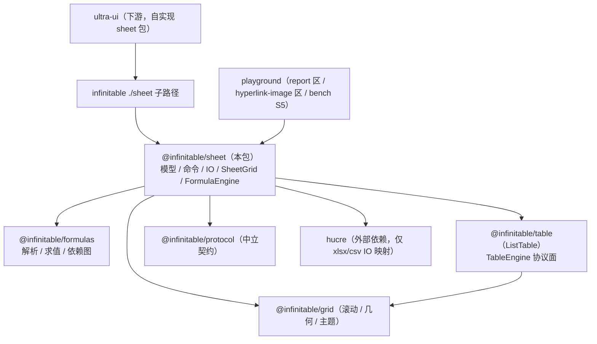

# 电子表格核心（@infinitable/sheet）

电子表格领域包：sheet 模型（值/样式/合并/冻结/图片/侧车 meta）+ 命令系统（一切写操作可 undo/redo）+ 图簿级公式编排（FormulaEngine 组合 formulas）+ xlsx/csv IO（经 hucre 映射）+ SheetGrid 视图适配（经引擎装配协议消费 table 引擎）。代码入口 `packages/sheet/src/index.ts`（聚合导出为公开 API 白名单，禁止星号导出）。

返回 [architecture.md](./architecture.md)

## 在整体架构中的位置

sheet 是 table + formulas + hucre 的**宿主装配层**：模型与命令是纯 TS（无 DOM，可无头测试），公式求值/依赖索引组合 `@infinitable/formulas`（见 [formulas.md](./formulas.md)），渲染消费 `@infinitable/table` 的 ListTable 引擎（见 [list-table-engine.md](./list-table-engine.md)，装配契约见 [engine-assembly-protocol.md](./engine-assembly-protocol.md)），xlsx IO 只经 hucre 做值/样式的导入导出映射。发布形态为 `infinitable` 包的 `./sheet` 子路径（见 [infinitable-package.md](./infinitable-package.md)）。



- 依赖方向（package.json dependencies）：`@infinitable/formulas` / `@infinitable/grid` / `@infinitable/protocol` / `@infinitable/table` + `hucre`；不依赖 render、pivot、plugins——渲染经 TableEngine 协议面间接消费。
- 下游消费现状：playground 的 sheet 电子表格示例**已移除**（下游 ultra-ui 自实现 sheet 包），现存消费面为 report 区（只读报表渲染）、hyperlink-image 区（可写模型 API 演示）与 bench S5 场景（性能口径），见「示例集」。
- 公式引擎 API 不从本包转售：sheet 模型消费 `@infinitable/formulas`（FormulaEngine 仅为组合门面），下游直接 `import '@infinitable/formulas'` 取解析器/内置函数。

## 核心概念

| 概念 | 类型或类名 | 代码位置 |
| --- | --- | --- |
| 单元格地址 / 区域（0 基坐标） | `CellAddress` / `CellRange`；`parseAddress` / `parseRange` / `colIndexToName` 等 | `src/core/address.ts` |
| 单元格数据（v 值 / t 类型 / f 公式原文 / s 样式 id） | `CellData` / `CellValue` / `CellType`；`CellStore` | `src/core/cell-store.ts` |
| 侧车元数据（按格 + namespace 的平行存储） | `CellMetaStore` / `CellMetaSnapshotItem`；`cellMetaKey` | `src/core/cell-meta.ts` / `cell-meta-store.ts` |
| 按格嵌入图 / 超链接 / 只读标记（meta namespace 常量） | `CELL_IMAGE_META_NAMESPACE` / `CELL_LINK_META_NAMESPACE` / `CELL_READONLY_META_NAMESPACE` | `cell-meta.ts` / `cell-readonly.ts` |
| 单元格样式与样式池（内容寻址，同定义共享 StyleId） | `CellStyle` / `CellStylePatch` / `NumFmt` / `StylePool` / `composeCellStyles` | `src/core/style/` |
| 合并管理（锚点 / 覆盖格 / 相交包围盒） | `MergeManager` / `MergedCellKind` / `CellInfo` | `src/core/merge-manager.ts` |
| 选区状态机 | `SelectionModel` / `SelectionState` | `src/core/selection.ts` |
| 单表模型（store + merges + selection + history + 公式图 组合） | `Sheet` / `SheetSnapshot` / `SheetEvents` / `FrozenState` | `src/core/sheet.ts` |
| 多表工作簿（全部 sheet 共享一个公式引擎） | `Workbook` / `WorkbookOptions` / `WorkbookEvents` | `src/core/workbook.ts` |
| 公式引擎门面（组合 formulas，图簿联动 / 重算编排） | `FormulaEngine` / `FormulaEngineOptions` | `src/core/formula-engine.ts` |
| 命令与补丁（一切模型变更的差量单元） | `Command` / `Mutation` / `Patch`（cell/merge/structure/snapshot/image/cell-meta/axis-style） | `src/core/command/types.ts` |
| 命令注册表（无状态命令，全局共享） | `CommandRegistry` / `defaultCommandRegistry`；`SetCellValueCommand` 等 17 个命令 | `src/core/command/` |
| undo/redo 历史与事务 | `HistoryManager` / `HistoryState` | `src/core/command/history.ts` |
| 浮动图片（锚点 from→to + data/src） | `SheetImage` / `ImageInput` / `insertImage` 命令 | `src/core/image.ts` |
| 视图适配（Sheet 模型 ↔ table 引擎 Facade） | `SheetGrid` / `SheetGridOptions` | `src/grid/sheet-grid.ts` |
| 查找 / 填充（纯函数，模型侧算法） | `findAll` / `findNext*` / `generateFill` | `src/core/find.ts` / `fill.ts` |
| xlsx/csv 导入导出 | `exportWorkbookXlsx` / `exportSheetXlsx` / `exportSheetCsv` / `importXlsx` / `importCsv` | `src/core/io/export.ts` / `import.ts` |

## 模块分层

| 层 | 模块 | 触 DOM | 职责 |
| --- | --- | --- | --- |
| M1 模型 | `core/address` `cell-store` `cell-meta*` `merge-manager` `selection` `style/*` `image` `fill` `find` `format` `defaults` | 否 | 纯数据结构与算法；空单元格不占存储（稀疏） |
| M2 命令 | `core/command/*`（types/registry/default-registry/命令族/history） | 否 | 一切模型变更的命令化：执行产出 Mutation（before/after 差量补丁），undo/redo 双向回放 |
| M3 编排 | `core/sheet.ts` `core/workbook.ts` | 否 | Sheet/Workbook 操作入口：命令执行 + 事务 + 事件 + 快照；公式重算编排在 executeCommand 内闭环 |
| M4 公式 | `core/formula-engine.ts` | 否 | 图簿联动（多 sheet 注册表/改名别名/删表联动）、标脏闭包、拓扑递归求值、#CYCLE! 护栏、实例函数集 |
| M5 IO | `core/io/export.ts` `core/io/import.ts` | 否 | 模型 ↔ hucre（xlsx/csv）映射与装配；导入走事务（单 undo 单元），导出纯函数可无头测试 |
| M6 视图 | `grid/*`（sheet-grid/grid-model/grid-selection-controller/grid-float-images/grid-cell-images/grid-cell-links/grid-header/grid-editors/grid-row-height-engine/grid-theme/grid-coords/grid-style-map） | 是 | SheetGrid 装配：构造 ListTable 后以 TableEngine 协议面持有，事件双向同步、pull 式取值 |

## 关键机制走读

### 1. 命令驱动模型与重算（`core/sheet.ts` + `core/command/`）

一切写操作（`setCellValue` / `setCells` / `setCellStyle` / `mergeCells` / `insertRows` / `setCellImage` / …）都收敛到 `Sheet.executeCommand(commandId, params)`：

```
executeCommand
  → defaultCommandRegistry.execute（命令 handler 产出 Mutation[]）
  → recalcAfterCommand(mutations)          ← 从 redo 补丁提取变更格（仅 v/t/f 变化者），
                                            交 formulaGraph.recalc 增量重算
  → 派生补丁立即经 boundApplyPatch 应用，并作为附加 mutation 并入同一 undo 单元
  → history.push(mutations + recalcMutation)
```

要点（`sheet.ts:717-730`、`1320-1360`）：

- **applyPatch 是唯一变更通道**：命令执行与 undo/redo 回放共用；`CellPatch.sheet` 字段把跨表重算派生补丁路由到目标 sheet 的变更通道（`boundApplyPatch`）。applyPatch 内部同时调 `formulaGraph.syncCell` 维护依赖图节点（f 增/删/改 → 节点增/删/重建）——undo/redo 回放不重算，靠派生补丁精确回放缓存值。
- **事务**：`beginTransaction/commit/rollback` 可嵌套（拍平到最外层）；一次命令 = 一个 undo 单元，批量粘贴/导入经单命令（`setCells` 一次传全量 items）合并。
- **`setCellValue` 识别 `=` 前缀走 `setCellFormula`**：公式原文存 `CellData.f`（不带 `=`），计算缓存 v/t 由重算填充；空白公式 = 清格。
- **结构变更**（insert/delete rows/cols）：`InsertCellsCommand` 先 `prepareDeletedCellPatches`（捕获被删格）+ `prepareFormulaShift`（引用平移补丁，走 formulas 的 `shiftFormulaText`；引用被删区间覆盖 → after = `#REF!`），再 `applyStructureChange` 平移数据/合并/行高列宽/轴样式/图片锚点；undo 走反向结构 + 精确还原操作前尺寸。

### 2. FormulaEngine：图簿联动与重算编排（`core/formula-engine.ts`）

组合而非重建（文件头注）：依赖索引（单格/区域反向索引、传递闭包、易失集）用 formulas 的 `DependencyGraph`，AST 求值用 formulas 的 `evaluate`；本层只做四件事——sheet 注册表、改名别名链、标脏闭包、递归求值驱动。

| 机制 | 源码依据（formula-engine.ts） |
| --- | --- |
| 图簿联动 | `sheets` Map（表名 → Sheet）为全簿注册表；Workbook 构造一个 FormulaEngine（`workbook.ts:61`）注入每个 `addSheet` 的 Sheet；独立 `new Sheet()` 自建引擎（`sheet.ts:217`）。坐标键 `keyOf` 以「长度前缀 + 表名」编码，任意表名无歧义 |
| 增量重算 | `recalc(changed)`：变更格命中图 → 标脏；加 `graph.affectedBy(coords)`（传递闭包依赖者）；再加 `volatileCells()` 全体易失格及其 `affectedBy`（易失语义：任意格变更必刷全部易失公式）；全簿无公式格时 `nodeCount === 0` 直接返回——百万级无公式批量写零编排开销 |
| 拓扑求值 | `evaluateDirty`：递归向下（依赖先于使用求值）+ memo（每格最多算一次）；`resolver.cell/range` 求值时命中脏集递归回环——裸引用（无表名）按「当前正在求值的公式所在表」路由（`defaultSheet` 保存/恢复） |
| #CYCLE! 护栏 | 在途栈遇回边：自栈中该格位置起全部入环（`cycleMembers`），环上格结果 = `#CYCLE!`，环外格只传播错误；求值期异常（自定义函数抛错）记 `#ERROR!` 不击穿重算。派生补丁只写 v/t、保留既有样式 s，收敛时值未变的格跳过（不产生冗余 undo 记录） |
| 实例函数集 | 构造 `options.functions`（key 统一大写）+ 运行时 `registerFunction(name, def)`（同名覆盖，此后新求值立即生效）；求值与易失探针（`astHasVolatileCall`）先于全局注册表命中——可覆盖内置（如盖掉 SUM 只影响本簿），与全局注册表隔离，多工作簿各持各的函数集 |
| 全量追溯 | `recalcAll()`：全部 sheet 的全部公式节点入脏集重算，返回派生补丁（未应用）；`Workbook.recalcAllFormulas()` 是其消费入口——补丁按目标 sheet 路由应用（不入 undo）。典型场景：运行时注册函数后追溯此前的 `#NAME?` 格。注意易失标记是公式注册时快照，运行时增补 volatile 函数不追溯已注册节点 |
| 删表联动 | `unregisterSheet`：注销前 `affectedBySheet` 收集引用方 → 注销 + 清别名 + `graph.removeSheet` → 引用方立即重算为 `#REF!`（补丁经 Workbook 应用，不入 undo） |
| 改名别名 | `renameSheet`：收集受影响节点（被改名表自身 + 引用方）→ 全部移出索引 → 注册表/别名切换 → 按新名重注册。别名链拍平：A→B→C 后引用 A 仍有效；新名是真实表名时别名不得覆盖（A→B→A 回改）。**公式文本不重写**——AST 里的旧名经别名解析到新名（`resolveSheet`），与「引用跟随改名」语义一致 |

### 3. SheetGrid 适配：经引擎装配协议消费 table 引擎（`grid/sheet-grid.ts`）

- **唯一构造点 + 协议面持有**：`new ListTable({...})` 后，实例以 `TableEngine` 协议面（EngineAssembly 中立装配 + 表格领域公共操作增量，见 [engine-assembly-protocol.md](./engine-assembly-protocol.md)）持有并传给全部协作模块（GridSelectionController / GridFloatImages / GridCellImages / GridCellLinks / GridHeaderLayer / GridEditorRouting / GridRowHeightEngine）——协作面不触碰 ListTable 具体类型，未来平级引擎按同一协议面接入时适配层无需改消费姿势（类头注，P7）。
- **数据面模型直挂**：`createSheetTableModel(sheet)` 把 Sheet 存储适配为引擎 TableModel；编辑提交经引擎回写 Sheet 命令系统（可 undo）。样式/显示为 pull 式按格取值（`resolveDisplayValue` / `resolveCellStyle` 渲染热路径回调），模型变更无需推送；`cell-change` 事件触发可视窗口局部 `refreshCell`。
- **运行时同步**：merge-change → `setMergeCells` 整体替换（签名判重）；frozen-change → `setFrozenRowCount/ColCount`；content-reset → 全量重刷；image-change → 浮动图重排；行高列宽拖拽落定写回模型（重建还原）。
- **WPS 式无限增长**：`growOnScroll`（缺省 true）滚动缓冲触界时模型 `ensureTableSize` + 引擎 `setRowCount/setColCount` 同步扩容「一幅可视 + 缓冲」；false 为固定网格。初始缺省 100×26。
- **LRU 可见性**：`setVisible(false)` 隐藏只置脏，激活时 `fullResync` 一次性同步——多 sheet tab 切换防隐藏实例空转。
- **键位**：Ctrl/Cmd+Z 撤销、Shift+Z / Ctrl+Y 重做（模型命令栈）、Ctrl+A 全选、Delete 删除选中浮动图。
- readonly 形态：不注册编辑器、行列拖改全禁、编辑链路整体关闭（report 区即此形态）；单格只读由 `resolveEditable` 拦截（模型 `isCellReadonly`）。

### 4. IO：xlsx 导出链路与 hucre 红线（`core/io/`）

导出链路（`export.ts`）：`exportWorkbookXlsx(workbook)` → 每表 `sheetToHucreWriteSheet`（值网格 rows + cells 覆盖项 + merges + freezePane + rowDefs + defaultRowHeight/ColWidth + columns + images）→ `hucre/xlsx` 的 `writeXlsx({ sheets, activeSheet })` → ZIP 字节（`Promise<Uint8Array>`）。映射口径：

- 公式格：rows 放计算缓存 v，cells 放 `formula`（不带 `=`）+ `formulaResult`；
- 日期 `t='d'`：模型 1900 系统序列数 → 数字 + `yyyy-mm-dd` numFmt（round-trip 保真）；
- 合并覆盖格：按 `getEffectiveStyle` 物化纯样式格（xlsx 端合并区边框取周边格外侧边，仅锚点带边框不完整）；
- 垂直对齐补缺省：未声明 vertical 的内容格补 `center`（视图 middle 缺省 vs Excel bottom 渲染差异）；
- 单位换算：行高 px→pt ×0.75；列宽 px→字符宽 `(px-5)/7`（导入对称 `×7+5`）。

导入链路（`import.ts`）：`importXlsx(buffer, onProgress?)` → `hucre/xlsx` 的 `readXlsx`（sparse + readStyles）→ 每表 `applyHucreSheet`：事务内清空 + 批量 `setCells`（单命令单次重算）+ `mergeCellsBatch` + `insertImage`，commit 成单 undo 单元；冻结/行高/列宽为模型状态不进 undo。worker 分片链路走 `replaceWorkbookWithSnapshots`（快照直接替换目标工作簿，`beginBatch/endBatch` 合并结构事件）。`importCsv(text, sheet)` 粘贴语义覆盖活动表。

**hucre 红线**：依赖仅限 xlsx/csv 导入导出的值/样式/几何映射与装配——不进模型层（模型不存 hucre 类型）、不进渲染层；边框线型收敛到模型 5 种、numFmt 只识别四类（date/thousands/cnUpper/fixed）之外的忽略。

## 示例集

以下示例均可运行（vitest / 浏览器宿主），逐条标注取材来源。

### 1. 最小 SheetGrid 装配（挂 DOM）

取材：`packages/sheet/tests/grid/grid-test-utils.ts`、`playground/src/sections/hyperlink-image.ts`。

```ts
import { Sheet, SheetGrid } from '@infinitable/sheet'

const container = document.createElement('div')
document.body.appendChild(container)
const sheet = new Sheet('demo') // 独立 Sheet 自建 FormulaEngine

const grid = new SheetGrid({
  container,
  sheet,
  rows: 20,
  cols: 8,
  width: 800,
  height: 600, // 显式视口；缺省测量容器，未布局回落 960×420
})

sheet.setCellValue({ row: 1, col: 2 }, 'hello') // 模型写入 → cell-change → 引擎局部刷新
grid.release() // 销毁：dispose 全部监听 + table.destroy()
```

### 2. 多 sheet 工作簿操作

取材：`packages/sheet/tests/core/workbook.test.ts`。

```ts
import { Workbook } from '@infinitable/sheet'

const wb = new Workbook() // 构造即含 Sheet1；全部 sheet 共享 wb.formulaGraph
// 初始数据二维数组（A1 起）：原始值类型自动推断，对象形式透传 { v, t, f }
const s2 = wb.addSheet('数据', {
  data: [
    [1, 10],
    [2, 20],
    [{ v: 30, t: 'n', f: 'B1+B2' }], // f 为公式原文（不带 '='），写入即重算
  ],
  rows: 10,
  cols: 4,
})

wb.renameSheet('Sheet1', '汇总') // 校验：空名/重名（不区分大小写）拒绝；跨表引用跟随新名
wb.activateSheet('数据') // 发 active-sheet-change 事件
wb.on('sheets-change', ({ sheets }) => console.log(sheets.map((s) => s.name)))

wb.removeSheet('汇总') // 至少保留一表；引用该表的公式格立即重算为 #REF!
```

### 3. 公式写入与自动重算（跨格 / 跨表 / undo 单元）

取材：`packages/sheet/tests/core/formula-engine.test.ts`（依赖重算、跨表引用 describe）。

```ts
import { Workbook } from '@infinitable/sheet'

const wb = new Workbook()
const sheet1 = wb.activeSheet
const sheet2 = wb.addSheet('Sheet2')

sheet1.setCellValue({ row: 0, col: 0 }, 1) // A1
sheet1.setCellFormula({ row: 0, col: 1 }, '=A1*2') // B1 = 2
sheet1.setCellFormula({ row: 0, col: 2 }, '=B1+1') // C1 = 3（拓扑序：A1 → B1 → C1）

sheet1.setCellValue({ row: 0, col: 0 }, 5) // 改 A1 → B1=10、C1=11（间接依赖按拓扑序重算）
console.log(sheet1.getCellData({ row: 0, col: 2 })) // { v: 11, t: 'n', f: 'B1+1', ... }

// 跨表引用：变更发生在 Sheet2，Sheet1 引用格实时重算；单次 undo 一并还原
sheet2.setCellValue({ row: 0, col: 0 }, 10)
sheet1.setCellFormula({ row: 0, col: 1 }, '=Sheet2!A1*2') // 20
sheet2.setCellValue({ row: 0, col: 0 }, 7) // 14
sheet2.undo() // true：Sheet2 源格与 Sheet1 派生格同单元还原 → 20
```

### 4. 循环引用 → #CYCLE! 护栏

取材：`packages/sheet/tests/core/formula-engine.test.ts`（循环引用 describe）。

```ts
import { Sheet, Workbook } from '@infinitable/sheet'

const A1 = { row: 0, col: 0 }
const B1 = { row: 0, col: 1 }
const C1 = { row: 0, col: 2 }

const sheet = new Sheet()
sheet.setCellFormula(A1, '=B1+1')
sheet.setCellFormula(B1, '=A1+1')
console.log(sheet.getCellData(A1)) // { v: '#CYCLE!', t: 'e' } —— 环上双格均入环
sheet.setCellFormula(C1, '=A1*2') // 环外格引用环上格 → 错误传播（#CYCLE!），自身不入环

sheet.setCellValue(B1, 5) // 打破循环：A1 恢复 6、C1 恢复 12

// 跨表循环同理：Sheet1!A1 ↔ Sheet2!B1 双格 #CYCLE!，打破后恢复
const wb = new Workbook()
const s1 = wb.activeSheet
const s2 = wb.addSheet('Sheet2')
s1.setCellFormula(A1, '=Sheet2!B1+1')
s2.setCellFormula(B1, '=Sheet1!A1+1')
console.log(s1.getCellData(A1)) // { v: '#CYCLE!', t: 'e' }
```

### 5. 实例函数集：构造注册 + 运行时 registerFunction + 多工作簿隔离

取材：`packages/sheet/tests/core/formula-engine.test.ts`（实例函数集 describe）。`FormulaFunction` / `EvalValue` 类型从 `@infinitable/formulas` 导入（本包不转售公式 API）。

```ts
import type { EvalValue, FormulaFunction } from '@infinitable/formulas'
import { Workbook } from '@infinitable/sheet'

const MYFUNC: FormulaFunction = {
  minArgs: 1,
  maxArgs: 1,
  impl: (args: EvalValue[]) => (typeof args[0] === 'number' ? args[0] * 10 : 0),
}

// ① 构造注册：key 大小写不敏感；实例集可覆盖内置（如盖 SUM 只影响本簿）
const a = new Workbook({ functions: { myfunc: MYFUNC } })
a.activeSheet.setCellFormula({ row: 0, col: 0 }, '=MYFUNC(3)') // 30

// ② 多工作簿隔离：未提供的簿得 #NAME?（实例集不写全局注册表）
const b = new Workbook()
b.activeSheet.setCellFormula({ row: 0, col: 0 }, '=MYFUNC(3)') // { v: '#NAME?', t: 'e' }

// ③ 运行时注册：此后新求值立即生效；已写入格经 recalcAllFormulas 全量追溯
b.activeSheet.setCellFormula({ row: 0, col: 1 }, '=MYFUNC(7)') // #NAME?
b.formulaGraph.registerFunction('MYFUNC', MYFUNC)
b.activeSheet.setCellFormula({ row: 0, col: 2 }, '=MYFUNC(2)') // 20（新写入立即生效）
b.recalcAllFormulas() // 追溯：B1 格 70
console.log(b.activeSheet.getCellData({ row: 0, col: 1 })) // { v: 70 }

// ④ 易失自定义函数：无关格变更也触发重算（易失探针感知实例集）
let tick = 0
const v = new Workbook({ functions: { MYRAND: { volatile: true, impl: () => ++tick } } })
v.activeSheet.setCellFormula({ row: 0, col: 1 }, '=MYRAND()') // 1
v.activeSheet.setCellValue({ row: 0, col: 0 }, 2) // 无关格变更 → B1 重算为 2
```

### 6. 模型可写 API：按格嵌入图 + 超链接 + 行列结构（可撤销）

取材：`playground/src/sections/hyperlink-image.ts`（embed/link 演示区）。

```ts
import { Sheet, SheetGrid } from '@infinitable/sheet'

const sheet = new Sheet('embed-demo')
const grid = new SheetGrid({
  container, // 同示例 1 的挂载容器
  sheet,
  rows: 14,
  cols: 8,
  growOnScroll: false, // 固定网格：插入行不触发动机扩容，平移观察范围可控
})

// 按格嵌入图：写模型（SheetGrid 自动接线引擎 media 渲染通道，宿主不传 hook）
const SRC = 'data:image/svg+xml,...' // 内联 data URL 直接命中引擎默认加载器
sheet.setCellImage({ row: 3, col: 2 }, { src: SRC, fit: 'contain' }) // insert 命令，可 undo
sheet.hasCellImage({ row: 3, col: 2 }) // true（按格查询 API，ultra-ui 判定同一通道）
sheet.setCellImage({ row: 3, col: 2 }, null) // 清除
sheet.getCellImage({ row: 3, col: 2 }) // CellImagePayload | undefined（副本）

// 行列结构：图随格平移，undo 一步还原
sheet.insertRows(3, 1) // 图所在行上方插行 → 图下移；数据/合并/公式引用整体平移
sheet.deleteCols(2, 1) // 删图左侧列 → 图左移
sheet.undo() // 反向结构 + 被删格/被平移公式精确还原

// 单元格超链接：模型命令通道（可 undo、随结构平移）；grid 门面同形转发
sheet.setCellLink({ row: 5, col: 1 }, { url: 'demo://open/docs', text: '引擎文档' })
grid.getCellLink({ row: 5, col: 1 }) // { url: 'demo://open/docs', text: '引擎文档' }
```

### 7. 结构变更下的公式引用平移与 #REF!

取材：`packages/sheet/tests/core/structure-change.test.ts`。

```ts
import { Sheet } from '@infinitable/sheet'

const sheet = new Sheet()
sheet.setCellValue({ row: 0, col: 0 }, 'a') // A1
sheet.setCellValue({ row: 2, col: 0 }, 'b') // A3
sheet.setCellFormula({ row: 3, col: 1 }, '=A1+A3')
sheet.setCellFormula({ row: 4, col: 1 }, '=SUM(A1:A3)')

sheet.insertRows(2, 2) // 第 2 行前插 2 行
console.log(sheet.getCellData({ row: 5, col: 1 })?.f) // 'A1+A5' —— 公式格与引用同步平移
console.log(sheet.getCellData({ row: 6, col: 1 })?.f) // 'SUM(A1:A5)' —— 区域端点扩展

sheet.deleteRows(0, 1) // 删 A1 所在行 → 引用被删区间覆盖
console.log(sheet.getCellData({ row: 4, col: 1 })?.v) // '#REF!'（公式死亡；undo 可恢复公式原文）
```

### 8. 只读报表形态（快照灌模型 + readonly 渲染）

取材：`playground/src/sections/report.ts`。

```ts
import { Sheet, SheetGrid, type SheetSnapshot } from '@infinitable/sheet'

// 服务端快照（cells/styles/merges/frozen/rowHeights/colWidths/colStyles/images/meta）→ 灌模型
const snapshot: SheetSnapshot = fetchReportSnapshot()
const sheet = new Sheet('report')
sheet.restore(snapshot) // 静默全量还原（不发逐格事件）

const grid = new SheetGrid({
  container,
  sheet,
  rows: 36,
  cols: 8,
  width: 760,
  height: 360,
  readonly: true, // 不注册编辑器、行列拖改全禁、撤销/填充写路径关闭
  showColHeader: false, // 报表表头带本身就是快照数据，引擎行列头是多余 Chrome
  showRowHeader: false,
  dpr: 1, // 像素断言/截图场景锁定 1:1
})

// 重灌（替换语义）：restore 幂等，对账后一切如初
const reload = () => sheet.restore(fetchReportSnapshot())
const save = (): SheetSnapshot => sheet.snapshot() // 模型全量快照采集（往返等价断言用）
```

### 9. xlsx 导出

取材：`packages/sheet/tests/core/io/io-export.test.ts`、`io-roundtrip.test.ts`。

```ts
import { exportSheetCsv, exportSheetXlsx, exportWorkbookXlsx, Workbook } from '@infinitable/sheet'

const wb = new Workbook()
const sheet = wb.activeSheet
sheet.setCellValue({ row: 0, col: 0 }, 1234.5)
sheet.setCellStyle(
  { start: { row: 0, col: 0 }, end: { row: 0, col: 0 } },
  { numFmt: { type: 'thousands' } }, // → Excel 格式码 #,##0.00
)
sheet.setCellFormula({ row: 0, col: 1 }, '=A1*2') // 公式 + 计算缓存一并导出

const zip: Uint8Array = await exportWorkbookXlsx(wb) // 整簿多 sheet（含冻结/合并/浮动图）
const single: Uint8Array = await exportSheetXlsx(sheet, { fallbackName: '报表' })
const csv: string = exportSheetCsv(sheet) // 活动表 → UTF-8 BOM 字符串；公式格导缓存值

// 导入：importXlsx(buffer) 返回新 Workbook（每表单 undo 单元）
// importCsv(text, sheet) 从 A1 粘贴语义覆盖既有活动表
```

### 10. 逐标识符核对导出面

公开面 = `src/index.ts` 白名单（迁移自 sheet-core 主入口，P9 定稿）；`infinitable/sheet` 子路径转售同一白名单，符号集合由 `packages/infinitable/tests/public-surface.test.ts` 快照冻结（增删导出必须显式改快照）。

```ts
import * as sheet from '@infinitable/sheet'

// 值导出（节选核对：地址 / 模型 / 命令 / IO / 视图）
for (const name of [
  'cellKey', 'colIndexToName', 'parseAddress', 'createRange', 'parseRange', 'formatRange',
  'rangesEqual', 'rangesIntersect', 'rangeContainsAddress', 'boundingBox', 'iterateRange',
  'NUMERIC_TEXT_RE', 'normalizeInputValue', 'inferCellType', 'isEmptyCellData', 'cellDataEqual',
  'CellStore', 'CellMetaStore', 'cellMetaKey', 'cellMetaKeyFrom', 'cloneCellMetaPayload',
  'cellMetaPayloadEqual', 'CELL_IMAGE_META_NAMESPACE', 'CELL_LINK_META_NAMESPACE',
  'CELL_READONLY_META_NAMESPACE', 'BORDER_SIDES', 'BORDER_STYLE_WIDTH', 'BORDER_EDGE_DEFAULTS',
  'FONT_STYLE_KEYS', 'ALIGN_STYLE_KEYS', 'StylePool', 'composeCellStyles', 'buildBorderPresetItems',
  'MergeManager', 'SelectionModel', 'computeFillTargetRange', 'generateFill',
  'findAll', 'findNext', 'findNextFrom', 'findPrev', 'findPrevFrom',
  'Sheet', 'Workbook', 'FormulaEngine', 'TypedEventEmitter', 'HistoryManager',
  'SetCellValueCommand', 'SetCellFormulaCommand', 'SetCellStyleCommand', 'SetAxisStyleCommand',
  'InsertCellsCommand', 'MergeCellsCommand', 'UnmergeCellsCommand', 'MergeCellsBatchCommand',
  'InsertImageCommand', 'RemoveImageCommand', 'UpdateImageCommand',
  'SetCellMetaCommand', 'ClearCellMetaCommand',
  'SetCellLinkCommand', 'ClearCellLinkCommand', 'InsertCellImageCommand', 'RemoveCellImageCommand',
  'defaultCommandRegistry', 'CommandRegistry',
  'createImageId', 'cloneImageAnchor', 'cloneSheetImage', 'IMAGE_MIME',
  'exportWorkbookXlsx', 'exportSheetXlsx', 'exportSheetCsv',
  'importXlsx', 'importCsv', 'replaceWorkbookWithSnapshots',
  'SheetGrid',
] satisfies (keyof typeof sheet)[]) {
  if (!(name in sheet)) throw new Error(`导出缺失: ${name}`)
}
```

注意两点白名单口径：`RestoreSheetCommand` 只在 `core/command/index.ts` 深路径导出（导入链路内部用），不在主入口白名单；`FormulaEngineOptions.functions` 的 `FormulaFunction` 类型来自 `@infinitable/formulas`，公式引擎 API 不经本包转售。

## 测试与验证入口

| 面 | 文件 |
| --- | --- |
| 公式引擎（重算/循环/跨表/错误值/undo 集成/合并对抗/实例函数集） | `packages/sheet/tests/core/formula-engine.test.ts`、`formula-adversarial.test.ts` |
| Workbook（改名别名/删表联动/批量事件/addSheet 初始数据） | `packages/sheet/tests/core/workbook.test.ts` |
| 模型与命令（命令/历史事务/快照恢复/只读/图片/链接/嵌入图） | `packages/sheet/tests/core/`（sheet / command/ / image / cell-* 系列） |
| 结构变更（平移/#REF!/跨表/undo 往返） | `packages/sheet/tests/core/structure-change.test.ts`、`row-col-shift.test.ts` |
| IO（导出映射 mock / 导入 / round-trip） | `packages/sheet/tests/core/io/` |
| SheetGrid（happy-dom：挂载几何/数据面/拖拽持久化/选区/只读/原生滚动条） | `packages/sheet/tests/grid/sheet-grid.test.ts` 及同目录 |
| 导出面冻结 | `packages/infinitable/tests/public-surface.test.ts`（`./sheet` 子路径符号集合） |
| 性能口径（切表重建/逐格写吞吐/大块粘贴/冻结切换/大批量初始化） | `playground/src/bench/sheet-scenarios.ts`（S5，headless 与浏览器同逻辑） |

## 边界与红线

- **依赖方向**：sheet → table、grid、formulas、protocol（+ hucre 外部、@cat-kit/core 仅 devDep）；table/formulas 不反向依赖 sheet。SheetGrid 消费 table 一律经 `TableEngine` 协议面，不 import 具体类（测试基建断言引擎内部状态时除外，见 `grid-test-utils.ts` 注释）。
- **hucre 只限 xlsx/csv IO**：导入导出的值/样式/几何映射与装配；模型层不出现 hucre 类型，渲染层零感知。
- **`createSheetPlugin` 已删**（历史口径）：sheet 插件族自旧 plugins 整体迁入独立成包，包入口即完整 API，无插件工厂形态；playground 的 sheet 电子表格示例随之移除（下游 ultra-ui 自实现 sheet 包），`@infinitable/sheet` 包与 playground 依赖保留——现存消费面为 report 区（只读渲染）、hyperlink-image 区（可写模型 API：setCellImage/setCellLink/insertRows 等）与 bench S5。
- **导出面纪律**：主入口白名单具名导出，禁止星号；grid 适配层（SheetGrid 及其类型）随主入口一并导出（spec 口径：完整 sheet API 单入口）；测试专用的内部符号（如 `rangeContainsRange`、`formatByNumFmt`）不导出，测试深导入 src 子路径。
- **模型层不设防只读**：`setCellReadonly` 的编辑拦截在 grid 层（SheetGrid 不为只读格开编辑器），绕过 SheetGrid 的命令仍可写入（同整表 readonly 约定，填报模板语义）。
- **重算只发生在命令执行后**：undo/redo 纯补丁回放不重算，图状态由 `applyPatch → syncCell` 维持；重算派生变更与源变更同属一个 undo 单元。
