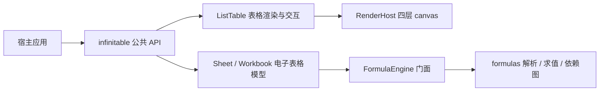
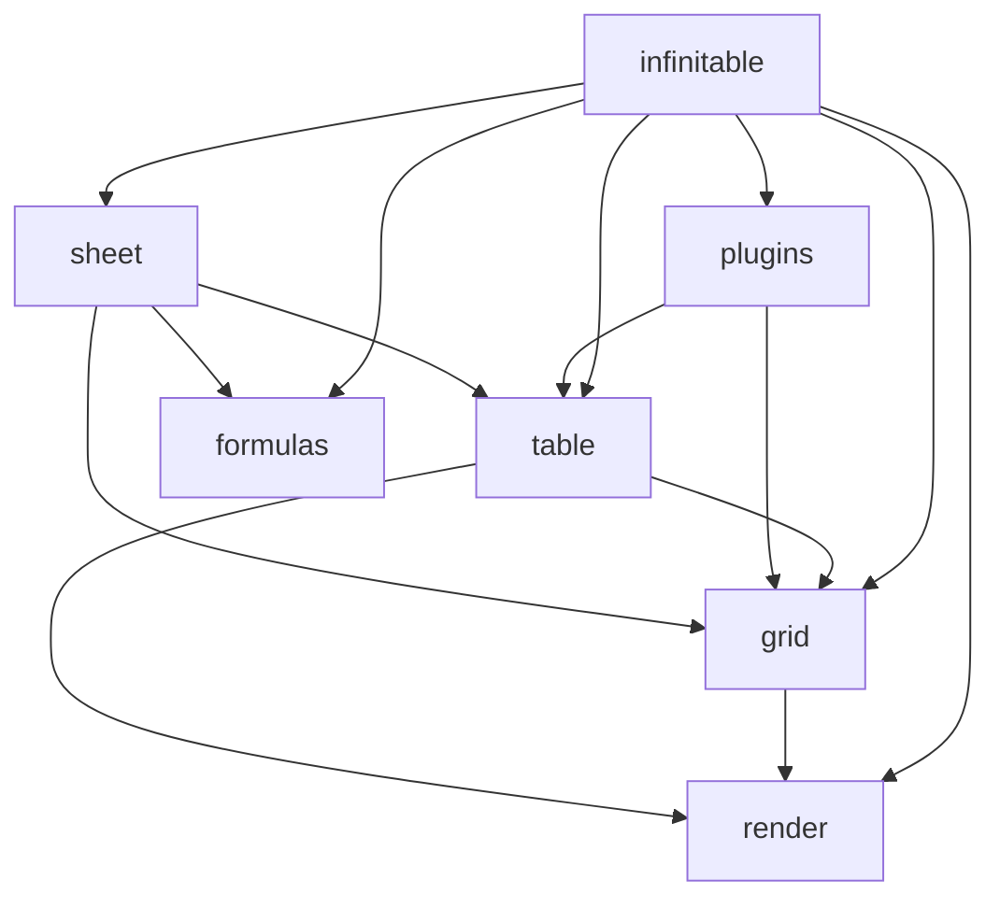

# 架构总览

infinitable 是一个库，不是应用框架。它负责把数据渲染成 canvas 表格、处理交互和编辑、提供电子表格模型与公式能力；数据从哪里来、如何持久化、页面如何组织，全部由宿主应用决定。

## 业务架构

核心业务域可以分成四块：

- **表格渲染**：四层 canvas（`ground` / `body` / `media` / `sky`）、虚拟滚动窗口、行带增量失效、冻结与合并单元格、文本溢出。
- **交互与编辑**：选区、填充柄、hover、行列 resize、键盘导航、触控惯性滚动、编辑器注册表、单元格超链接、浮动对象。
- **公式与电子表格**：A1 地址解析、公式求值、依赖图增量重算、`Sheet` / `Workbook` 模型、命令与撤销、xlsx/csv 导入导出。
- **插件与扩展**：图表、打印、水印，以及宿主自写插件；官方能力和用户扩展走同一条注册路径。

下游产品（例如 ultra-ui）在自己的页面里消费这些能力。仓库内的 `playground` 是唯一的应用，用于示例、页内 VTable 对比、量化基准和冒烟自检，不进入任何发布的包。



## 技术架构

### 技术栈

| 层                       | 选型                                                    | 说明                                      |
| ------------------------ | ------------------------------------------------------- | ----------------------------------------- |
| 语言 / runtime           | TypeScript 7（tsgo 原生编译器）、ESM only、浏览器 + bun | `strict: true`                            |
| 构建 / 包管理            | bun 1.4.2 workspaces + vite-plus 1.3.0                  | 内含 rolldown-vite、oxlint、oxfmt、vitest |
| 渲染                     | 自研 `@infinitable/render`（canvas 2d、多区域失效）     | 不依赖 vrender 系列                       |
| 工具库                   | `@cat-kit/core`                                         | 公式引擎精确计算依赖 `$n`                 |
| 测试                     | vitest                                                  | 浏览器行为用冒烟自检                      |
| 应用 UI（仅 playground） | React + shadcn/ui + Tailwind CSS                        | 不进入任何 `packages/`                    |

### 为什么是重写而非改造

本仓库的表格主体来自原 `vtable-core/`（约 69k 行）的**重写**，不是在该实现上做渐进改造。原代码已删除，迁移已完成；它曾经的用途是迁移参考与 API 行为基准。

选择重写的原因在于目标架构的几个约束无法通过局部补丁同时满足：

- **失效模型必须从底层统一**。目标要求滚动、交互、图片加载、批量写入共享同一条 `cell` / `band` / `full` 失效语言。原实现建立在 vrender 的渲染管线上，失效单位和层所有权无法在不重写渲染层的情况下改变。
- **core 只能依赖窄接口**。目标要求表格主体只通过 `RenderHost` 使用渲染引擎，不接触场景树和 vrender 系列包。渐进改造会把旧渲染栈的依赖继续带进新包边界。
- **全量虚拟滚动和场景树必须一起设计**。滚动帧要做“滚出摘除、滚入补建、存活节点平移”，这依赖场景树、层失效和文本测量缓存协同；在旧绘制路径上叠加会保留全量重建分支。
- **体积目标**。目标引擎核心控制在很小的大小内，最小渲染面 gzip 27KB。保留旧依赖树无法达到这个量级。

重写保留了原实现的行为基线（API 行为、交互口径、渲染结果作为迁移基准），但包结构、渲染引擎和失效模型是新的。

## 七个包的职责与依赖

| 包                      | 职责                                                                                                                  | 主要入口                            |
| ----------------------- | --------------------------------------------------------------------------------------------------------------------- | ----------------------------------- |
| `@infinitable/render`   | canvas 渲染引擎：场景树、四层 canvas、多 region 失效、federated 事件、canvas 池化、帧调度、`RenderHost` 窄接口        | `packages/render/src/index.ts`      |
| `@infinitable/grid`     | 共享网格内核：`ScrollManager`、行列前缀和/虚拟窗口/二分命中、布局与主题投影、选区状态、共享边、cell-range、浮动对象层 | `packages/grid/src/index.ts`        |
| `@infinitable/table`    | 表格引擎：`ListTable` 主体与装配、交互、编辑、合并、媒体、插件注册路径                                                | `packages/table/src/index.ts`       |
| `@infinitable/formulas` | 公式引擎：地址与错误码、tokenizer、Pratt parser、`evaluate`、49 个内置函数、依赖图、容错引用扫描、引用平移            | `packages/formulas/src/index.ts`    |
| `@infinitable/plugins`  | 官方插件：`TablePlugin` 契约转出 + chart / print / watermark 插件工厂                                                 | `packages/plugins/src/index.ts`     |
| `@infinitable/sheet`    | 电子表格核心：`Sheet` / `Workbook` 模型、命令与撤销、xlsx/csv IO、`SheetGrid` 适配层                                  | `packages/sheet/src/index.ts`       |
| `infinitable`           | 唯一 npm 发布包：主入口 re-export 六层公共 API，`./sheet` 子路径导出电子表格核心                                      | `packages/infinitable/src/index.ts` |



依赖方向是单向的：

- `render` 不知道 `grid` / `table` 的存在，只暴露渲染宿主、层句柄、场景树和失效类型。
- `grid` 只依赖 `render`；`table` 依赖 `grid` 与 `render` 的窄接口，不依赖 `formulas`；表格只负责显示模型给出的值。
- `formulas` 不依赖 `grid` / `table`，求值所需的取值能力由宿主以 `FormulaResolver` 形式注入。
- `plugins` 依赖 `table` 的 `TablePlugin` 契约，官方插件与用户插件使用同一个挂载路径。
- `sheet` 同时依赖 `table`、`grid` 和 `formulas`：模型负责单元格存储与命令，公式门面负责图簿联动和增量重算，`SheetGrid` 把 `Sheet` 适配成 `ListTable` 的数据模型。
- `infinitable` 只是发布层，构建时把六个内部包打成自包含产物，不做二次 API 扩张。

外部依赖中，`@cat-kit/core` 是公式精确计算的运行时依赖，`chart.js` 由图表插件动态加载，`hucre` 用于 sheet 的 xlsx 导出，React 技术栈只属于 playground。

## 四层 canvas

四层画布自下而上叠放，每层有独立的场景树和失效队列：

| 层  | 名称     | 职责                                                                                     | 创建时机                             | 消费策略               |
| --- | -------- | ---------------------------------------------------------------------------------------- | ------------------------------------ | ---------------------- |
| L0  | `ground` | underlay painter 预留层（例如位于内容之下的水印）；当前 table 不在此层绘制网格线或斑马纹 | 首次写入 underlay painter 时惰性创建 | 只响应 `band` / `full` |
| L1  | `body`   | 单元格背景、文本、边框、行列头、外框；滚动窗口的主要承载层                               | 构造时创建                           | 逐 region 补画         |
| L2  | `media`  | 单元格图片、图表格位图；cell 级 MediaCache LRU                                           | 首次出现图片或图表格时惰性创建       | 逐 region 补画         |
| L3  | `sky`    | 选区、填充柄、滚动条、浮动对象、顶层 overlay painter                                     | 构造时创建                           | 整层重画               |

分层的目的不是视觉分层，而是**变化频率隔离**：

- 滚动只改变 `body` 和 `media` 的内容，`ground` 的 underlay 内容不受单格变化影响，`sky` 内容便宜且可以整层重画。
- 图片和图表走 `media`，避免每次滚动把位图内容混在文本层里重绘。
- 选区、悬浮控件和滚动条在 `sky`，不会污染单元格内容层。

## 三档失效

所有变化统一登记为三种失效之一：

```ts
export type Invalidation =
  | { type: 'cell'; region: Region; prevRegion?: Region }
  | { type: 'band'; region: Region }
  | { type: 'full' }
```

- **cell**：单元格级脏区。可带 `prevRegion`，用于内容移动前后双包围盒重绘。登记时会做像素对齐，并在四边外扩 10px 防止增量补画的边缘残影。
- **band**：行带或列带级脏区。滚动窗口滑动产生的整条带是典型来源。新 band 会吸收被它完全包含的 cell；只相交的 cell 保留自身重绘区域。
- **full**：整层重绘。无可靠包围盒、几何变化、主题切换、首帧等情况使用。

失效队列在帧末按层收敛：

- 同一帧内的 `cell` 会合并、去重。
- `band` 数量超过 8 条时升级为 `full`，避免大量条带导致重绘退化为碎片化全绘。
- `full` 吸收该层所有其它失效。
- 各层消费策略不同：`ground` 只处理 `band` / `full`，`body` / `media` 逐 region 补画，`sky` 收到任何失效都整层重画。

三档失效由 `grid` 的滚动与 `table` 的交互、图片加载、批量更新共同使用。批量更新期间 `cell` 失效先收集，结束时合并为一次 `band` 提交。

## RenderHost 窄接口

`grid` / `table` 与 `render` 之间只有下面这组接口：

```ts
export interface RenderHost {
  createLayer(opts: LayerOpts): LayerHandle
  submitInvalidation(kind: LayerKind, inv: Invalidation): void
  requestFrame(task: FrameTask): void
  measure(text: string, font: string): Size
  resize(width: number, height: number, dpr?: number): void
  destroy(): void
}

export interface LayerHandle {
  readonly kind: LayerKind
  readonly root: SceneNode
  readonly canvasElement: RenderCanvas
  setSize(width: number, height: number, dpr?: number): void
  invalidate(inv: Invalidation): void
  translateBy(dx: number, dy: number): void
}
```

这个接口把表格主体需要的能力限制在六件事：建层、提交失效、请求帧、测量文本、调整尺寸、销毁。`grid` / `table` 不需要知道画布怎么分配、场景树怎么遍历、事件怎么命中，也不会直接操作 DOM canvas。

- `createLayer` 对同一个 `kind` 幂等，重复调用返回同一句柄。
- `submitInvalidation` 等价于向对应层提交失效；同帧多次提交由各层队列合并。
- `requestFrame` 把任务收敛到下一个渲染帧，同一任务引用在一帧内只执行一次。
- `measure` 提供 CSS 像素文本测量，缺失时引擎使用测量画布。
- `resize` 原地重设已建层尺寸并整层失效。
- `destroy` 幂等，取消挂起帧、解绑事件、回收池化画布并移除 DOM canvas。

`LayerHandle.translateBy` 是位图平移的 blit 快路径，目前作为预留能力存在；`grid` 的滚动走“窗口增量重建 + band 失效”路线，没有调用它。

## 插件机制

插件契约很小：

```ts
export interface TablePlugin {
  readonly name: string
  mount(table: ListTable): void
  unmount?(table: ListTable): void
}
```

注册方式有两种：

- `new ListTable({ plugins: [...] })`：插件在首次场景重建之前挂载，渲染接线参与首帧。
- `table.use(plugin)`：运行时挂载，适合动态启停；晚挂载的插件需要自己触发必要的重建。

`ListTable.destroy()` 时按注册的逆序调用 `unmount`。

官方插件都是 `createXxxPlugin` 工厂返回的对象，同时实现 `TablePlugin` 和运行时 handle：

- `createChartPlugin` 在 `mount` 时把“格 → 图表媒体”的解析器写入 `table.chartMediaResolver`，位图经 `media` 层上屏。
- `createWatermarkPlugin` 通过 `setOverlayPainter` 挂在 `sky` 层最顶；需要位于内容之下的衬底水印时，宿主自行使用 `setUnderlayPainter` 挂到 `ground` 层。
- `createPrintPlugin` 提供分页、页面构建、打印输出和 DOM 预览的 handle 方法。

引擎还预留了几个扩展位，用户插件可以直接使用：`chartMediaResolver`、`setUnderlayPainter`、`setOverlayPainter`、`table.floatObjects`。官方能力与用户扩展因此走同一条路径，不需要为官方功能开特例。

## 公式引擎边界

`@infinitable/formulas` 只做纯计算，不做表格集成：

- 提供 A1 地址解析与格式化、tokenizer、Pratt parser、`evaluate`、49 个内置函数、`DependencyGraph`、容错引用扫描和引用平移。
- 不依赖 `grid` / `table`，不知道 `ListTable`、单元格样式或渲染。
- 求值由宿主驱动：`evaluate` 接受 `FormulaResolver`，由宿主决定如何取值。
- 不支持数组公式；区域作为最终结果会求值为 `#VALUE!`。
- 不内置循环引用检测。`#CYCLE!` 错误码保留，由宿主或适配层用递归护栏产出。
- 易失函数识别由 `astHasVolatileCall` 提供，实际的重算编排由宿主或 sheet 适配层完成。
- 行列插入删除时的公式文本改写出 `shiftFormulaText` / `shiftFormulaRefs` 提供，写入模型仍由宿主决定。

`sheet` 包内的 `FormulaEngine` 是公式能力的唯一组合门面：它把 `formulas` 的依赖图与 `Sheet` / `Workbook` 的存储联动起来，负责工作表注册、改名别名、易失单元格标记、`affectedBy` 传递闭包标脏，以及带 `#CYCLE!` 护栏的递归求值。不存在第二套公式图或第二套求值实现。

## sheet 包定位

`@infinitable/sheet` 不是插件，而是电子表格核心：

- 提供 `Sheet` 单表模型、`Workbook` 多表簿、`FormulaEngine` 公式门面、`HistoryManager` 撤销栈、命令族、xlsx/csv 导入导出、快照与替换。
- 提供 `SheetGrid` 适配层，把 `Sheet` 包装成 `ListTable` 可消费的 `TableModel`，同时保留公式显示值、数字格式、样式池、合并、冻结、图片与超链接等电子表格语义。
- 依赖 `table`、`grid` 与 `formulas`；引擎不知道 sheet 的存在。
- 原先位于 plugins 包的 sheet 插件族已整体迁入本包，`createSheetPlugin` 已删除。
- 发布时通过 `infinitable/sheet` 子路径导出，主入口不转售 sheet 符号。

需要无 UI 的数据面时直接用 `Sheet` / `Workbook`；需要画布渲染与交互时用 `SheetGrid` 装配，而不是自己把 sheet 模型接到 `ListTable` 上。

理解完包边界后，可以继续阅读[渲染管线与失效模型](/guide/rendering-pipeline)，看一次滚动是如何变成一次带失效并最终上屏的。
