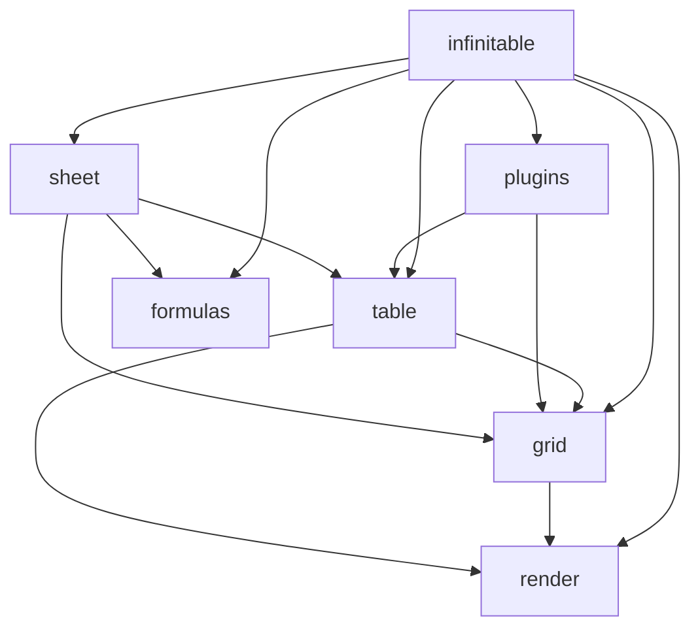

# 介绍

infinitable 是一个高性能 canvas 表格引擎，核心是**多层 canvas 失效驱动渲染 + 全量虚拟滚动**。它面向需要展示和操作 10 万到 100 万行数据的前端应用，目标是在大规模数据下让构造、首次渲染、滚动和写入的成本不随数据量线性劣化。

npm 包名为 `infinitable`，采用 MIT 许可，当前版本 0.3.4。

## 它解决什么问题

浏览器里的表格一旦进入十万行量级，DOM 节点数量、样式计算和布局开销就会成为瓶颈。常见做法是虚拟滚动加 canvas 绘制，但很多实现在数据量增大后仍会出现以下问题：

- 构造时遍历全量数据，首帧时间随行数增长。
- 滚动时重建整个可视区，滚动帧成本随窗口格数增长。
- 单格更新触发整表重绘，或退化为全量 `setRecords` 重放。
- 表格主体与图表、图片、选区浮层混在一张画布上，任何一层变化都要重绘全部内容。

infinitable 用一套统一的失效模型解决这些问题：数据只提供值，渲染只处理可视窗口，变化只登记受影响的区域。滚动、交互、图片加载和批量写入都收敛到同一套 `cell` / `band` / `full` 失效语言，再由分层渲染器按层消费。

## 核心特性

- **虚拟窗口 O(1)**：场景装配与首帧绘制只处理可视区；行高/列宽前缀和是一次廉价的全量数组计算，不创建逐行对象。10 万行与 100 万行的首次渲染时间几乎相同（100 万行 TTFF P50 16.7ms）。
- **四层 canvas + 区域失效**：`ground` / `body` / `media` / `sky` 四层画布，滚动收敛为一条 `band` 失效，滚动路径没有全量重绘，拖动滚动条大幅跳转也不退化。
- **模型直挂**：数据模型按格 O(1) 读写，不需要为一次写入重放全量数据；`batchUpdate` 把大块写合并为一次失效提交。
- **Excel 式交互**：选区、填充柄、hover、行列 resize、键盘导航、触控惯性滚动、编辑器注册表、冻结行列、合并单元格。
- **图表格位图路由**：Chart.js 离屏出图后经 cell 级位图缓存 LRU 上屏，滚动滚回命中缓存直接贴图，不闪烁。
- **插件体系**：图表、打印、水印等以插件挂载；电子表格核心（sheet 模型、命令、IO、`SheetGrid` 适配）独立为 sheet 包，经 `infinitable/sheet` 子路径导出。
- **公式引擎**：A1 地址、Pratt 解析、求值、49 个内置函数、依赖图增量重算；四则与聚合走精确计算。

## 与 VTable 的差异

infinitable 是为替代 [VisActor VTable](https://github.com/VisActor/VTable) 而重写的引擎，不是 VTable 的封装或渐进改造。两者公开 API 不同，infinitable 不提供 VTable API 兼容层，迁移需要按本文档重新接入。

### 基准口径

以下数据来自仓库 README 的量化基准：

- 同一页面、同一数据（10 万 / 100 万行 × 20 列）、同视口（1280×720、行高 32、列宽 100、无冻结、双方默认主题、公开 API 直调）。
- 每个规模按 `[本仓, VTable, VTable, 本仓]` 对称跑序各 2 轮取均值。
- “快 N×” = VTable 耗时 / 本仓耗时（吞吐类指标反之），±5% 内记为持平。

::: tip 采样环境
macOS（Apple Silicon）Chrome headless · VTable 1.26.8 · 本仓 git `21c6a25` · 2026-09-28。完整报告与 JSON 基线见仓库的 `playground/results/`。
:::

### 构建体积

最小渲染面入口（`ListTable` + `createRenderHost`），`bun build --minify --target=browser` 产物实测，gzip 按产物文件分别压缩求和：

| 口径     | infinitable | VTable 1.26.8 | 差异      |
| -------- | ----------- | ------------- | --------- |
| minified | 93.8KB      | 2076.3KB      | 约为 1/22 |
| gzip     | 27.3KB      | 514.8KB       | 约为 1/19 |

### 10 万行 × 20 列

| 指标                     | infinitable | VTable     | 对比     |
| ------------------------ | ----------- | ---------- | -------- |
| 构造耗时 P50             | 1.70ms      | 26.85ms    | 快 15.8× |
| 首次渲染时间（TTFF）P50  | 17.15ms     | 29.90ms    | 快 1.7×  |
| 整表重建（构造 + 首帧）  | 18.00ms     | 27.82ms    | 快 1.6×  |
| 逐格写吞吐               | 316 ops/ms  | 127 ops/ms | 快 2.5×  |
| 批量写 2000 格           | 16.10ms     | 18.05ms    | 快 1.1×  |
| 单次大幅跳转 JS 耗时 P95 | 1.45ms      | 11.10ms    | 快 7.7×  |
| 滚动调用 JS 耗时 P95     | 0.80ms      | 1.05ms     | 快 1.3×  |
| 稳态滚动 FPS             | 60.0        | 60.0       | 持平     |

### 100 万行 × 20 列

| 指标                     | infinitable | VTable     | 对比    |
| ------------------------ | ----------- | ---------- | ------- |
| 构造耗时 P50             | 12.00ms     | 42.30ms    | 快 3.5× |
| 首次渲染时间（TTFF）P50  | 16.70ms     | 44.70ms    | 快 2.7× |
| 整表重建（构造 + 首帧）  | 17.27ms     | 45.30ms    | 快 2.6× |
| 逐格写吞吐               | 360 ops/ms  | 144 ops/ms | 快 2.5× |
| 批量写 2000 格           | 16.10ms     | 16.85ms    | 持平    |
| 单次大幅跳转 JS 耗时 P95 | 1.25ms      | 10.25ms    | 快 8.2× |
| 滚动调用 JS 耗时 P95     | 0.85ms      | 1.00ms     | 快 1.2× |
| 稳态滚动 FPS             | 60.0        | 60.0       | 持平    |

### 关键结论

- 两项规模合计 22 项指标中，infinitable 领先 17 项、持平 5 项、落后 0 项。
- 数据量从 10 万增加到 100 万，infinitable 的 TTFF 从 17.15ms 变为 16.70ms、整表重建从 18.0ms 变为 17.3ms；VTable 的 TTFF 从 29.9ms 劣化到 44.7ms，重建从 27.8ms 劣化到 45.3ms。
- 体积差一个数量级：gzip 27.3KB 对 514.8KB。
- FPS 持平是测试机上两库都满帧的真实反映。帧预算敏感的场景（低端设备、大步长滚动）差距主要体现在“滚动调用 JS 耗时”和“大幅跳转 JS 耗时”上。

基准的复现方式见[性能与虚拟滚动](/guide/performance)。

## 包分层

仓库以 workspace 分包开发，发布时合并为单包 `infinitable`：

| 包                      | 职责                                                                                         | 用户侧使用方式                                |
| ----------------------- | -------------------------------------------------------------------------------------------- | --------------------------------------------- |
| `@infinitable/render`   | 自研 canvas 渲染引擎：场景树、四层画布、三档失效、federated 事件、canvas 池化                | 主入口导出 `createRenderHost`、`SceneNode` 等 |
| `@infinitable/grid`     | 共享网格内核：滚动、行列前缀和/虚拟窗口/二分命中、布局与主题投影、选区状态、合并区、浮动对象 | 主入口导出 `normalizeRange`、`GridCellRef` 等 |
| `@infinitable/table`    | 表格引擎：`ListTable`、交互、编辑、合并、媒体与浮动对象、插件注册路径                        | 主入口导出 `ListTable` 等                     |
| `@infinitable/formulas` | 公式引擎：A1 地址、tokenizer、Pratt parser、求值、49 个内置函数、依赖图、引用扫描与平移      | 主入口导出解析/求值/依赖图 API                |
| `@infinitable/plugins`  | 官方插件：图表、打印、水印，统一以 `createXxxPlugin` 工厂返回插件对象                        | 主入口导出三个插件工厂                        |
| `@infinitable/sheet`    | 电子表格核心：`Sheet` / `Workbook` 模型、命令与撤销、xlsx/csv IO、`SheetGrid` 适配层         | 经 `infinitable/sheet` 子路径                 |
| `infinitable`           | 唯一 npm 发布包：主入口 re-export 六层公共 API，`./sheet` 子路径导出电子表格核心             | `import { ... } from 'infinitable'`           |

用户侧只需要从 `infinitable` 导入。`@infinitable/*` 是仓库内部开发时的包边界，不是给使用方的导入路径。

依赖方向的关键约束：

- `grid` 只依赖 `render`；`table` 通过 `RenderHost` 窄接口依赖 `render`，不接触场景树内部实现。
- `formulas` 不依赖 `grid` / `table`。求值由宿主驱动，`sheet` 包内的 `FormulaEngine` 是公式能力的组合门面。
- `plugins` 依赖 `table` 的插件契约，官方插件与用户插件走同一条注册路径。
- `infinitable` 是发布层，本身不承载业务逻辑。

更多包职责和设计取舍见[架构总览](/guide/architecture)。

## 适用与不适用场景

### 适用

- 10 万到 100 万行的数据表格，需要快速构造、流畅滚动和局部更新。
- 需要 Excel 式交互：选区、填充、行列 resize、键盘导航、冻结、合并单元格。
- 需要在单元格内渲染图表或图片，并希望滚动时位图复用、不闪烁。
- 需要电子表格模型：多工作表、公式、撤销重做、xlsx/csv 导入导出。
- 对包体积敏感，希望表格引擎保持在一个很小的构建面内。

### 不适用

- 需要服务端直出表格画面的 SSR 场景。渲染实例必须在有 DOM 的浏览器环境构造。
- 需要多级表头、透视表、交叉表等高级表格形态。当前 `ListTable` 的列头固定为单层。
- 依赖 DOM 语义做无障碍、SEO 或浏览器原生查找的场景。canvas 内容不是 DOM 节点。
- 单元格内需要富文本编辑器的场景。内置编辑器以单行 input 和多行 textarea 为主。
- 只有几十行、用原生 `<table>` 就能满足的场景。引入引擎不会带来收益。
- 希望从 VTable 无改动迁移的场景。infinitable 不提供 API 兼容层。

下一步阅读[快速开始](/guide/getting-started)，或直接了解[渲染管线与失效模型](/guide/rendering-pipeline)。
