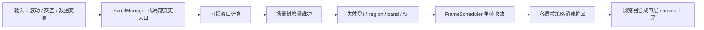
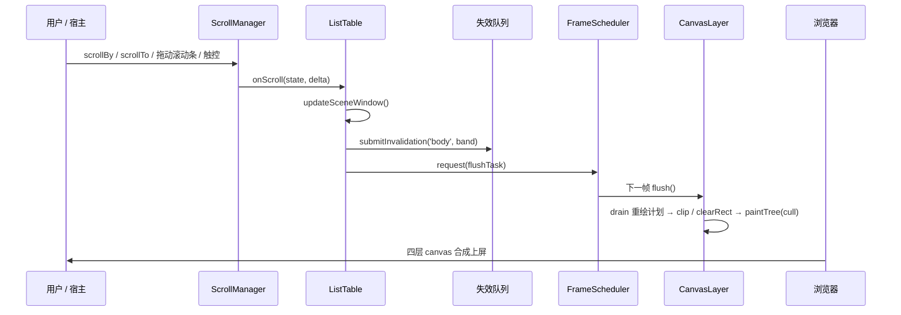

# 渲染管线与失效模型

infinitable 的渲染不是“每次变化重画整张表”，而是一条固定链路：**滚动或变更进入 → 计算可视窗口 → 维护场景树 → 登记失效 → 单帧收敛 → 各层消费脏区 → 浏览器合成上屏**。理解这条链路，就能判断一次操作应该产生多大范围的重绘。

## 全链路





## ScrollManager：唯一滚动源

`ScrollManager` 持有滚动位置、内容尺寸和视口尺寸，所有滚动都收敛到它：

- 代码调用 `table.scrollTo` / `scrollBy`。
- 画布内建滚动条的拖拽与轨道点击。
- 触控惯性滚动。
- 键盘方向键导航触发的滚动。
- 原生滚动条模式下，DOM 滚动容器与 `ScrollManager` 双向同步。

滚动位置始终夹取在 `[0, maxLeft]` / `[0, maxTop]`。位置未变化时不会广播，避免空帧。状态变更以 `(state, delta)` 广播给 `ListTable`，后者据此更新窗口并登记失效。

滚动位置定义在“可滚动内容”上：总内容尺寸扣除冻结区尺寸，因此冻结行列不参与滚动偏移。

## 可视窗口

行列位置通过前缀和表示：

- `rowOffsets[i]` 是第 `i` 行的上缘内容坐标，长度是行数 + 1。
- `colOffsets[i]` 是第 `i` 列的左缘内容坐标。
- 行高和列宽可以有逐行 / 逐列覆盖（resize 产物），前缀和会把这些覆盖计算进去。

窗口计算分三步：

1. 用滚动位置在 `rowOffsets` / `colOffsets` 上做二分下界定位 `start`，复杂度 O(log n)，不随滚动深度线性增长。
2. 从 `start` 向后短程扫描，直到越过视口右/下缘，得到 `end`，复杂度与可视行列数相关，与总行数无关。
3. 叠加 `overscanRows` / `overscanCols` 扩展场景装配窗口，再夹取到可滚动带，避免扩展后混入冻结区。

冻结行列单独成带，不参与滚动窗口。最终场景由这些带组合：

- 可滚动数据区。
- 部分可见的合并单元格主格。
- 冻结列带、冻结行带、冻结角。
- 列头、行号列、左上角。
- 窗口外但仍需参与文本溢出的源格。

`ListTable.getVisibleRange()` 返回的是可滚动带窗口，不含冻结区；`getBodyVisibleCellRange()` 会把冻结行列并入。

## 场景树

场景树节点是 `SceneNode`，持有局部坐标、尺寸、可见性、可命中性、子节点和事件监听器。绘制时父节点先画自身，再按 `children` 顺序画子节点，后画的在上。

`table` 引擎维护两类更新：

- **全量重建** `rebuildScene`：构造、主题切换、行列尺寸变化、冻结数变化、合并区变化时使用。重建可视窗口内的全部节点。
- **增量窗口** `updateSceneWindow`：滚动帧使用。做三件事：
  1. 摘除滚出窗口的节点，存活节点原地平移。
  2. 为新滚入的行、列补建节点。
  3. 维护合并主格、窗口外溢出源、冻结带和表头的 z 序。

滚动帧的节点分配和样式投影从 O(窗口格数) 降到 O(滚入格数)。纯平移帧没有新建格时，扫描成本更低。

场景树还承担两个容易被忽略的职责：

- **文本溢出**：单元格文本可以按 Excel 口径溢出到右侧或左侧空格。溢出源节点需要保持在同行走廊节点之上，窗口外但走廊仍伸入可视区的源格也要保留节点。
- **脏区剔除**：`SceneNode.paintedBounds()` 描述节点实际绘制覆盖的包围盒。溢出文本的节点会把溢出段并入，避免自身包围盒在脏区外时被剔除而漏画。

## 三档失效

引擎只用三种失效表达变化：

| 失效     | 语义                                             | 典型来源                                                         |
| -------- | ------------------------------------------------ | ---------------------------------------------------------------- |
| `region` | 一个矩形脏区，可带 `prevRegion` 表示移动前包围盒 | 单格写入、图片加载完成、图表格出图完成、编辑内容隐藏/恢复        |
| `band`   | 横向或纵向整条带                                 | 纵向滚动（冻结行以下）、横向滚动（冻结列以右）、批量写入合并提交 |
| `full`   | 整层重绘                                         | 首帧、几何变化、主题切换、冻结/合并变化、无法给出可靠脏区        |

失效提交的实际位置：

- 纵向滚动：`body` 提交一条 `band`，存在 `media` 层时 `media` 也提交同一条带；起点在列头 + 冻结行之下。
- 横向滚动：`body` 提交一条 `band`，存在 `media` 层时 `media` 也提交同一条带；起点在行号列 + 冻结列之右。
- 单格刷新：`body` 提交一个 `region`。失效区域会并入文本溢出走廊的新旧范围；合并格路由到主格包围盒。
- `batchUpdate`：期间的 `region` 先收集，结束时合并为一条 `band`。
- 几何变化（`resize`、行列尺寸、冻结数、合并区）：重建场景后提交 `body` 的 `full`，存在 `media` 时一并 `full`。
- 主题切换：重建场景并提交 `body` 的 `full`，同时刷新交互浮层。
- 选区与浮层：`sky` 收到内容变化后整层重画。

### 失效队列的合并规则

每层有一个 `InvalidationQueue`，帧末 `drain()` 出重绘计划：

- `region` 先做双包围盒 union（若带 `prevRegion`），再做像素对齐，最后四边外扩固定的 10px 防边缘残影。
- `band` 会吸收被它完全包含的 `region`；只相交的 `region` 不被吸收，因为窄 band 与较大 `region` 相交时，`region` 的重绘范围可能远大于 band。
- `band` 数量超过 8 条时升级为 `full`。
- `full` 吸收该层所有其它失效。

各层的消费策略不是队列内部写死的，而是建层方在建层时经 `LayerOpts.consumption` 注入（缺省 `'regions'`）：

```ts
// 三种取值（类型本体 LayerConsumption 定义在 @infinitable/render，未经主入口转售）
type LayerConsumption = 'band-full-only' | 'regions' | 'always-full'

// ListTable 建层时按层选择注入：
host.createLayer({ kind: 'ground', consumption: 'band-full-only' })
host.createLayer({ kind: 'body', consumption: 'regions' })
host.createLayer({ kind: 'media', consumption: 'regions' })
host.createLayer({ kind: 'sky', consumption: 'always-full' })
```

`ground` 只处理 `band` / `full`，因为单格内容变化不影响底层 underlay；`body` 和 `media` 逐 region 补画；`sky` 收到任何失效都整层重画，因为它的内容通常只有选区、滚动条和浮动控件，整层重绘比按区域裁剪更简单。

## FrameScheduler：单帧收敛

`FrameScheduler` 用 `Set` 保存待执行任务：

- 多次 `request` 只会在下一帧执行一次。
- 同一个任务引用在一帧内只执行一次。
- 默认使用 `requestAnimationFrame`；无 `requestAnimationFrame` 的环境退化为 `setTimeout(16)`。
- 宿主可以注入 `scheduleFrame` / `cancelFrame`，测试中可改成同步执行。

`RenderHost` 内部持有一个稳定的 `flushTask`。同帧内无论提交多少次失效，各层都只请求一次帧；帧末按 `ground → body → media → sky` 顺序调用各层 `flush()`。上屏模式由浏览器合成四层 canvas，引擎不做额外的位图合成。

## 各层如何消费脏区

### ground

`ground` 是 underlay painter 预留层，首次调用 `setUnderlayPainter` 时才惰性创建。它只响应 `band` / `full`；当前引擎不在这层绘制网格线或斑马纹，单元格背景和边框由 `body` 层的 `CellNode` 绘制。

### body

`body` 承载单元格背景、文本、边框、行列头和外框。它按重绘计划逐 region 处理：

1. 把 region 裁剪到层边界。
2. `save()`、按 DPR 设置变换。
3. `beginPath()` + `rect()` + `clip()` 限定脏区。
4. `clearRect()` 清掉脏区。
5. `paintTree(root, ctx, dirty)` 重画与脏区相交的节点。
6. `restore()`。

`paintTree` 在遍历时用节点的 `paintedBounds()` 与脏区求交，不相交的整棵子树直接跳过。因此哪怕场景树里有可见窗口的全部节点，单格失效也只实际绘制与该格相交的少数节点。

### media

`media` 的消费方式与 `body` 相同。它承载单元格图片和图表格位图。位图按 cell 级缓存，滚动滚回时命中缓存直接贴图；图片加载完成或图表出图完成时只提交对应格或对应区域的失效。

### sky

`sky` 承载选区、填充柄、画布滚动条、浮动对象和顶层 overlay painter。它的消费策略是 `always-full`：只要收到任何失效就整层重画。层本身尺寸小、内容便宜，整层重画比维护细粒度脏区更稳定。

DOM 编辑器浮层不在这四层 canvas 内，它由编辑管理器挂到容器上，并通过滚动帧和几何变化保持与单元格对齐。

## DPR 与 resize

画布的物理像素尺寸按 CSS 尺寸乘以 DPR：

```ts
canvas.width = Math.round(width * dpr)
canvas.height = Math.round(height * dpr)
ctx.setTransform(dpr, 0, 0, dpr, 0, 0)
```

因此场景树和绘制代码始终使用 CSS 像素坐标，DPR 只影响物理分辨率。

- `RenderHost` 构造时缺省读取 `window.devicePixelRatio`；无 `window` 环境回落为 1。
- 运行期 DPR 变化由两条通道探测：`window.resize` 和 `matchMedia('(resolution: ...dppx)')`。变化后以新 DPR 重设全部已建层的物理尺寸并整层失效，实例和滚动位置都不重建。
- `RenderHost.resize(width, height, dpr?)` 原地重设已建层尺寸；显式传入 `dpr` 时才更新内部 DPR。
- `ListTable.resize(width, height)` 会透传当前 DPR，调用 `host.resize`，同步原生滚动容器和浮层尺寸，然后走几何变更：重算滚动边界、全量重建场景、提交 `body` / `media` 的 `full`。滚动位置和选区保留。

`setSize` 会重置 canvas 的 `width` / `height`，这本身会清空位图，所以每次尺寸变化都以整层失效收尾。

## canvas 池化

`CanvasPool` 按物理像素尺寸分桶复用离屏画布，最多保留 16 张，超出容量直接丢弃。它主要服务于 `LayerHandle.translateBy` 的位图自拷贝：平移前先申请一张临时画布保存当前位图，再清除并平移回原画布，最后归还临时画布。

需要区分两点：

- 四层 canvas 本身是长期持有的层画布，不进入池。
- 池化的是短生命周期的临时位图，避免滚动帧反复分配大画布。

`translateBy` 目前是预留能力，引擎的滚动走“窗口增量重建 + band 失效”路线，没有调用它。

## 事件系统

`EventSystem` 绑定在 `eventsTarget` 上，缺省就是容器。它监听：

- `pointerdown` / `pointermove` / `pointerup`
- `contextmenu`
- `touchstart` / `touchmove` / `touchend` / `touchcancel`
- `keydown` / `keyup`
- `wheel`（预留，当前没有场景级订阅方）

每次事件到达时：

1. 以事件源容器的 `getBoundingClientRect()` 为基准，换算成层坐标（CSS 像素）。
2. 按 `sky → media → body → ground` 自顶向下逐层命中，找到最上层、最深层的可拾取节点。
3. 从命中节点沿 `parent` 链冒泡，依次调用节点的监听器；`stopPropagation()` 中断冒泡。
4. 键盘事件不做命中，从最顶层根开始派发。

`table` 引擎在 `body` 根上绑定指针、触摸和 contextmenu，在 `sky` 根上绑定键盘。`sky` 根和 overlay 节点不可拾取，指针事件会穿透到 `body`，因此选区浮层不会挡住单元格交互。

滚轮事件由宿主接线到 `table.scrollBy`，引擎不直接消费。双击进入编辑也不是依赖浏览器的 `dblclick`，而是引擎基于 `pointerdown` 的落点、时间和位移阈值自行判定。

## 一帧的完整时序

以一次纵向滚动为例：

1. 宿主把 `wheel` 转成 `table.scrollBy(0, deltaY)`。
2. `ScrollManager` 夹取新位置，广播 `(state, delta)`。
3. `ListTable.onScroll` 调用 `updateSceneWindow`：摘除滚出行、补建滚入行、平移存活节点。
4. 因为 `delta.dy !== 0`，向 `body` 和 `media` 提交冻结行以下的 `band` 失效。
5. 图片服务更新窗口化加载队列，浮动对象同步位置，交互浮层刷新，滚动帧监听器经 `requestFrame` 收敛。
6. 帧末 `FrameScheduler` 执行 `flushTask`，`RenderHost` 按 `ground → body → media → sky` 调用 `flush`。
7. `body` / `media` 的失效队列 drain 出该条带；绘制时按脏区裁剪并剔除不相交节点。
8. 浏览器合成四层 canvas 上屏。

如果同一帧内又发生了单格写入、选区变化或图片加载完成，它们提交的失效会进入同一批队列，在该帧内一起收敛，不会额外触发一轮重绘。

下一步可以阅读[性能与虚拟滚动](/guide/performance)，了解这套管线在大数据量下的实际成本，以及哪些用法会破坏失效面积控制。
